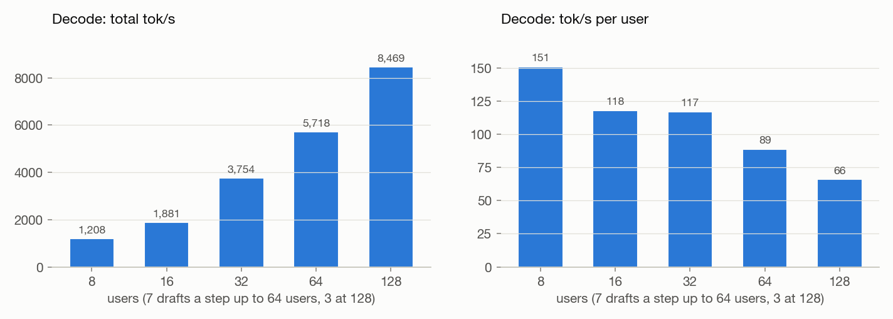
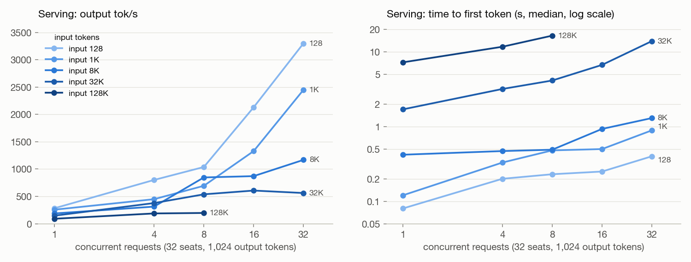
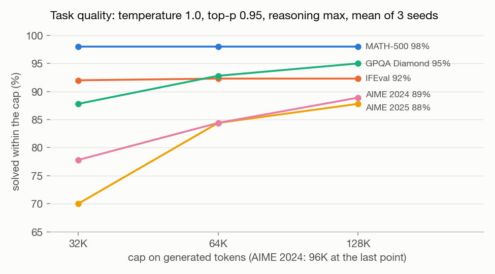
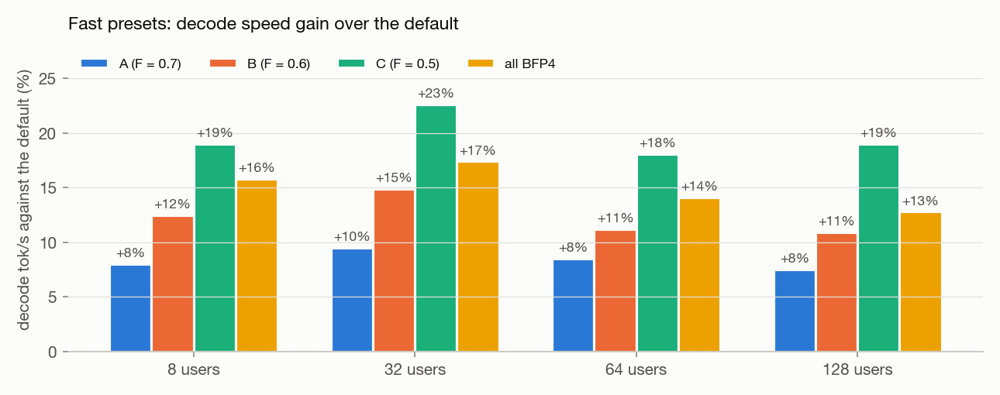

# GLM-5.3-Flash on Blackhole Galaxy: Performance

Measured performance and quality of GLM-5.3-Flash on one Blackhole Galaxy, with the conditions of each measurement.
All values were measured in November 2026 on this branch. Newer versions of the software stack (TT-Metal, vLLM and
the vLLM TT plugin) may give different numbers.

## Configuration

| Item | Value |
|---|---|
| Hardware | One Blackhole Galaxy: 32 chips as an 8x4 mesh, 2D torus fabric (TorusXY). 31.3 GiB of DRAM a chip |
| Weights and compute | The large matrices (routed experts included) in BFP8, matmuls at HiFi4 with fp32 accumulation; activations bf16 / fp32 |
| Speculative decoding | DFlash2: a small drafter on the device proposes the next K tokens, the model verifies them in one step and keeps those equal to its own greedy choice. K = 7 up to 64 users, K = 3 at 128 users |
| Users | Multiples of 8 (one group of users per mesh row); measured at 8, 16, 32, 64 and 128 |
| Serving | vLLM 0.31.0 with [`tenstorrent/vllm-tt-plugin`](https://github.com/tenstorrent/vllm-tt-plugin), OpenAI-compatible API. The server's default K is 7 up to 32 seats and 3 above |
| Context | Up to 1M tokens a user for up to 64 users, 576K at 128 users ([Long context and memory](#long-context-and-memory)) |

Unless a section says otherwise, the measurements use the default form (not a fast preset) and greedy decoding.
Values marked † were measured with the DSA cache of long contexts kept in bf16 and not split over the chips (the four
switches of [Long context and memory](#long-context-and-memory) set back); a context of up to 2,051 tokens is held the
same way in both.

## Decode

| Users | Step | Total tok/s | tok/s per user | Max context per user |
|---|---|---|---|---|
| 8 | 27.7 ms (K = 7) | 1,208 | 151 | 1M |
| 16 | 35.6 ms (K = 7) | 1,881 | 118 | 1M |
| 32 | 35.7 ms (K = 7) | 3,754 | 117 | 1M |
| 64 | 46.8 ms (K = 7) | 5,718 | 89 | 1M |
| 128 | 47.1 ms (K = 3) | 8,469 | 66 | 576K |



- **Step**: one DFlash2 step for all users at once: the model verifies every user's token and its K drafts, accepts
  drafts on the device, and the drafter writes its context and proposes the next K drafts. The whole step is one
  captured trace. Measured with the real weights, random input tokens and a 512-token cache, the model built for the
  measured number of users as the server builds it (the default L1 landing of the next MoE layer's expert weights
  and the other per-shape defaults).
- **Tokens a step**: how far a user advances in one step, measured on real text (the prompts of the 11 greedy reference
  records): 4.18 tokens at K = 7 and 3.12 at K = 3. Total tok/s = users x tokens a step / step time.
- A draft is accepted only where it equals the model's greedy token, so the output is the model's greedy output (up to
  rounding differences of the batched verify step at near-ties).
- At 16 and 64 users, K = 3 gives 28.4 / 37.4 ms, 1,758 / 5,332 tok/s: K = 7 is 7.0 % / 7.2 % faster there.
- The server still uses K = 3 above 32 seats: in serving at 64 seats, K = 7 was ahead only while every seat was busy
  (and behind on sampled wikitext requests), and the whole runs' tok/s was lower in all four loads tried.
- With temperature sampling (the settings of [Quality](#quality)) fewer drafts are accepted (about 2.6 tokens a step on
  GPQA and 4.6 on AIME), so the total speed is lower than in the table.
- Longer contexts make the step longer (random weights): at a 32K cache 38.5 / 44.5 / 56.4 ms at 8 / 32 / 128 users (the
  mean of 2,000 steps from position 0), at a 1M cache 40.6 / 50.4 / 49.3 / 64.8 ms at 8 / 16 / 32 / 64 users (positions just
  below the cache's end).
- **Max context** is the longest context each user can hold when all users hold the same length. Each value was
  checked on the device by building a cache of that length, prefilling it to the full length and generating a few
  tokens: with the real weights at 32 users, random weights otherwise. The memory left free is in
  [Long context and memory](#long-context-and-memory); at 128 users 576K leaves 1.5 GiB a chip free and 640K does not
  fit.
  - The lengths include one working seat a mesh row for splitting a long prompt over the 8 rows (as served). Serving
    also needs vLLM's trace region (0.3-0.5 GiB a chip).

Reproduce the step times with `tests/test_dflash2_speed.py`, one number of users and K a process (the model is built
for that shape, as served), for example 8 and 32 users at K = 7:
```
GLM53_DEVICE_TEST=1 GLM53_DFLASH2_K=7 GLM53_VERIFY_USERS=1,4 GLM53_DFLASH2_PAIRS=1:7,4:7 GLM53_DFLASH2_PARTS=step \
  GLM53_DFLASH2_TOKENS_A_STEP=7:4.182,3:3.118 GLM53_DFLASH2_MTP_MS_8=1 GLM53_DFLASH2_MTP_MS_32=1 \
  pytest models/demos/blackhole/glm53_flash/tests/test_dflash2_speed.py -s
```
and 128 users at K = 3 with `GLM53_DFLASH2_K=3 GLM53_VERIFY_USERS=16 GLM53_DFLASH2_PAIRS=16:3 GLM53_DFLASH2_MTP_MS_128=1`.
`GLM53_VERIFY_USERS` is users per mesh row and `GLM53_DFLASH2_PAIRS` the (users a row, K) pairs to time;
`GLM53_DFLASH2_MTP_MS_<users>=1` skips the MTP step's timing; add `GLM53_SYNTHETIC_WEIGHTS=1` for random weights. The
test's docstring lists its other options.

## Serving

vLLM server with 32 seats, DFlash2 with K = 7 (the command in [README.md](README.md#vllm-serving)) and the server's
defaults (chunked prefill, new requests gathered into shared prefills, the next decode step launched ahead, the prefix
store: random prompts do not hit it), 32 concurrent requests, 1,024 output tokens each. The 1K rows ran with a
2,048-token context (`--max-model-len 2048`), the 8K row with 33,792.

| Input | Output tok/s | TTFT (median) | TPOT (median) |
|---|---|---|---|
| 1K tokens (random ids) | 2,648 | 0.79 s | 7.0 ms |
| About 1K tokens (wikitext) | 2,157 | 0.88 s | 12.2 ms |
| 8K tokens (random ids) | 1,107 | 1.54 s | 16.0 ms |

- Greedy requests (temperature 0), exact acceptance of the drafts.
- Sampled requests (temperature 1.0, top-p 0.95, top-k 32): 1,398 tok/s on the wikitext inputs (TTFT 1.36 s, TPOT
  21.3 ms, medians), 65 % of the greedy value: fewer drafts match a sampled token than the greedy one. On 1K random-id
  inputs, 2,261 tok/s.

### By concurrency and input length

Greedy requests, random-id prompts, 1,024 output tokens, 32 seats, the server's defaults. Output tok/s, with the
median time to first token in parentheses.

| Input \ concurrent requests | 1 | 4 | 8 | 16 | 32 |
|---|---|---|---|---|---|
| 128 | 283 (0.08 s) | 801 (0.20 s) | 1,038 (0.23 s) | 2,131 (0.25 s) | 3,300 (0.40 s) |
| 1K | 257 (0.12 s) | 449 (0.33 s) | 694 (0.48 s) | 1,329 (0.50 s) | 2,450 (0.89 s) |
| 8K | 188 (0.42 s) | 313 (0.47 s) | 847 (0.49 s) | 871 (0.93 s) | 1,168 (1.30 s) |
| 32K | 147 (1.70 s) | 378 (3.19 s) | 538 (4.14 s) | 607 (6.70 s) | 562 (14.0 s) |
| 128K | 91 (7.25 s) | 188 (11.7 s) | 197 (16.5 s) | not measured | not measured |



- Each cell ran twice as many prompts as concurrent requests (as many for 32K and 128K). The cells with few prompts
  vary with how repetitive the random-id prompts make the output (the drafts' acceptance), e.g. 128 against 1K at one
  request.
- From 32K up the prefill decides the throughput (32 requests of 32K are about a million prompt tokens); the time to
  first token includes waiting for the prefills of the requests ahead.

## Prefill

Device time of the prefill (not the time to first token through the server), random weights with uniform expert
routing, traced.

| Prompts | Time | Speed |
|---|---|---|
| 1 x 8K | 0.340 s | 24,080 tok/s |
| 8 x 2,048 | 0.545 s | 30,080 tok/s |
| 1 x 256K | 13.2 s | 19,790 tok/s |
| 1 x 1M | 61.8 s | 16,960 tok/s |

- A single long prompt is split over the 8 mesh rows and computed in parallel (5.5-6.8x faster than on one row).

## Quality

### Tasks (the model card's evaluation settings)

Temperature 1.0, top-p 0.95 (top-k 32 on the device), reasoning effort max; the mean of 3 seeds. Each column is a cap
on the generated length: a problem counts as correct when it is solved within that many tokens.

| Task | 32K | 64K | 128K |
|---|---|---|---|
| GPQA Diamond (first 60 problems) | 52.7 (88 %) | 55.7 (93 %) | **57.0 (95 %)** |
| AIME 2025 (30 problems) | 21.0 (70 %) | 25.3 (84 %) | **26.3 (88 %)** |
| AIME 2024 (30 problems) | 23.3 (78 %) | 25.3 (84 %) | **26.7 (89 %)** (cap 96K) |
| IFEval (first 100 prompts, prompt-level strict) | 92.0 | 92.3 | **92.3** |
| MATH-500 (first 100 problems) | 98.0 | 98.0 | **98.0** |

- With the DSA cache in bf16 and not split (†), the five tasks score the same within the seed-to-seed variation:
  paired problem by problem over the five tasks, 0.1 points apart (p 0.94).



### Other checks

| Check | Result |
|---|---|
| GSM8K (1,319 problems) | 96.1 % (greedy) |
| HumanEval (164 problems) | 96.3 % (greedy) |
| Tool calls | 9 / 9 hand-made cases (tool choice, argument types, parallel calls, nested arguments, no call when none is needed, answering from a tool result, streaming) |
| Long-context retrieval (passkey) | 8 / 8 at 32K |

## Fast presets

Two optional forms that are faster than the default with a small change in quality. They are not the default and
their output differs from the default's. A third form (C) is faster still; the all-BFP4 form is listed for comparison
only. The switches for each are in [README.md](README.md#options).

| Form | Contents |
|---|---|
| A | Routed experts in the progressive form: a BFP4 base for every expert plus a BFP4 correction read for the experts with the largest routing weight in each step (about 0.7x the bytes of BFP8 read a step), LoFi matmuls |
| B | As A with fewer corrections (about 0.6x the bytes of BFP8) |
| C | As A with fewer corrections still (about 0.5x; faster than all-BFP4) |
| All-BFP4 (comparison) | Routed experts all in BFP4, LoFi matmuls |

### Speed

Decode, the conditions of [Decode](#decode).

| Users | Default | A | B | C | All-BFP4 |
|---|---|---|---|---|---|
| 8 | 1,208 tok/s | 1,305 (+8.0 %) | 1,359 (+12.5 %) | 1,437 (+19.0 %) | 1,399 (+15.8 %) |
| 32 | 3,754 | 4,112 (+9.5 %) | 4,312 (+14.9 %) | 4,604 (+22.6 %) | 4,409 (+17.4 %) |
| 64 | 5,718 | 6,203 (+8.5 %) | 6,356 (+11.2 %) | 6,753 (+18.1 %) | 6,527 (+14.1 %) |
| 128 | 8,469 | 9,102 (+7.5 %) | 9,396 (+10.9 %) | 10,081 (+19.0 %) | 9,551 (+12.8 %) |



- Real weights, random input tokens, a 512-token cache. Every form's step time is converted with the default's tokens
  a step ([Decode](#decode)): the presets' drafts are accepted as often as the default's (on GSM8K, 5.08 tokens a step
  for both the default and A).

Step time against the default's, random weights:

| Users | A | B | C | All-BFP4 |
|---|---|---|---|---|
| 8 | -9.3 % | -13.9 % | -21.9 % | -19.2 % |
| 32 | -9.2 % | -14.2 % | -22.8 % | -19.6 % |
| 64 | -9.8 % | -14.0 % | -18.7 % | -17.8 % |
| 128 | -9.3 % | -12.7 % | -20.4 % | -17.0 % |

- With the real weights the gain is about three quarters of the random weights' (0.67-0.95).
- Prefill: A, B and C are about as fast as the default (the prefill reads every correction). All-BFP4 is 5-8 % faster
  in prefill too.
- Memory: A, B and C take about 0.56 GiB a chip more than the default (base and correction, 9 bits a value against
  BFP8's 8.5); all-BFP4 about 4.8 GiB less.

### Quality

The settings of [Tasks](#tasks-the-model-cards-evaluation-settings), cap 128K, mean of 3 seeds. The presets were
measured with the DSA latents in FP8 as in the default, but the indexer keys in bf16 and the cache not split (the
default's other two long-context switches off).

| Task | Default | A | B | C | All-BFP4 |
|---|---|---|---|---|---|
| GPQA Diamond (60 problems) | 57.0 | 56.0 | 55.0 | 57.0 | 56.7 |
| AIME 2025 (30 problems) | 26.3 | 24.7 | 26.3 | 25.0 | 19.7 |
| AIME 2024 (30 problems, cap 96K) | 26.7 | 25.3 | 26.0 | 25.7 | 23.3 |
| IFEval (100 prompts, prompt-level strict) | 92.3 | 90.0 | 90.7 | 90.0 | 90.3 |
| IFEval (the same, cap 32K) | 92.0 | 89.3 | 90.0 | 88.7 | 87.7 |
| MATH-500 (100 problems) | 98.0 | 99.0 | 98.0 | 98.0 | 96.7 |

- A, B and C differ from the default by up to about 2 problems a task; the same form varies by 1-3 problems from seed
  to seed.
- Over the five tasks, paired problem by problem against the default: A is 2.6 points lower (p 0.007), B 1.4 points
  (p 0.13), C 2.0 points (p 0.026). A, B and C cannot be told apart from each other (at most 1.2 points, p 0.32 or
  more).
- All-BFP4 is clearly lower on AIME: 2025 -22 points (6.7 problems, p < 0.001) and 2024 -11 points (p 0.01), 7.4
  points below the default over the five tasks; on GPQA, IFEval and MATH-500 it shows no difference.

## Long context and memory

For a context longer than 2,051 tokens, the default keeps the DSA latent cache in FP8 and the indexer's pooled keys
in BFP4; from 8,192 tokens it also splits the latent cache by position over the 4 chips of a mesh row, with the
indexer's scoring split the same way. Shorter contexts use the dense attention form. The switches that set this form
back to a bf16 cache on every chip are in [README.md](README.md#long-contexts).

| Users | Memory a chip (used / free) at a 1M context | Checked with | Step at a 1M cache (K = 7) |
|---|---|---|---|
| 8 | 17.6 / 13.7 GiB | Random weights | 40.6 ms (random weights) |
| 16 | 19.3 / 12.1 GiB | Random weights | 50.4 ms (random weights) |
| 32 | 22.5 / 8.8 GiB | Real weights (GSM8K, 30 of 32 problems correct) | 49.3 ms (random weights) |
| 64 | 29.1 / 2.3 GiB | Random weights | 64.8 ms (random weights) |
| 128 | 1M does not fit (576K: 29.9 / 1.5 GiB) | Random weights | |

- The task results of [Quality](#quality) (caps up to 128K) were measured in this form; passkey retrieval at 32K is
  8 / 8.
- A 1M-token prompt prefills in 61.8 s ([Prefill](#prefill)).
- The fast presets fit at 64 users and 1M too: preset C with the real weights took 29.3 / 2.1 GiB a chip (used / free)
  and answered 311 of 320 GSM8K problems; its step at a 1M cache is 55.5 ms (random weights), 14 % shorter than the
  default's 64.8 ms.
- The drafter attends to the last 4,096 positions only: its memory is 17 MiB a user whatever the context, and past 64K
  of context its drafts are accepted more often than with the whole context.

## Known limitations

- **Sampled requests in serving** need vLLM TT plugin commit `ca7a182` or later (tested with `042a948`) and vLLM 0.31.0;
  with such a plugin they are on by default. Serve with a default top-k of 32
  (`--override-generation-config '{"top_k": 32}'`): the device draws from each step's top 32 candidates, so a request
  without a top-k would otherwise need the host path. Requests that need the host path (repetition penalties,
  logprobs, a grammar or token filter, min_tokens, a top-k above 32) are refused with HTTP 400 naming the control.
  With `GLM53_VLLM_HOST_SAMPLING=allow` they are served on the host path, which slows the whole batch down while they
  run: the verify step's logits for every position (32 users x 8 positions x 154,880) are read back to the host and
  the plugin accepts the drafts there, about 2.4 s a step against about 34 ms on the device path.
- **A long prompt pauses the other users' decoding** while a step of it prefills: with chunked prefill (the default
  with DFlash2) at most about 0.46 s at a time for a 30K-token prompt (1.5 s when it is prefilled whole).
- **Not measured yet**: serving 128K-token inputs at 16 or 32 concurrent requests, RULER, and a large tool-calling
  evaluation set.

## Terms

| Term | Meaning |
|---|---|
| BFP8 / BFP4 | Tenstorrent block floating point: 16 values share an exponent, each keeps an 8 / 4-bit mantissa (about 8.5 / 4.5 bits a value) |
| HiFi4 / LoFi | Matmul fidelity: HiFi4 uses the whole mantissa, LoFi a part of it (faster) |
| Prefill / decode | Reading the prompt / generating one step at a time |
| Greedy | Always choosing the most likely token; sampling draws from the probabilities instead |
| DSA latent cache, indexer keys | What the sparse attention layers (DSA) keep for every past token; grows with the context |
| Progressive form, correction | The fast presets' expert weights: a BFP4 base plus a BFP4 correction (their sum about as precise as BFP8); a decode step reads the corrections of the experts with the largest routing-weight sums, up to F times the busiest mesh column's BFP8 bytes in every column ([README](README.md#fast-presets-the-progressive-form-and-f)) |
