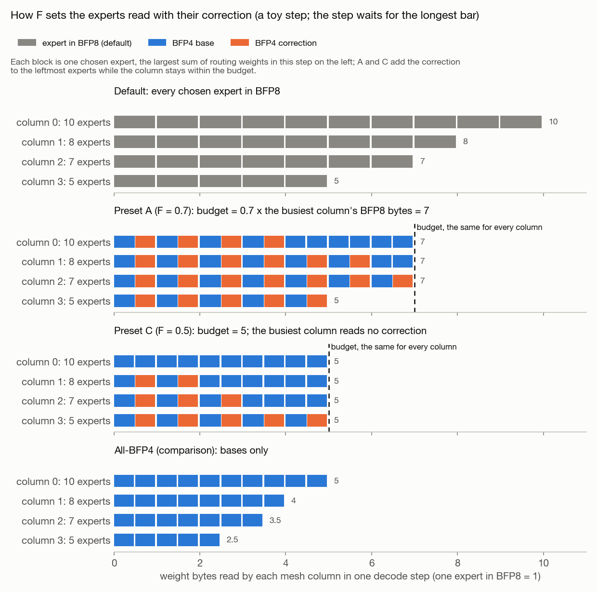

# GLM-5.3-Flash

## Platforms:
    Galaxy (BH): one Blackhole Galaxy, 32 chips as an 8x4 mesh

## Introduction
This is GLM-5.3-Flash (text) on one Blackhole Galaxy, from the BF16 checkpoint
[zai-org/GLM-5.3-Flash-BF16](https://huggingface.co/zai-org/GLM-5.3-Flash-BF16). GLM-5.3-Flash is a mixture-of-experts
model of 320B parameters, 18B of them active per token (as its model card states). Its 45 layers combine linear
attention (Kimi delta attention, KDA, 34 layers) with sparse attention (DeepSeek sparse attention, DSA, 11 layers:
MLA with an indexer that picks the 2,048 most relevant past tokens), 288 routed experts (8 per token) plus a shared
expert, and a residual of 4 streams mixed by manifold hyper-connections (mHC). Its context is up to 1M tokens.

The whole model runs on the 32 chips with BFP8 weights and HiFi4 matmuls. Decoding uses DFlash2 speculative decoding:
a small drafter ([canada-quant/GLM-5.3-Flash-DFlash2-G](https://huggingface.co/canada-quant/GLM-5.3-Flash-DFlash2-G))
runs on the device next to the model.

Measured speed and quality are in [PERF.md](PERF.md); the implementation is described in [docs/DESIGN.md](docs/DESIGN.md),
and how it was brought up and optimized, with what worked and what did not, in
[docs/BRINGUP_AND_OPTIMIZATION.md](docs/BRINGUP_AND_OPTIMIZATION.md).

### Key Features
- **Whole model on one Galaxy**: all 45 layers, BFP8 weights (converted from BF16 at load), HiFi4 matmuls with fp32
  accumulation, bf16 / fp32 activations.
- **Speculative decoding on the device**: the DFlash2 drafter proposes 7 (or 3) tokens a step and the model verifies
  them in one traced step; only drafts equal to the model's greedy token are kept, so the output is the greedy output.
- **Batch decoding**: 8 to 128 users (multiples of 8), up to 8,469 tok/s in all at 128 users.
- **Long contexts**: 1M tokens a user for up to 64 users (576K at 128 users), with the DSA cache in FP8 / BFP4 and split
  over a mesh row's chips.
- **Prefill**: chunked, traced, several requests at once (one per mesh row); a long prompt is split over the 8 mesh
  rows (sequence parallel).
- **Sampling**: temperature, top-p and top-k (up to 32) on the device, with speculative decoding.
- **vLLM-compatible**: an OpenAI-compatible server through the Tenstorrent vLLM TT plugin, with tool calls, chunked
  prefill and prefix caching (a later request that repeats a long prompt's start, such as the next turn of a
  conversation, resumes from the stored state at a multiple of 8,192 tokens).
- **Optional fast presets** (lower-precision experts): 8-10 % (A), 11-15 % (B) or 18-23 % (C) faster decode with a small
  change in quality.

## Prerequisites
- This branch of tt-metal, built from source as in [INSTALLING.md](../../../../INSTALLING.md):
  ```
  ./build_metal.sh
  ./create_venv.sh
  source python_env/bin/activate
  ```
- One Blackhole Galaxy, opened as one 8x4 mesh with the 2D torus fabric:
  ```
  export MESH_DEVICE="(8, 4)"
  export TT_MESH_GRAPH_DESC_PATH=$TT_METAL_HOME/tt_metal/fabric/mesh_graph_descriptors/single_bh_galaxy_torus_xy_graph_descriptor.textproto
  ```
- About 650 GB of disk for the checkpoint. The host does not need that much memory: tensors are read through
  memory-mapped views of the safetensors shards.

### Weights
The model reads the BF16 checkpoint at a pinned revision. The download tool fetches it from Hugging Face (643 GB,
resumable) and verifies every file against the revision's listing (SHA-256 for the weights):
```
python -m models.demos.blackhole.glm53_flash.tools.download_checkpoint --out <checkpoint dir>
export GLM53_CHECKPOINT=<checkpoint dir>
```
- `--revision` (default: the pinned one), `--workers` (parallel downloads, 16), `--hash-threads` (16).
- `--verify-only` checks the files without fetching. A file that fails is deleted, so running the tool again fetches it;
  files already verified (same size and modification time) are not hashed again.

`HF_MODEL`, the name other tt-metal demos use, works too: it is read when `GLM53_CHECKPOINT` is not set
(`GLM53_CHECKPOINT` wins when both are), and only if it is a local directory with GLM-5.3-Flash-BF16's `config.json`
(not a Hugging Face hub id, not another model's directory: the run stops with a message naming both variables).

The DFlash2 drafter for speculative decoding:
```
huggingface-cli download canada-quant/GLM-5.3-Flash-DFlash2-G --local-dir <drafter dir>
export GLM53_DFLASH2_DRAFTER=<drafter dir>
```

Other paths:
- `GLM53_DATA_DIR` (default `./glm53_data`): reference outputs and task files that some tests read.
- `GLM53_OUT_DIR` (default `./glm53_out`): results that tests and tools write.

Loading the real weights takes about 3 minutes (the BF16 matrices are converted to BFP8 as they load, on several
host threads, with the checkpoint read ahead). How long a first run takes in all is under
[How long a first run takes](#how-long-a-first-run-takes).

## How to Run
### Running the Demo
```
pytest models/demos/blackhole/glm53_flash/demo/demo.py
```
The demo loads the model and the drafter, renders the prompt with the checkpoint's chat template, prefills it and
decodes up to 256 new tokens greedily with DFlash2 (K = 7), then prints the text and the decode speed. Without
`GLM53_DFLASH2_DRAFTER` it uses the plain greedy decode (one token a step).

Options: pytest command-line options named as in the other tt-metal demos, and environment variables. An option
overrides its environment variable.

| Option | Environment variable | Default | Effect |
|---|---|---|---|
| `--input_prompts FILE` | `GLM53_DEMO_PROMPTS` | one prompt | A JSON file of prompts: a list of strings or of `{"prompt": ...}` objects, up to 64; prompt i runs on mesh row i % 8 |
| | `GLM53_DEMO_PROMPT` | a short question | The one prompt when no file is given |
| `--max_generated_tokens N` | `GLM53_DEMO_MAX_NEW` | 256 | New tokens a prompt at most (a prompt stops earlier at an end token) |
| `--batch_size N` | | the prompts given | The prompts repeated (or cut) to N, 1 to 64: N users |
| `--max_seq_len N` | | room for the longest prompt and its new tokens | The cache a user, in tokens, rounded up to a multiple of 512 (at least 1,024). Past 2,051 tokens the DSA cache takes its long-context form, and the warm-up compiles more prefill forms |
| | `GLM53_DEMO_REASONING` | `low` | The chat template's reasoning effort: `low`, `high` or `max` (the template's own default: a long reasoning part first) |
| | `GLM53_DEMO_K` | 7 | DFlash2's drafts a step, 1 to 7 |
| | `GLM53_SYNTHETIC_WEIGHTS=1` | | Random weights made on the device; loads in seconds, the text is noise |

For example, the 8 sample questions of [demo/sample_prompts/questions.json](demo/sample_prompts/questions.json) (one a
mesh row: 8 users), 128 new tokens each:
```
pytest models/demos/blackhole/glm53_flash/demo/demo.py \
  --input_prompts models/demos/blackhole/glm53_flash/demo/sample_prompts/questions.json --max_generated_tokens 128
```
It logs the load and the warm-up, each prompt and its output, and the speed (a first run with the real weights; two of the eight outputs, without the log's time and source columns. With the reasoning effort `low` the answer follows `</think>` at once):
```
loaded in 201 s: 8 prompts (models/demos/blackhole/glm53_flash/demo/sample_prompts/questions.json), 1 a mesh row, cache 1024
warmed up in 244 s; DFlash2 with K = 7

PROMPT: Write a haiku about a lighthouse in winter.
OUTPUT (23 tokens): </think>Frost grips the white tower—
its lone beam sweeps frozen waves,
guiding no ships home.

PROMPT: What is 17 times 23? Show your working.
OUTPUT (91 tokens): </think># 17 × 23

**Method: Split 23 into 20 + 3**

- 17 × 20 = 340
- 17 × 3 = 51
- 340 + 51 = **391**

**Check:** 17 × 23 = 17 × 23... using (20 − 3)(20 + 3) = 400 − 9 = 391 ✓

(... the six other prompts ...)
prefill: 202 prompt tokens in 0.81 s (eager)
decode: 770 tokens in 1.23 s, 41 steps of 30.0 ms; 625.7 tok/s in all, 78.2 tok/s a prompt; 3.38 tokens a step a prompt
```
Every decode step runs all 8 x (users per row) seats of the mesh, so with fewer than 8 prompts the reported speed is
that of a batch of 8 users.

### How long a first run takes
Measured on one Galaxy with the checkpoint on a local NVMe drive, the demo above with the real weights and an empty
kernel cache:
- opening the mesh and starting the fabric: about 14 s;
- loading the weights and the drafter (`loaded in`): 201 s;
- the warm-up (`warmed up in`: compiling the kernels of the prefill and the decode, capturing the decode's trace):
  244 s the first time. The compiled kernels stay in the kernel cache (`TT_METAL_CACHE`, default
  `~/.cache/tt-metal-cache`; 4.0 GB after this run), and with them the warm-up took 33 s;
- the prompts: under 3 s.

In all 7 min 41 s (pytest's time), about 4 minutes once the kernels are cached.

Starting the vLLM server takes longer: it loads the same weights, then compiles and captures the prefill's forms for
every chunk start up to `--max-model-len`. With the kernel cache from earlier runs the server was ready after about
6.5 min at `--max-model-len 2048`, 8 min at 4,096, 10.5 min at 9,216, 13 min at 33,792 and at 65,536 (also at 64
seats) and 16 min at 132,096 (32 seats); the first start also compiles the kernels.

## Testing
### CPU tests (no device)
The CPU reference `tt/` follows Hugging Face Transformers' `glm5_next` model operation by operation and matches it bit
for bit. Tests that need no device:
```
pytest models/demos/blackhole/glm53_flash/tests/test_generator_no_device.py \
  models/demos/blackhole/glm53_flash/tests/test_vllm_adapter_no_device.py \
  models/demos/blackhole/glm53_flash/tests/test_vllm_requests_no_device.py \
  models/demos/blackhole/glm53_flash/tests/test_prefix_no_device.py \
  models/demos/blackhole/glm53_flash/tests/test_paths_no_device.py \
  models/demos/blackhole/glm53_flash/tests/test_serve_no_device.py \
  models/demos/blackhole/glm53_flash/tests/test_demo_options_no_device.py \
  --confcutdir=models/demos/blackhole/glm53_flash -p no:cacheprovider
```
`tests/test_reference_vs_hf.py` and `tests/test_model_vs_hf.py` compare `tt/` with Transformers on the checkpoint (they
need a Transformers version with `glm5_next`, 5.16 or later).

### Device tests
Device tests run only with `GLM53_DEVICE_TEST=1`:
```
GLM53_DEVICE_TEST=1 pytest models/demos/blackhole/glm53_flash/tests/<test>.py -s
```
- `test_device_smoke.py`: opens the mesh and runs the collectives the model uses on both axes.
- `test_dflash2_generator.py`: DFlash2 in the serving generator against the plain greedy decode on the 11 greedy
  reference records (`tools/acceptance/greedy-v1`), with requests arriving into freed seats.
- `test_model_device_accuracy.py`: teacher-forced KLD against the CPU reference's logits and the greedy records (the
  reference logits are made by the tools in `tools/` and read from `GLM53_DATA_DIR`; see the test's docstring).
- `test_model_device_trace.py`, `test_dflash2_speed.py`, `test_prefill_bench.py`: decode and prefill speed.
- `test_model_device_long.py`: long-context passkey retrieval.
- `test_model_device_tasks.py`: task accuracy (GSM8K and others; the task files are made by `tools/*_tasks.py` and
  `tools/*_prompts.py` into `GLM53_DATA_DIR`).
- `test_prefix_resume.py`, `test_prefix_turns.py`: the prefix store's snapshot and restore against prefilling the whole
  prompt, bit for bit.
- Most other device tests check one op or one form of the model against the form it replaces, bit for bit (each
  test's docstring says what it compares).

Speed tests can use `GLM53_SYNTHETIC_WEIGHTS=1`: random weights made on the device, of the checkpoint's shapes (the
checkpoint's index and headers are still read), so the model loads in seconds. The timing matches the real weights
where kernels do not depend on values; expert routing is spread evenly (`GLM53_SYNTHETIC_ROUTING=spread`, the default).
Correctness and accuracy need the real weights.

## How It Works
A short tour of what the code does, and of where its output can differ from a plain reference run.
[docs/DESIGN.md](docs/DESIGN.md) has the details.

**Mesh.** The 8 rows of the 8x4 mesh hold different users (users come in multiples of 8, a group per row); the 4 chips
of a row split each layer's heads and matrices. The routed experts are split by mesh column instead: column c holds
experts 72 c .. 72 c + 71, and the 8 chips of a column share each expert's work
([placement](docs/DESIGN.md#3-placement-on-the-8x4-mesh)).

**Decoding.** Each decode step is one traced sequence of device programs. The DFlash2 drafter proposes K tokens a user
(K = 7, or K = 3 for large batches: the server switches above 32 seats), the model checks all of them in one step, and
the drafts are kept up to the first one that differs from the model's own greedy token (with sampling, its own draw).
So the text is the model's own output; only the batched step rounds differently from one-token decoding, which can
flip near-ties ([DFlash2](docs/DESIGN.md#44-dflash2-speculative-decoding)).

**Prefill.** Prompts are prefilled in traced chunks, a request per mesh row at once; a single long prompt is split over
the 8 rows and computed in parallel. The vLLM server gathers new requests into one prefill call (up to 4, waiting up to
1.5 s), but stops waiting once they fill one prefill step's 8,192 tokens or once waiting costs the decoding users more
than another call would. With chunked prefill, a long prompt goes in 8,192-token steps between decode steps
([prefill](docs/DESIGN.md#5-prefill), [serving](docs/DESIGN.md#7-serving)).

**Long contexts.** A cache past 2,051 tokens keeps DSA's latents in FP8 and the indexer's keys in BFP4, and a cache of
8,192 tokens or more is split by position over a row's 4 chips: this is what lets 64 users hold 1M tokens each.
Shorter caches stay in bf16 ([long contexts](docs/DESIGN.md#6-long-contexts); quality in
[PERF.md](PERF.md#quality)).

### Fast presets: the progressive form and F
A decode step spends most of its time reading the experts' weights from DRAM, so the fast presets read fewer bytes,
for the experts that matter least in that step:

- Each routed expert is stored as a **BFP4 base** (its weights rounded to BFP4) and a **BFP4 correction** (what the
  base missed, rounded to BFP4 again). Base plus correction is about as precise as BFP8. This takes about 0.56 GiB a
  chip more memory than the default.
- In each decode step, every mesh column reads the base of every expert its tokens chose. It then adds corrections,
  starting from the expert with the largest sum of routing weights in this step (over all the tokens that chose it),
  while the column stays within its **budget**.
- The budget is **the same number of bytes for every column: F times what the busiest column** (the column whose tokens
  chose the most experts) **would read in BFP8**. The step waits for the busiest column anyway, so the other columns
  spend their spare time on corrections.
- A base is about 0.53 of an expert's BFP8 bytes, so at F = 0.5 the busiest column reads no correction (it uses the
  bases only, like the all-BFP4 form), while the other columns still read some. With many users nearly every expert is
  chosen in every column, the columns are close to even, and there is less spare room.
- The prefill reads every correction (its speed does not change). The decode step runs the shared expert as one more
  expert of one column, under the same rule.
- Presets: **A** is F = 0.7, **B** F = 0.6, **C** F = 0.5, all three with LoFi expert matmuls (the default is HiFi4).
  Their speed and quality are in [PERF.md](PERF.md#fast-presets); the exact rule is in
  [docs/DESIGN.md](docs/DESIGN.md#91-the-fast-presets-progressive-form).



**Where the output can differ from a reference run**: near-ties under the batched steps' rounding (above), caches past
2,051 tokens (the FP8 / BFP4 cache), the fast presets, `GLM53_ACCEPT_RELAX`, and sampling's top-k of at most 32
([numerics](docs/DESIGN.md#9-numerics)).

## Details
### Options
Environment variables read when the model is built (set them before starting the process).

| Variable | Default | Effect |
|---|---|---|
| `GLM53_CHECKPOINT` | (required) | The BF16 checkpoint directory |
| `HF_MODEL` | (unset) | Read in place of `GLM53_CHECKPOINT` when that is not set, if it is a local directory with GLM-5.3-Flash-BF16's `config.json` (else the run stops with a message) |
| `GLM53_DFLASH2_DRAFTER` | (unset) | The DFlash2 drafter's directory |
| `GLM53_DFLASH2` | `0` | vLLM: decode with DFlash2 speculative decoding |
| `GLM53_DFLASH2_K` | by seats | vLLM: DFlash2's drafts per step (default 7 up to 32 seats, else 3) |
| `GLM53_MTP` | `0` | Load the model's own MTP layer; vLLM: speculative decoding with one MTP draft per step instead of DFlash2 |
| `GLM53_ACCEPT_RELAX` | `0` (off) | Relaxed acceptance for greedy requests: a draft is also accepted when its logit is within this many nats of the top. Faster (more drafts accepted) but the text is no longer the greedy output |
| `GLM53_SYNTHETIC_WEIGHTS` | `0` | `1`: random weights made on the device (speed tests and plumbing checks) |
| `GLM53_TRACE_REGION_MB` | `256` | Trace region per chip for the tests and the demo (vLLM takes `trace_region_size` instead) |
| `GLM53_W1` | by shape | The L1 landing of the next MoE layer's chosen experts' weights, copied ahead of the experts op: by default sized for the DFlash2 step the model is built for; `0` off (the same values either way) |
| `GLM53_PREFIX_ENTRIES` | `auto` (vLLM with DFlash2) | vLLM: the prefix store's entries; `auto` sizes it from the free DRAM at start-up, `0` turns it off |

**Fast presets** (how they work: [above](#fast-presets-the-progressive-form-and-f); speed and quality: [PERF.md](PERF.md#fast-presets)). They change the output relative to the default:

| Preset | Variables |
|---|---|
| A | `GLM53_MOE_PROG_F=0.7 MOE_EXPERTS_FIDELITY=0 GLM53_MOE_PREFILL_FIDELITY=lofi` |
| B | `GLM53_MOE_PROG_F=0.6 MOE_EXPERTS_FIDELITY=0 GLM53_MOE_PREFILL_FIDELITY=lofi` |
| C | `GLM53_MOE_PROG_F=0.5 MOE_EXPERTS_FIDELITY=0 GLM53_MOE_PREFILL_FIDELITY=lofi` |
| All-BFP4 (comparison) | `GLM53_EXPERT_DTYPE=bfp4 MOE_EXPERTS_FIDELITY=0 GLM53_MOE_PREFILL_FIDELITY=lofi` |

- `GLM53_MOE_PROG_F=F`: the routed experts as a BFP4 base plus a BFP4 correction; in each decode step every mesh column
  reads its chosen experts' bases and the corrections of those with the largest routing-weight sums, up to F times the
  busiest column's bytes in BFP8. The prefill reads every correction. See
  [Fast presets: the progressive form and F](#fast-presets-the-progressive-form-and-f).
- `MOE_EXPERTS_FIDELITY` (decode experts op: `0` LoFi, `2` / `3` / `4` HiFi2 / HiFi3 / HiFi4, `1` by the weights'
  format) and `GLM53_MOE_PREFILL_FIDELITY` (prefill experts: `lofi`, `hifi2`, `hifi3`, `hifi4`, `auto`): the experts'
  matmul fidelity, HiFi4 by default.

### Long contexts
By default a cache longer than 2,051 tokens keeps the DSA latents in FP8 and the indexer's pooled keys in BFP4, and a
cache of 8,192 tokens or more is split by position over the 4 chips of a mesh row: 1M tokens a user for up to 64 users,
576K at 128 users (see [PERF.md](PERF.md#long-context-and-memory) for memory, speed and quality). Shorter caches use
the dense attention form. Four switches set this back to a bf16 cache, the same on a row's 4 chips (up to 680K tokens
a user at 8 users, 272K at 32, 80K at 128):
```
export GLM53_KV_LATENT_FP8=0          # DSA latent cache in bf16 (default 1: FP8)
export GLM53_DSA_POOLS_DTYPE=bf16     # the indexer's pooled keys in bf16 (default bfp4)
export GLM53_DSA_SHARD_KV=0           # the latent cache not split (default 8192: split from a cache of that many tokens)
export GLM53_DSA_SCORES_SHARD=0       # the indexer's scoring not split (default 8192)
```
Serving with 1M-token contexts has not been measured yet.

### vLLM Serving
The model is served by vLLM 0.31.0 with the [Tenstorrent vLLM TT plugin](https://github.com/tenstorrent/vllm-tt-plugin)
at commit `ca7a182` or later (tested with `042a948`). Install both as the plugin's `docs/install-vllm-tt.sh` does, into
a Python environment that can import this tt-metal build, and add the Transformers version that knows the
`glm5_next` config:
```
pip install transformers==5.16.1
```

Start the server with the release's settings (32 seats, DFlash2 with 7 drafts a step, contexts up to 33,792
tokens):
```
export GLM53_CHECKPOINT=<checkpoint dir>        # (or HF_MODEL)
export GLM53_DFLASH2_DRAFTER=<drafter dir>
python -m models.demos.blackhole.glm53_flash.tools.serve --seats 32 --max-model-len 33792
```
- `--seats` (vLLM's `--max_num_seqs`): concurrent requests, a multiple of 8. The drafts a step follow it: 7 up to 32
  seats, 3 above (`GLM53_DFLASH2_K` overrides both).
- `--max-model-len`: the longest context a request can reach, prompt and output. The trace region follows it.
- `--port` (default 8000), `--checkpoint` and `--drafter` (default: the variables above), `--tool-calls` (tool calls,
  below), `--trace-region BYTES`.
- `--print` prints the full command and exits. Flags after `--` go to vLLM after the script's own, and one the script
  also sets replaces its value (e.g. `-- --uvicorn-log-level warning`, or `-- --additional-config '...'`).
- The script runs the server in its own process, so Ctrl-C (SIGINT) stops the server, which shuts its engine down and
  closes the mesh.
- The server is ready after about 6.5 minutes at `--max-model-len 2048` and 13 minutes at 33,792, loading included
  ([How long a first run takes](#how-long-a-first-run-takes)).
- Coding agents send long prompts (with OpenCode, about 10K tokens of instructions and tool definitions a request):
  use `--max-model-len 65536` or more, which starts in about the same 13 minutes. Each concurrent agent or subagent
  takes a seat; for more than about 30, use `--seats 64` (3 drafts a step). Tried with OpenCode at 64 seats: up to 23
  subagents running at once, about 50-60 tokens/s each, 81 % of their prefills resumed from the prefix store.

The script runs this command (what `--print` shows, written here with `$TT_METAL_HOME`, `$GLM53_CHECKPOINT` and
`$GLM53_DFLASH2_DRAFTER` for the paths; a `PYTHONPATH` already set follows the tt-metal root):
```
cd $TT_METAL_HOME && \
EXTRA_MODELS_DIR=$TT_METAL_HOME/models/demos/blackhole/glm53_flash/tools/vllm_bundle \
MESH_DEVICE='(8, 4)' \
TT_MESH_GRAPH_DESC_PATH=$TT_METAL_HOME/tt_metal/fabric/mesh_graph_descriptors/single_bh_galaxy_torus_xy_graph_descriptor.textproto \
GLM53_DFLASH2=1 \
GLM53_DFLASH2_DRAFTER=$GLM53_DFLASH2_DRAFTER \
PYTHONPATH=$TT_METAL_HOME \
python -m vllm.entrypoints.openai.api_server \
  --model $GLM53_CHECKPOINT \
  --served-model-name glm-5.3-flash \
  --max_num_seqs 32 \
  --block_size 64 \
  --max-model-len 33792 \
  --no-enable-prefix-caching \
  --enable-chunked-prefill \
  --max-num-batched-tokens 8192 \
  --scheduler-cls models.demos.blackhole.glm53_flash.tools.glm53_vllm_scheduler.Glm53Scheduler \
  --speculative-config '{"method": "custom_class", "model": "vllm_tt_plugin.model_owned_drafter", "num_speculative_tokens": 7}' \
  --hf-overrides '{"architectures": ["TTGlm5NextForConditionalGeneration"]}' \
  --additional-config '{"tt": {"l1_small_size": 32768, "trace_region_size": 1073741824, "worker_l1_size": 1436288, "sample_on_device_mode": "decode_only", "prefill_chunk_alignment": 8192, "decode_interleave_prefill_steps": 1}}' \
  --override-generation-config '{"top_k": 32}' \
  --port 8000
```
About its settings:
- `--max_num_seqs` must be a multiple of 8 (the users are spread over the 8 mesh rows).
- `num_speculative_tokens` must equal the drafts per step the model uses: 7 up to 32 seats and 3 above, or
  `GLM53_DFLASH2_K`. The server refuses another value at start-up.
- The trace region (`trace_region_size`, bytes a chip) holds the captured decode and prefill traces, whose number
  grows with `--max-model-len` (a long cache has more prefill forms): 1 GiB for 33,792 as above; 768 MiB is too small
  there (the server stops at start-up) but enough for 2,048; 2 GiB served 132,096 (the 128K rows of
  [PERF.md](PERF.md#by-concurrency-and-input-length)). The script picks 768 MiB up to 2,048, 1 GiB up to 33,792 and
  2 GiB above.
- `--override-generation-config '{"top_k": 32}'` gives sampled requests a top-k the device draws from (below).
- The model keeps its own per-seat state (KDA states, DSA caches), not vLLM's paged KV cache, so vLLM's own prefix
  caching stays off (`--no-enable-prefix-caching`). The model has its own prefix store instead (below).
- With DFlash2, the server launches the next decode step while vLLM does its host work, also at the steps where
  requests end and right after prefills (this needs `Glm53Scheduler`). `GLM53_VLLM_RUN_AHEAD=0` turns this off.
- With DFlash2, `Glm53Scheduler` gathers new requests into one prefill call (up to 4, waiting up to 1.5 s for them:
  `GLM53_PREFILL_BATCH`, `GLM53_PREFILL_BATCH_WAIT_MS`; `GLM53_PREFILL_BATCH=0` prefills each as it comes), and a call
  of 3-4 requests on neighbouring mesh rows is prefilled as one sequence-parallel wave (`GLM53_SP_INTERLEAVE=0` turns
  this off). It does not wait for more requests than one prefill step's 8,192 tokens take (one 8K prompt), and it
  stops waiting once the waiting requests' summed wait reaches what one more prefill call would cost the decoding
  ones (100 ms each, `GLM53_PREFILL_BATCH_CALL_MS`), so at low concurrency a new request is prefilled within a decode
  step or two (`GLM53_PREFILL_BATCH_ADAPT=0`: always wait for 4 or 1.5 s).
- `GLM53_MTP=1` (in place of `GLM53_DFLASH2=1`, with `"num_speculative_tokens": 1`, by hand from the command above)
  uses the model's own MTP layer as the drafter instead (slower).
- `GLM53_PREFILL_CHUNK` sets the prefill chunk lengths (default `128,512,1024`).

Send a request:
```
curl http://localhost:8000/v1/chat/completions -H "Content-Type: application/json" \
  -d '{"model": "glm-5.3-flash", "messages": [{"role": "user", "content": "Write a haiku about the sea."}], "max_tokens": 512, "temperature": 0}'
```

**Tool calls**: `--tool-calls` adds `--enable-auto-tool-choice --tool-call-parser glm47 --reasoning-parser glm47`.

**Sampled requests** (temperature, top-p, top-k): on by default with DFlash2 when the installed plugin supports them
(commit `ca7a182` or later; with an older plugin the server warns at start-up and takes greedy requests only;
`GLM53_VLLM_SAMPLING=1` makes the start-up stop instead, `0` turns sampling off), with
`--override-generation-config '{"top_k": 32}'` (the script sets it). The device draws each token from the step's 32
most likely candidates and accepts the drafts against those draws, so speculative decoding keeps working with
sampling. A request without a top-k (such as the model card's recommended temperature 1.0 / top-p 0.95, the server's
defaults from the checkpoint's `generation_config.json`) needs the whole vocabulary, which the device does not handle,
so the server's default top-k of 32 keeps those requests on the device. Requests with controls the
device does not draw (repetition penalties, logprobs, a grammar or token filter, min_tokens, a top-k above 32) are
refused with HTTP 400 naming the control. `GLM53_VLLM_HOST_SAMPLING=allow` serves them instead: while one of them is in
the batch, every step reads the full logits back to the host for the plugin's acceptance, which slows the whole batch
down by about 40 times.

**Prefix caching** (on by default with DFlash2 and chunked prefill): after a prompt's prefill the model keeps its state
at each multiple of 8,192 tokens in a store in DRAM, and a later request that starts with the same tokens (such as the
next turn of a conversation) is restored from the longest stored prefix into a free seat of the same mesh row and
prefilled from there. The restored state is the one a whole prefill leaves, so the output is the same. The store's
size is set at start-up from the free DRAM (`GLM53_PREFIX_ENTRIES=auto`, the start-up log gives it; a number sets the
entries, `0` turns it off).

**Chunked prefill** (on by default with DFlash2): a long prompt is prefilled in steps of 8,192 tokens with decode
steps between them, so the other users keep generating. With prompts of 30K tokens arriving while 24 requests decoded,
the longest stall of those requests went from 1.52 s (whole prompts) to 0.46 s; the long requests themselves (12
output tokens) also finished sooner (2.05 s against 3.29 s on average), and the other requests' throughput was about
1 % lower. It needs the flags of the command above:
`--enable-chunked-prefill --max-num-batched-tokens 8192`, `"prefill_chunk_alignment": 8192` and
`"decode_interleave_prefill_steps": 1` in the `tt` block of `--additional-config`, and `Glm53Scheduler`; the server stops
at start-up with a message when these do not match. A prompt's later chunks stay on the seat of its first.
`GLM53_VLLM_CHUNKED=0` prefills every prompt whole (then set `--max-num-batched-tokens` to at least the longest prompt,
e.g. 65536; the prefix store needs chunked prefill).

**Checks** (in the vLLM environment):
- The offline engine on the prompts of the 11 greedy reference records, each output compared with its record (the plain
  greedy decode, without speculative decoding):
  ```
  GLM53_DFLASH2=0 python -m models.demos.blackhole.glm53_flash.tools.vllm_offline_check --model $GLM53_CHECKPOINT
  ```
- Against a running server: `python models/demos/blackhole/glm53_flash/tools/vllm_tool_check.py --port <port>` (tool
  calls: a server started with `--tool-calls`), `vllm_sampling_check.py --port <port>` (sampled requests on the device
  and the host paths) and `vllm_chunked_check.py --port <port>` (long prompts arriving while others decode, with and
  without chunked prefill), `vllm_prefix_check.py --port <port>` (multi-turn conversations through the prefix store).

Shut the engine down when a process that uses vLLM in-process ends (as `vllm_offline_check` does): a mesh left open
at exit can keep the boards' Ethernet cores busy for the next process.

## Troubleshooting
Failures seen with this code, by the message they print:

- **The mesh does not open**: `TT_THROW: Device 0: Timed out while waiting for active ethernet core 27-25 to become
  active again. Try resetting the board.` An earlier process left the mesh open (it was killed, or it used vLLM
  in-process and ended without shutting the engine down). Reset the Galaxy with `tt-smi -glx_reset` and run again.
  Stop a server with SIGINT (Ctrl-C), not SIGKILL, so it closes the mesh.
- **Trace region too small**, at start-up while the traces are captured: `TT_FATAL: Creating trace buffers of size
  504111104B on MeshDevice 0, but only 503316480B is allocated for trace region.` Give the server a larger trace region
  (`--trace-region` of `tools/serve.py`, or `trace_region_size` in the `tt` block), the demo and the tests
  `GLM53_TRACE_REGION_MB`. A longer `--max-model-len` needs more ([vLLM Serving](#vllm-serving)).
- **DRAM too small** for the seats and the context length: `TT_FATAL: Out of Memory: Not enough space to allocate
  1610612736 B DRAM buffer across 8 banks, where each bank needs to store 201326592 B, but bank size is 4205232512 B
  (allocated: ..., free: ..., largest free block: ...)` while the model builds its caches. Lower `--max-model-len` or
  the seats: the longest context by number of users is in [PERF.md](PERF.md#decode) ("Max context"; 1M tokens a user
  up to 64 users, 576K at 128), and the server's trace region takes from the same DRAM.
- **num_speculative_tokens does not match**: `... refused speculation at max_num_seqs=64, num_speculative_tokens=7:
  DFlash2 at 64 seats drafts 3 a step; supported draft lengths at max_num_seqs=64: [3]. Change --spec-tokens or
  --max-num-seqs, or drop the speculative flags`. The drafts a step must be 7 up to 32 seats and 3 above (or
  `GLM53_DFLASH2_K`); `tools/serve.py` sets them from `--seats`.
- **Seats not a multiple of 8**: `max_num_seqs (12) must be a multiple of the 8 mesh rows`, after the mesh opened.
  `tools/serve.py` refuses such `--seats` before it starts anything.
- **Chunked prefill's flags missing**: `GLM-5.3-Flash's chunked prefill (GLM53_VLLM_CHUNKED=1) needs: ...` with what
  is missing or different (for example `a step's prompt tokens 2048 (--max-num-batched-tokens equal to the
  alignment)`, or the scheduler). vLLM 0.31 turns chunked prefill on by default, so a command without these flags
  stops here: use the flags of the command above, or `GLM53_VLLM_CHUNKED=0` / `--no-enable-chunked-prefill` for whole
  prompts.
- **No checkpoint**: `GLM53_CHECKPOINT is not set (nor HF_MODEL): ...`, or `HF_MODEL='...' is not a GLM-5.3-Flash-BF16
  checkpoint directory: ...` when `HF_MODEL` names a hub id or another model (other demos often leave it set): set
  `GLM53_CHECKPOINT`, which takes precedence.
