# GLM-5.3-Flash on Blackhole Galaxy: bring-up and optimization

How GLM-5.3-Flash was brought up on one Blackhole Galaxy (32 chips as an 8x4 mesh) and made fast: the order of the work,
what each technique gave, what did not work and why, and the practices that kept the work safe and quick. It is written
for whoever brings up or optimizes the next model on this hardware.

The implementation as it stands is described in [DESIGN.md](DESIGN.md), the measured speed and quality in
[PERF.md](../PERF.md), setup and options in [README.md](../README.md). This report links to them rather than repeating
them. The figures are drawn by `plot_report.py` from the values written in it.

**Contents**

1. [Summary](#1-summary)
2. [Method](#2-method)
3. [Decode, phase by phase](#3-decode-phase-by-phase)
4. [Decode techniques](#4-decode-techniques)
5. [Prefill](#5-prefill)
6. [Long contexts](#6-long-contexts)
7. [Serving](#7-serving)
8. [Start-up and the fast presets](#8-start-up-and-the-fast-presets)
9. [What did not work](#9-what-did-not-work)
10. [Practices and pitfalls](#10-practices-and-pitfalls)
11. [Checklist for the next model](#11-checklist-for-the-next-model)

**Conditions used throughout.** "Users" are the decode batch (multiples of 8, one group per mesh row). "Random weights"
are weights made on the device with the checkpoint's shapes (they load in seconds); "real weights" are the BF16
checkpoint converted at load. Decode speeds are traced steps at a 512-token cache unless a section says otherwise; with
speculative decoding, total tok/s = users x tokens a step / step time, the tokens a step measured on real text. Where a
number was measured with random weights, the text says so: their timing matches the real weights only where the
kernels do not depend on the values (see [2.3](#23-random-weights-for-speed-real-weights-for-quality)).

## 1. Summary

The first end-to-end version (prefill, traced decode, a vLLM server) decoded at 59 / 226 / 722 tok/s for 8 / 32 / 128
users. The release decodes at 1,208 / 3,754 / 8,469 tok/s, 12-20 times faster, with BFP8 weights (the first version
had BF16), HiFi4 matmuls and bf16 / fp32 activations, and its output is the model's own greedy output up to rounding.

| | First end-to-end version | Release ([PERF.md](../PERF.md)) |
|---|---|---|
| Weights, matmuls | BF16, HiFi4 | BFP8, HiFi4 |
| Decode, 8 / 32 / 128 users | 59.3 / 226.3 / 722.2 tok/s (135 / 141 / 177 ms a step, one token a step) | 1,208 / 3,754 / 8,469 tok/s (27.7 / 35.7 / 47.1 ms a step, 4.18 / 4.18 / 3.12 tokens a step) |
| Prefill, 8 prompts x 2,048 | 398 tok/s (one request at a time, eager, chunks of 512) | 30,080 tok/s |
| Prefill, one long prompt | 398 tok/s (2,048 tokens) | 24,080 tok/s (8K tokens, split over the 8 rows) |
| Serving, 32 concurrent | 103 tok/s (128 in / 128 out, 64 seats) | 3,300 tok/s (128 in / 1,024 out); 2,648 tok/s (1K in / 1K out) |
| Longest context a user | 2,048 tokens (no indexer) | 1M tokens for up to 64 users, 576K at 128 |
| Weight load | about 6.5 minutes (BF16, in the server) | about 3 minutes (BF16 converted to BFP8 as it loads) |
| Quality check (teacher-forced KLD against the CPU reference's decode / prefill path) | 0.0020 / 0.0016 | 0.0024 / 0.0023 |

The first version's speeds were measured with random BF16 weights (its dense MoE does not depend on the values: within
0.3 % of the real weights), its decode at a short context. The release's decode used the real weights at a 512-token
cache, its prefill random weights, as [PERF.md](../PERF.md) states.

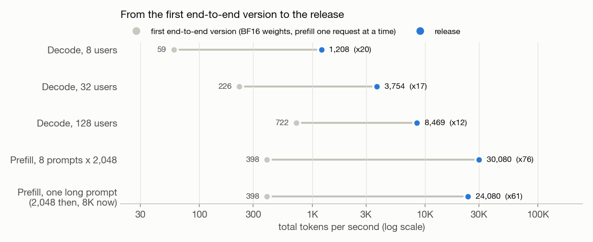

*Each row is one throughput, first version (gray) against the release (blue), on a log scale; the factor is printed at
the right. Decode gained 12-20x, prefill 61-76x.*

The main lessons, each developed below:

- **Trace first, then cut the op count.** The eager whole model spent about 0.95 s of a 1.19 s step waiting for the
  host to dispatch about 11,000 ops. Tracing the step gave 4.9-6.6x before any kernel work.
- **Write custom ops when the stock layer saturates.** Reworking the model code with stock ops (fusing matmuls,
  regrouping MoE and KDA) and BFP8 weights took the 8-user step from 245 ms (real weights) to 117 ms, and further
  model-code changes to roughly 75 ms (both random weights, the latter with the biased routing of
  [2.3](#23-random-weights-for-speed-real-weights-for-quality)); custom ops for KDA, mHC and the MoE experts, and custom
  collectives, then took it to 21 ms with the real weights.
- **Placement is a lever op work cannot replace.** Splitting each expert over the 8 chips of a mesh column, instead of
  spreading whole experts over 32 chips, cut 5-7 ms a step and evened out the work of the chips.
- **Speculative decoding multiplies everything else.** An on-device drafter (DFlash2, 7 or 3 drafts) and a verify
  step of K + 1 tokens a user gave +49 / +60 / +28 % over the model's own one-draft MTP at 8 / 32 / 128 users, keeping
  the greedy output (up to rounding at near-ties).
- **After that, the step is mostly fixed time.** The verify step's remaining distance to its weight-read bound is in
  communication waits, small ops and per-op overheads; it was narrowed piece by piece (0.2-4.6 ms each; the largest
  pieces read the experts' weights less).
- **Serving needs its own work.** With DFlash2, served throughput was first about a third of the decode-only number,
  and about half once its prefill was split over the rows; that split (+21-26 % at 1K inputs, 2.5x at 8K), a run-ahead
  decode step (+13-19 %) and gathered prefills (+8-10 %) closed part of the gap.
- **Every value-preserving change was checked bit for bit, and every synchronization change with a long traced stress
  run.** Rare hangs appeared only after thousands of steps.

## 2. Method

### 2.1 Bring-up order

1. **A CPU reference first** (`tt/`), module by module, that follows Hugging Face Transformers operation by operation
   and matches it bit for bit, per layer (`tests/test_reference_vs_hf.py`), on the first layers with the decode cache
   (`tests/test_model_vs_hf.py`) and on all 45 layers (`tools/hf_reference.py compare-full`).
2. **Reference outputs to compare against**: 11 greedy generations of that CPU reference (so of Transformers) with the
   BF16 weights and the LM head in fp32 (`tools/acceptance/greedy-v1`), and teacher-forced logits on their 659 generated
   positions (`tools/run_cpu_reference.py`).
3. **Device modules one at a time**, each compared with its CPU counterpart (PCC thresholds kept in one file,
   `tests/pcc_thresholds.json`).
4. **The whole model eagerly**, checked by teacher-forced KLD and greedy agreement with the records. The first whole
   model (BF16, eager, no prefill) loaded in 317 s, used 22.5 of 31.8 GiB a chip, matched 7 of the 11 records over 64
   tokens and had a mean KLD of 0.0016. Almost every divergence from a record, then and later, was at a near-tie of
   the reference's top two tokens.
5. **A first end-to-end version as early as possible**: chunked prefill, a traced decode step with the greedy choice
   on the device, and a vLLM server. Its numbers became the baseline for everything after.

Two findings from this stage carried through. The model's official FP8 checkpoint was not a better starting point
than BF16: rounding BF16 straight to BFP8 gave about the same CPU KLD as the FP8 checkpoint's values (0.0016 against
0.0015), and on the device the FP8 path matched 5 greedy records against 7. And the CPU reference itself is not a
fixed point: its prefill and decode paths agree on the top-1 token at only 99.39 % of positions, so some disagreement
at near-ties is expected even between two exact implementations.

### 2.2 Measure before optimizing, at fixed points

- **Fixed measurement points.** Decode speed was measured at 8, 32 and 128 users in routine experiments, and at
  8 / 16 / 32 / 64 / 128 / 256 / 512 users (as far as memory allowed) at milestones; prefill at one fixed set of prompt
  counts and lengths. Changes were compared only at these points.
- **A/B in one process.** Two runs of the same code in different jobs differed by 1-3 ms a step; candidates
  and baselines were run alternately in one process (`GLM53_*` switches read at build or call time make that possible).
- **Profiles with the device profiler** (`tests/test_model_device_profile.py`, `tools/profile_report.py`): a few layers
  traced, each program's kernel time on the slowest chip. Two traps: summing each op's slowest chip counts the wait for
  an imbalanced op twice (once in the op, once in the next collective that waits for it), and a profile of a few layers
  must be scaled with care. For the critical path, use clock-aligned per-chip times: the MoE's communication at that
  point was 3.2 / 3.2 / 4.3 ms a step at 8 / 32 / 128 users, not the 9.1 / 10.0 / 5.7 ms the summed profile showed.
- **A bound for every part.** For each module, the time to read its bytes once at the DRAM peak (512 GB/s a chip),
  both for the current placement ("layout bound") and for an ideal one where every byte is read once by the whole
  mesh. The distance to the layout bound tells what op work can still gain; the distance between the two bounds tells
  what a different placement could gain.

### 2.3 Random weights for speed, real weights for quality

Random weights made on the device load in seconds against 3-10 minutes for the real ones, so all speed iteration used
them, with three corrections learnt the hard way:

- **Routing.** With random weights the random selection bias outweighed the router logits about tenfold, so every token
  chose about the same experts (24 distinct experts a layer at 8 users, where uniform routing gives 58). Step times
  measured that way were 4-17 ms optimistic. The fix is to zero the bias ("spread" routing, uniform choice): 3-7 ms
  pessimistic instead, which is the safer side.
- **Replicated tensors.** Seeding the random generator once per chip gave each chip different values of tensors meant
  to be identical (router, mHC), so the 8 chips of a mesh column routed differently and the column's work became
  artificially uneven (about 1.8 ms at 8 users). Each random tensor now has its own seed.
- **Real text routes heavier than random tokens.** With the real weights, random input tokens spread over fewer experts
  than text does: the busiest column of a layer chose 37 / 54 / 61 experts at 8 / 32 / 128 users on random tokens,
  41 / 58 / 62 on GSM8K and 46 / 66 / 71 on conversation. A step on conversational text is therefore estimated
  (from these counts and the 3.3-4.6 µs an expert adds) to be about 3-6 % slower than the fixed-point number.

Quality was measured only with the real weights: teacher-forced KLD on the reference records
(`tests/test_model_device_accuracy.py`), the verify step's KLD (`tests/test_model_device_verify_kld.py`), wikitext
(`tests/test_model_device_wikitext.py`), greedy records, and at milestones task accuracy and long-context passkeys.

### 2.4 Value-preserving changes are checked bit for bit

Most changes were meant to keep every value. They were checked by saving the outputs of a fixed run with seeded random
weights and comparing the candidate bit for bit (`tests/test_model_bits.py`: traced prefills in several forms, decode
logits and ids, MTP and verify steps). A change that is meant to keep values and does not is a bug, however small the
difference. Changes that do change values (summation order, precision) were measured by KLD on the records, with
confidence intervals where the difference was small, and adopted only after weighing the KLD against the speed (BFP8
weights, which raised the KLD, among them). The teacher-forced KLD stayed between 0.0016 and 0.0030 through all phases:

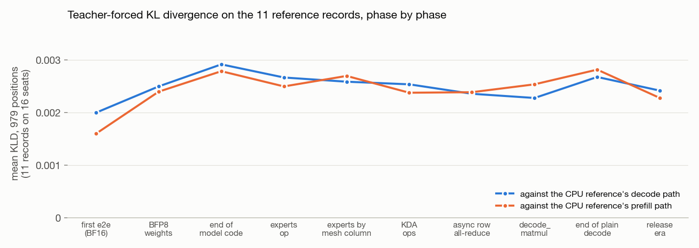

*KLD against the CPU reference's decode path (blue) and prefill path (orange). BFP8 weights raised it from 0.0020 to
0.0025; nothing after that moved it outside 0.0022-0.0030 (the last point is after KDA's state moved to bf16).*

### 2.5 A fast cycle

- Device kernels are compiled at first use from the source tree, so kernel-only changes need no build; a C++ op change
  needs an incremental build (about 26 s for one op file) plus an install. Kernel-only first.
- New ops are tested alone against torch (and timed in a trace) before they enter the model.
- Every new form sits behind a switch, with the old form kept until the new one is the default, so a comparison never
  needs a rebuild and a regression can be bisected by switches.
- Compile each changed kernel for every compile-time variant offline before a device run: a kernel that compiles for
  one op can fail for another op that shares it (for example a division by a compile-time zero in an unused branch,
  which `-Werror` rejects).
- Never edit the source tree a device job reads while it runs: kernels are compiled from it at first use, and a job
  then mixes new kernels with old host code.

## 3. Decode, phase by phase

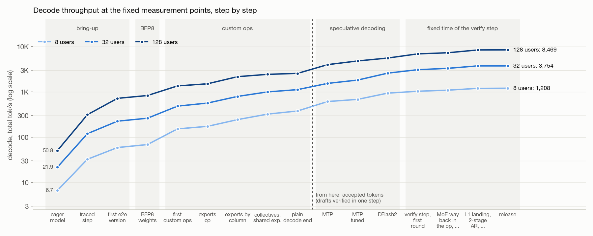

*Total decode tok/s at 8 / 32 / 128 users after each step of the work (log scale). Left of the dashed line one token a
step; right of it accepted tokens a step (MTP, then DFlash2). The eager and traced points used the real BF16 weights,
the first end-to-end and BFP8 points random weights, all with a dense MoE (timing independent of routing); from "first
custom ops" on, the real weights with random tokens. The table below lists the main points; the later labels name the
largest of several changes between two milestone measurements.*

| Phase | 8 / 32 / 128 users | What changed |
|---|---|---|
| Eager whole model (BF16) | 6.7 / 21.9 / 50.8 tok/s | Every op dispatched from the host |
| Traced step | 32.7 / 119.9 / 314.7 | Inputs at fixed addresses, states updated in place, greedy choice on the device |
| First end-to-end version | 59.3 / 226.3 / 722.2 | Model code reworked: MoE, KDA and mHC regrouped |
| BFP8 weights | 69 / 263 / 833 | Weight format (and, at 128 users, two small decode changes) |
| First custom ops (real weights from here) | 153 / 486 / 1,357 | KDA, mHC, routing ops (and the model-code work before them) |
| Experts op | 174 / 568 / 1,512 | A custom op for the decode MoE |
| Experts by mesh column | 245 / 796 / 2,171 | Expert placement; Sinkhorn on the SFPU, KDA and mHC kernel fixes, an mHC read + norm op, DSA matmul configs |
| End of the one-token decode work | 380 / 1,124 / 2,565 | Collectives, decode_matmul, LM head, more |
| MTP, one draft | 614 / 1,543 / 4,001 | The model's MTP layer as the drafter, a verify step |
| DFlash2 | 941 / 2,596 / 5,593 | On-device block drafter, K = 7 (K = 3 at 128 users) |
| Release | 1,208 / 3,754 / 8,469 | Fixed time of the verify step |

### 3.1 Eager: the host is the bottleneck

The first device step took 1.19 s at 8 users and 3.76 s at 256. A 32-fold increase in users only tripled the step,
and synchronizing after every module changed nothing (1.33 against 1.31 s): the device was waiting for the host. The
step had about 260 ops a layer (140 of them mHC's stream mixing) and about 11,000 in all, about 110 µs each. Weights
halved (experts in BFP8) left the speed unchanged (0.96-0.99x). The LM head and reading all vocabulary logits back to
the host took another 15 %.

### 3.2 Traced step: 4.9-6.6x

The decode step was captured once and replayed: inputs (tokens, positions) at fixed device addresses written each
step, KDA's states and DSA's cache updated in place, and the greedy choice made on the device so only ids leave it.
The trace replayed bit for bit like eager. The step went from 1.191 to 0.245 s at 8 users and from 3.757 to 0.565 s at
256. In the trace, the gaps between programs were about 0.5 µs, so the step became the sum of kernel times: 1,871
programs for 5 layers and the head, 1,378 of them under 10 µs.

### 3.3 Reworking the model code

With the profile in hand, the model code (still stock ttnn ops) was reworked where it was plainly wasteful: the dense
MoE computed every token through each chip's 9 experts (36 times the useful work at 256 users), mHC's mixing used
about 140 small ops a layer, KDA's state matmuls used 4 cores. Gate and up became one matmul over the 9 experts, the
routing weights were applied before down, and down summed the 9 experts inside one matmul's fp32 accumulation (the
MoE alone −28 ms a step at 8 users, −146 ms at 256); KDA's six input projections became one matmul and its state
matmuls ran on all cores with an explicit config, updating the state in place; mHC was regrouped (8 tokens a tile), and
the head's top-k was simplified. The first end-to-end version decoded in 135 ms at 8 users.

### 3.4 BFP8 weights and the last model-code changes

BFP8 weights cut the step by 14 % at 8 users and by 1 % at 512, where the dense MoE's compute decided the time. KLD went
from 0.0020 to 0.0025. The remaining model-code changes: a sparse MoE for decode up to 128 users (−6.5 to −14 %) and, a
few percent each, norms spread over 16 cores (ttnn's default ran a decode RMSNorm on one core, 58 µs), the router matmul
with a hand-picked program config (3-5 times faster than the default), one matmul config rule for decode weights
(`decode_linear`: the defaults were up to 3 times slower), and DSA's cache kept as the 512-wide latent instead of
per-head K and V (1/16 of the bytes; at a 2,048-token context the step for 256 users went from 179 to 153 ms and 512 and
1,024 users fit). At this point the model-code layer was saturated: the remaining waste (1-core Sinkhorn, KDA's many
element-wise ops, the sparse MoE's packing and zero fills) could only be removed inside ops.

### 3.5 Custom ops

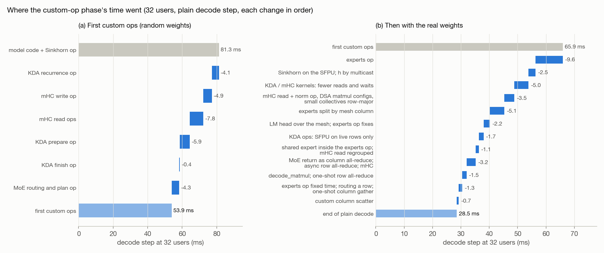

*The one-token decode step at 32 users after each change, in the order they landed; each bar is the difference between
two successive measurements (separate runs, which vary by about 1 ms). (a) The first custom ops, measured with the
random weights whose routing was later found biased (the deltas of non-MoE ops are valid). (b) The rest, with the real
weights; some bars hold several changes. In (b) the largest single steps were the experts op and the expert placement
by mesh column.*

The first seven ops replaced chains of stock ops: Sinkhorn's normalization inside the destination registers, KDA's
recurrence (state read and written once), mHC's write, mHC's read, KDA's prepare and finish, and MoE routing with its
plan. The six after Sinkhorn took 29-34 % off the step at 8 / 32 / 128 users. Then came the experts op
([4.1](#41-custom-ops-for-kda-mhc-and-the-moe-experts)), the placement by mesh column
([4.2](#42-expert-placement-by-mesh-column)), the LM head over the mesh ([4.6](#46-lm-head-acceptance-and-the-host)),
custom collectives ([4.4](#44-collectives)) and `decode_matmul` ([4.5](#45-decode_matmul-and-weight-matmuls)).

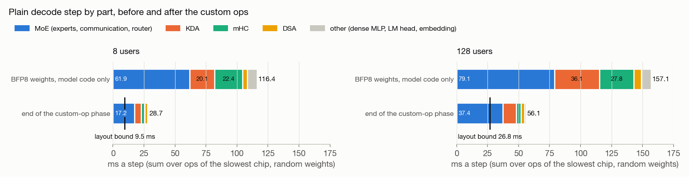

*Kernel time a step by part (sum over ops of the slowest chip, random weights), with the BFP8 weights before the last
model-code changes and any custom op, and at the end of the custom-op phase; the black tick is the layout bound. mHC
went from 22-28 ms to 2.6-4.0 ms, KDA from 20-36 ms to 5.7-10.6 ms; MoE is the largest remaining part.*

### 3.6 Speculative decoding

With one token a step, 128 users took 50 ms for 128 tokens, much of it fixed time independent of the batch. Verifying
several tokens a user in one step amortizes that fixed time. Two drafters were brought up in turn
(section [4.7](#47-speculative-decoding-from-mtp-to-dflash2)):

- **MTP** (the model's own 46th layer, one draft): 1.884 tokens a step on real text; +51 / +29 / +44 % over the
  one-token step at 8 / 32 / 128 users.
- **DFlash2** (an 8-layer block drafter run on the device, 7 or 3 drafts): 4.18 tokens a step at K = 7 and 3.12 at
  K = 3; +37 / +36 / +7 % over MTP at the first measurement, +49 / +60 / +28 % after the first round of verify-step
  work.

### 3.7 Fixed time of the verify step

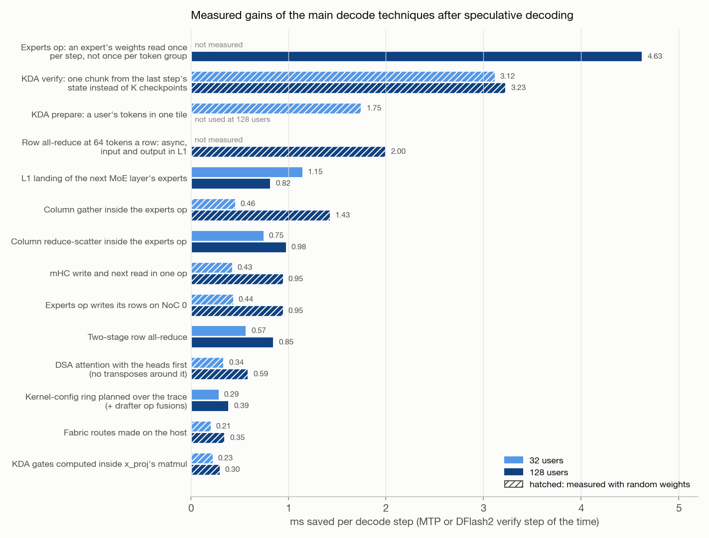

*Milliseconds saved a step by each technique, measured when it landed (on the MTP or DFlash2 verify step of the time)
at 32 and 128 users; hatched bars were measured with random weights. The largest came from not reading an expert's
weights twice and from KDA's verify forms. The landing at 128 users is shown alone (2.1 ms with a deeper read ring).*

The verify step has K + 1 tokens a user: 32 tokens a mesh row at 32 users (K = 7) and 64 at 128 users (K = 3). Its
time is mostly the experts op (reading the chosen experts' weights) plus fixed costs that do not shrink with the
batch: collectives that wait for the slowest chip, KDA's recurrence, mHC's chain of small steps, small DSA ops and the
drafter. Each was taken in turn; the step just before the release looked like this:

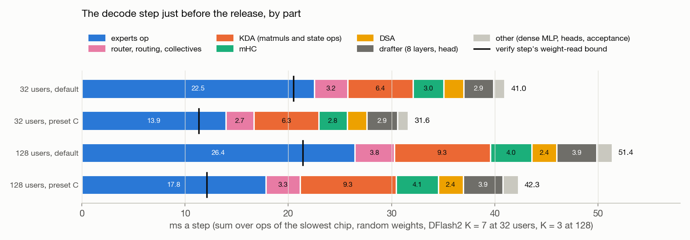

*Kernel time of one DFlash2 step by part at 32 and 128 users, default and preset C (random weights; the black tick is
the verify step's weight-read bound, which excludes the drafter). The experts op is 51-55 % of the default step;
everything else is nearly the same in the default and preset C (17.7-18.5 ms at 32 users, 24.5-24.9 ms at 128).*

Measured with the real weights, the default step reaches 58 % of its weight-read bound at 32 users and 45 % at 128.
The remaining distance is not in any single op: the experts op reads at 97 % of the read ceiling seen by its access
pattern, and the dense weight matmuls (x_proj, o_proj) are within a few percent of the DRAM time (KDA's x_proj: 62.5
µs for 28 MB). What remains is the structure: about 690 programs run one after another, each starting, reading its
inputs from DRAM and handing its outputs over, and every collective waiting for the slowest chip. A further step of the
same size needs a different structure (keeping data in L1 across several ops, streaming weights during the attention
part), not faster ops.

## 4. Decode techniques

### 4.1 Custom ops for KDA, mHC and the MoE experts

All are in `ttnn/cpp/ttnn/operations/experimental/` or run as `ttnn.generic_op` with kernels in the model directory
(the list is in [DESIGN.md](DESIGN.md#2-code-layout)).

- **KDA**: three ops for decode (prepare: convolution, SiLU, norms, decay and beta; the recurrence: the state read once,
  updated in fp32 in the destination registers, written once in bf16; finish: the gated norm), outputs handed over in
  L1. Two details mattered: computing the SFPU stages only on the rows that hold tokens, and, in the verify step,
  packing one user's T tokens into one tile (prepare at T = 8, one user a row: 157.5 to 110.7 µs; the 8 / 32-user step
  −4.1 / −3.5 %). Keeping KDA's state in bf16 instead of fp32 halved its traffic, and the KLD did not get worse (0.00242
  / 0.00228 against 0.00268 / 0.00282).
- **mHC**: the read as one op (projection to the 24 mixing coefficients and their RMS, all 20 Sinkhorn iterations on
  the SFPU, the block input and its norm), and the write fused with the next block's read in one program (the write's
  cores send the new streams to the read's cores in L1). The first version of that fusion was slower than two ops
  (76-84 against 48-65 µs: the read's 8 slice cores then computed serially); the version that worked split the work
  differently and saved 0.43 / 0.95 ms a verify step at 32 / 128 users (random weights).
- **MoE routing**: sigmoid, bias, top 8, normalization and the expert plan in one op, later in the same program as the
  router matmul; each mesh row routes only its own tokens.
- **The experts op** (`moe_decode_experts`): each chip streams its slice of each chosen expert from DRAM once a step,
  whatever its token count, and computes gate, up, the clipped SwiGLU and down on two groups of cores. Its development
  (figure below) is the clearest example of where decode time goes on this hardware:
  - Reading weights on NoC 1 was half the speed of NoC 0 for this pattern.
  - A multicast of h from 64 gate/up cores to the same rectangle of down cores serialized on route reservation; one
    unicast write per core (with the down cores placed next to the gate/up cores) removed the wait (132 to 82 µs). The
    compute was not the limit: without it the time was the same.
  - Placing each core's weights in one DRAM bank (an ND-sharded layout made at load) gave 74 µs; reading alone took 65
    µs (411 GB/s).
  - A deeper read pipeline was slower (4, 8, 12 blocks in flight: 75, 81, 87 µs; most likely more contention at the
    banks), and smaller read requests were slower too (a core can issue a read request only about every 70 ns). In
    `decode_matmul`, fewer reads in flight per core (2 instead of 6) made the op faster: deep read-ahead made the cores
    less even, and the slowest core decides the op.
  - Later the op took over the work around it: the column's gather of tokens, the column's reduce-scatter (the way back
    to the row), the shared expert as a 73rd expert of one column, and reading each expert's weights once per step even
    when its tokens fall into several 32-token groups. That last change alone saved 4.6 ms a step at 128 users (K = 3,
    real weights).

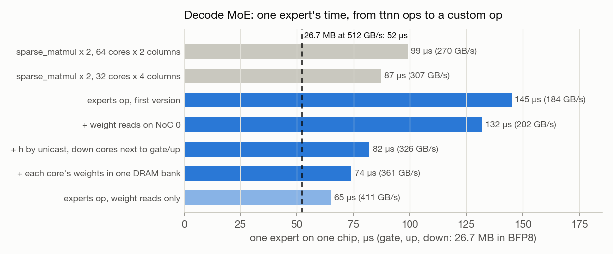

*One expert (26.7 MB in BFP8) on one chip in the decode MoE, when whole experts sat on a chip. The first custom version
was slower than two `sparse_matmul` calls; reading on NoC 0, sending the intermediate h by unicast instead of multicast,
and placing each core's weights in one DRAM bank brought it to 74 µs (361 GB/s) against a 52 µs bound.*

### 4.2 Expert placement by mesh column

The first placement spread whole experts over the 32 chips (9 a chip). Each step then waited for the chip whose experts
were chosen most, and every MoE layer gathered all rows' tokens to all 32 chips and sent the sums back. The release
splits experts by mesh column:
column c holds experts 72c .. 72c + 71, and each of its 8 chips holds a 256-wide slice of every one of them, so the 8
chips of a column always share the work evenly ([placement](DESIGN.md#3-placement-on-the-8x4-mesh)). With the real
weights this saved 5.0 / 5.1 / 7.4 ms a step at 8 / 32 / 128 users (more than the 4.4 / 2.3 / 2.2 ms seen with random
weights, because real routing is more uneven) for 32 s more load time and the same memory.

An intermediate form, slicing every expert over all 32 chips, also beat whole experts at 8 and 32 users (−5.6 / −7.2 ms)
but was 17.8 ms slower at 128 users, where more than one tile row of tokens a column fell back to the dense path; the
column form beats whole experts at every point. The remaining imbalance is between the 4 columns: at 8
users the busiest column chooses about 18 experts against 14.5 on average (uniform routing), and the experts op's
time is close to "experts in the busiest column x bytes / bandwidth + a fixed 20 µs".

### 4.3 The L1 landing of the next layer's experts

In the last 70-95 µs of each MoE layer's experts op the DRAM is nearly idle: the op is waiting for the hand-off of h,
the column's way back and the ring. In that window the DRAM cores' own RISCs copy the gate | up blocks of the experts
the next MoE layer is most likely to read (a per-layer table of each column's most chosen experts, measured on real
text) into an L1 landing area on the compute cores; the next experts op reads those blocks from L1 and the rest from
DRAM. Each block is framed by seals naming its layer and expert, so a stale or half-written block is read from DRAM
again and the values never change ([details](DESIGN.md#42-per-layer)).

- Copying up to 12 MB in that window did not lengthen the op that runs beside it.
- Against no landing, it saves 0.8-1.0 / 1.2-1.4 ms a step at 8 / 32 users with 12 experts a column, and 0.8 ms at 128
  users with 5 (2.1 ms together with a deeper gate | up read ring), real weights.
- The size is limited by L1: the landing is allocated once at load and stays, so every program's circular buffers,
  including the prefill's, must fit below it. A first attempt with 12 slots at 8 / 32 users collided with the prefill's
  mHC buffers, and the generator's warm-up stopped with an allocation error (found in a serving-flow test; the speed
  stress runs have no prefill); the size was cut to 5 until the prefill's buffers were rearranged.

### 4.4 Collectives

The model runs about 90 row all-reduces and 42 MoE gathers and returns a step. Small messages and many calls made the
stock collectives' fixed costs dominant, so most were replaced:

- **One-shot row all-reduce** for up to 4 tokens a row (plain decode) (each chip writes its part straight into the
  others' landing buffers over the fabric): 20.5 to 9.1 µs a call, −1.3 / −1.1 ms at 8 / 32 users. Its landing buffers
  live in DRAM with only the semaphores in L1, so they do not compete with the prefill's buffers.
- **`all_reduce_async`** with input and output in L1 (the previous matmul writes its output straight into the
  collective's input shards, the next op reads the output from L1) for 8-16 tokens a row, sending only the rows that
  hold tokens; its multicast directions alternated per output core so that the busiest link carries 1.5 chips' share
  instead of 2, and its fabric routes made on the host.
- **Two-stage row all-reduce** for 17-64 tokens a row (`row_ar2.py`): a one-shot reduce-scatter to the chip that owns
  each part, then a multicast all-gather of the sums, each owner sending as soon as its sum is ready. The busiest link
  carries 0.44 of a chip's share instead of 0.75: 26.3 to 17.3 µs at 64 tokens, −0.57 / −0.85 ms a step at 32 / 128
  users.
- **The MoE way back**: first a one-shot column scatter fused with the row all-reduce (one op), then the column's
  reduce-scatter inside the experts op itself, its rows written on NoC 0. That second step took the way back at 32 / 128
  users from 5.0 / 6.7 to 2.0 / 3.3 ms a verify step (sum of each op's slowest chip, random weights), for 0.5 / 1.3 ms
  more in the experts op. At 8 users the way back mostly waits for the busiest column's experts op, and
  moving it into the op would not remove that wait.

### 4.5 `decode_matmul` and weight matmuls

The large decode matmuls (KDA's x_proj and o_proj, DSA's projections) read megabytes of weights for one or two tile rows
of tokens. Stock program configs were up to 3 times slower than a hand-picked 1D config (the shared expert's gate | up:
65.0 to 20.8 µs; KDA's x_proj: 101.6 to 84.8 µs). `decode_matmul` goes further: each core reads its weight columns as
one DRAM bank's run, the activations are multicast to it, and once that multicast has finished the cores read on both
NoCs. KDA's x_proj then took 72-75 µs; later, without the gate projections fused into it, 62.5 µs against 62.0 µs for
reading its 28 MB alone. With the weights already in L1 it would take 17 µs, which is why moving
dense weights into L1 during idle DRAM time is the next candidate here. The first version read on both NoCs from the
start and hung after about 6,000 steps (see [10.2](#102-noc-rules-on-blackhole)).

### 4.6 LM head, acceptance and the host

- The LM head splits the vocabulary over all 32 chips (4,840 tokens a chip); each chip's best candidates are gathered
  and the choice is made on the device. Reading the ids back from one chip instead of all 32 was most of the gain
  (1.8-2.1 to 0.7-0.9 ms; the step −1.7 / −1.9 / −1.5 ms at 8 / 32 / 128 users).
- The host writes a step's inputs in one packed write and reads one small result back; in serving the next step's
  inputs are made on the device and the host's write is skipped when they are unchanged (with the adapter's input
  assembly vectorized, −1.8 to −2.0 ms of host time a step).
- With DFlash2, acceptance with the drafter's inputs, and the step's results row, are two small one-core ops, and the
  whole step
  (verify, acceptance, the drafter's context write and next block) is one trace.

### 4.7 Speculative decoding: from MTP to DFlash2

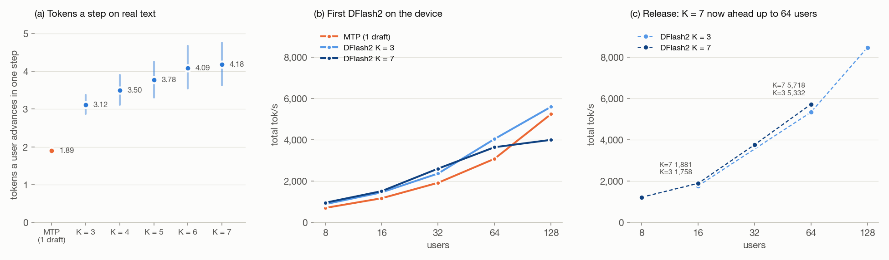

*(a) Tokens a user advances in one step on the 11 reference records, with 95 % intervals (CPU reference). (b) Total
tok/s at the first DFlash2 measurement on the device (real-weight step times x the tokens a step of (a)): K = 7 is
best up to 32 users, K = 3 from 64.
(c) The release ([PERF.md](../PERF.md#decode)): K = 7 is now ahead at 64 users too (K = 3 was measured at 16, 64 and
128 users only).*

- **The verify step** runs K + 1 tokens a user through the whole model as extra virtual users. KDA cannot simply
  "undo" rejected tokens; the first form kept K checkpoints of the state. The faster form keeps the state at the start
  of the last step plus the K + 1 token rows, and the next step first redoes the accepted tokens in one chunk, so a
  rejected draft never enters the state (−0.9 / −3.1 / −3.2 ms at 8 / 32 / 128 users, random weights); a later change
  writes the state only once a step. DSA's rejected positions are written over before anything reads them, with one
  exception that became a bug: the indexer's page of recent keys for long caches (rows at the position mod 4), where a
  rejected draft could overwrite a kept token's row before its pool was built; it is now a ring of 16 rows (4 pools).
- **MTP** with one draft accepted 0.884 of drafts on real text (1.884 tokens a step). Two drafts gave 2.56 tokens but
  a longer step: only +5 % at 8 / 32 users, and slower at 128, where 48 tokens a row took a slow path.
- **DFlash2** proposes a block of K tokens from the last accepted token, conditioned on the mean of mHC's streams after
  9 of the model's layers. It runs on the device with the model's mesh layout (rows of users, 4-chip tensor parallel),
  shares the LM head and embedding, and attends to its last 4,096 positions only. Its 8 layers and its head take 2.9 /
  3.9 ms of the step at 32 / 128 users (random weights).
- **Choosing K.** A row's token count must stay on multiples of 32 (one tile row): K = 4-6 never won anywhere. K = 7
  (32 tokens a row at 32 users) won up to 32 users and K = 3 from 64 at first. As the verify step got faster, K = 7
  pulled ahead at 64 users too (5,718 against 5,332 tok/s); the server still uses K = 3 above 32 seats because, in
  serving, K = 7 led only while all seats were busy ([PERF.md](../PERF.md#decode)). 128 users at K = 7 would need the
  step under 76-82 ms; it was 100.2 ms, and 93.6 ms with every change tried for that shape (random weights).
- **Relaxed acceptance** (accept a draft within a logit gap of the top, off by default, `GLM53_ACCEPT_RELAX`): +8.9 %
  tokens a step at a gap of 1 nat with GSM8K unchanged (1,265 of 1,319, as greedy), but HumanEval went down (155
  greedy, 158 with exact acceptance; 153 / 152 / 150 at gaps of 1 / 2 / 3, significant only at 3), mostly through
  drafts accepted early in the reasoning. It stays a switch.

## 5. Prefill

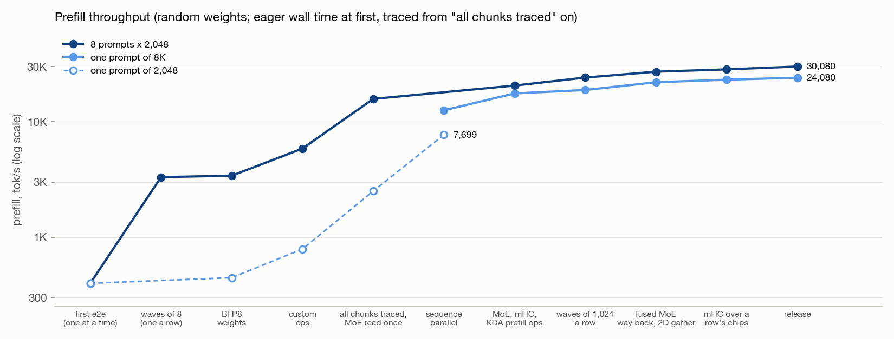

*Prefill tok/s, random weights throughout (BF16 before the BFP8 point); eager wall time up to the custom-ops point,
traced from "all chunks traced" on, and the time until the device finishes in the last points. Dark: 8 prompts of 2,048
tokens. Light: one long prompt, 2,048 tokens (hollow, up to the first sequence-parallel point) and 8K (filled). The big
steps were waves of 8 requests, tracing every chunk with the MoE weights read once a chunk, and splitting one prompt
over the 8 rows.*

The first version prefilled one request at a time, eagerly, while the other 7 mesh rows waited. In order:

1. **Waves of 8 requests**, one a mesh row, each into its own seat (KDA carries a per-row wave state, DSA writes each
   chunk into the user's cache), with the chunk length chosen per prompt (128 or 512) and single-chunk waves traced:
   8 x 2,048 from 398 to 3,309 tok/s; served throughput at 64 concurrent requests from 137 to 337 tok/s.
2. **Traces for every chunk form**, captured at warm-up with the start position as an input, and **the MoE as an op
   that reads each chosen expert's weights once a chunk** (dense matmuls over all tokens had been the limit), with
   padding tokens masked out of routing, mHC in a grouped form and the logits read back from one chip a row (that
   readback had been a fixed 0.15 s a wave): 8 x 2,048 from 5,852 to 15,751 tok/s.
3. **Sequence parallel prefill**: a long prompt is split into segments over the 8 rows. KDA turns each segment into an
   affine map of the incoming state and chains the maps over the rows; DSA gathers the segments' latents and each row
   attends with its own queries ([details](DESIGN.md#5-prefill)). One prompt of 2,048 tokens went from 2,502 to 7,699
   tok/s, one of 8K from 2,174 to 12,552.
4. **Waves of 1,024 tokens a row** (two 512-token waves as one) and many fused ops for the MoE's way there and back,
   mHC and KDA.

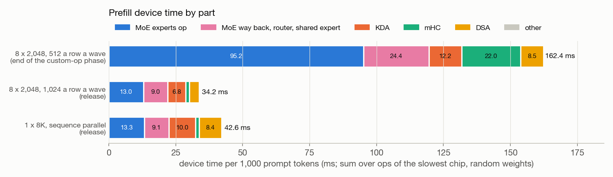

*Device time per 1,000 prompt tokens, by part (random weights). Experts went from 95 to 13 ms per 1,000 tokens, mHC from
22 to 1.3. The first row is scaled from a profile of 5 layers. One prompt of 8K costs more than 8 x 2,048 per token
because its KDA chain and DSA's sparse path add work.*

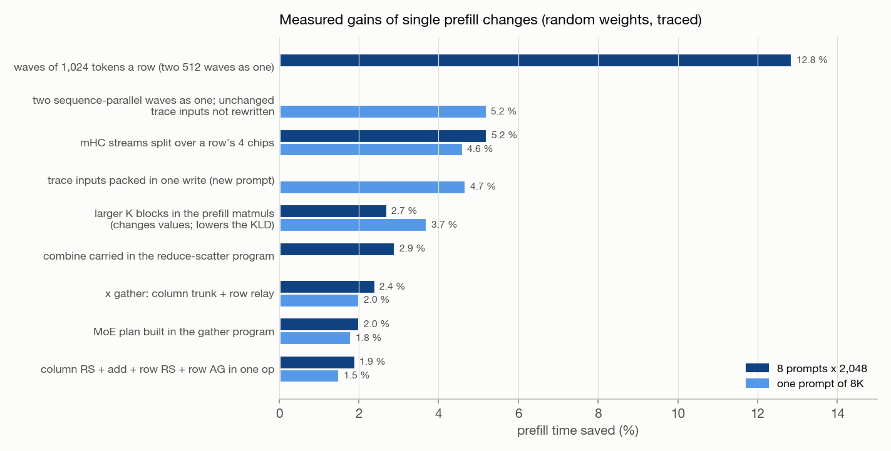

*Prefill time saved by single changes from the waves of 1,024 tokens on, each measured alone (random weights, traced;
the input packing as wall time for a new prompt). All keep the values except the larger K blocks, which change the
summation and lowered the wikitext KLD (0.0194 to 0.0131).*

Notes on what mattered:

- **The MoE way back as one op** (`col_row_reduce_scatter`): the column's reduce-scatter batch by batch, the shared
  expert's add and the row's reduce-scatter and all-gather behind it, then the combine carried in the same program so
  each batch's reduce-scatter starts as soon as its combine is written. The stock ring reduce-scatter finished most of
  its output only in its last steps, so nothing could overlap it.
- **The column gather in two dimensions**: half of each token travels down the column and relay cores pass it along
  the row, so both link directions carry it (514 against 706 µs for 1,024 tokens). A two-dimensional multicast tried
  first did not help: routers on the trunk with three exits ran the trunk at half speed. Relays sending to two routers
  from one RISC also ran slower (about 11 GB/s a link against 17-18); one RISC per router fixed it.
- **mHC split over a row's 4 chips**: from 512 tokens a row each chip keeps the streams of a quarter of the tokens, so
  a block's output is reduce-scattered and exchanged all-to-all instead of all-reduced (−5.2 / −4.6 %).
- **Host-side cost**: once the device time fell, the host's writes showed: packing a wave's trace inputs into one
  write was worth about 5 % for one new long prompt.
- The release's prefill reaches 16-19 % of its compute bound (HiFi4 matmuls, BFP8 weights). The rest is the experts
  op, the MoE's way back, KDA's chain and DSA's sparse path, and op overheads.

## 6. Long contexts

The first version had no indexer: DSA was computed as dense attention, exact up to 2,051 tokens (the indexer keeps
512 pools of 4 tokens plus the tail), and longer contexts did not run at all. Its cache held per-head K and V (176 KiB a
token a chip over the 11 layers), so 256 users did not fit even at 2,048 tokens.

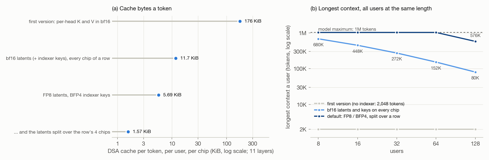

*(a) DSA cache per token, per user, per chip over the 11 layers, in each form (log scale). (b) The longest context
every user can hold at once (checked on the device), against the number of users: bf16 latents and keys on every chip
of a row, and the default form; 1M is the model's maximum. Gray: the first version's limit of 2,048 tokens.*

Steps:

1. **Latent cache** (the 512-wide latent, absorbed MLA attention; the model has no RoPE): 1/16 of the bytes.
2. **The indexer** on the device: the pooled keys updated in place, the pool scores of a step's queries in one op
   (four queries of a user at a time), the top 512 pools (long rows sorted on helper cores and merged), their tokens
   and the tail, and the sparse attention with each query's tokens split over several cores. Passkey retrieval
   passed 8 / 8 at 8K and 32K. The first form made a step at an 8K cache 4.5-6.8 ms longer than the dense form at a
   1,900-token cache; splitting each query's sparse attention over cores and lighter indexer preprocessing took
   2.4-2.9 ms off a plain step and 2.6-3.8 ms off a verify step. Later, at 1M tokens, scoring four queries at a time
   saved 0.4 / 1.4 / 2.5 ms a step at 8 / 32 / 64 users and splitting the top-k sort over helper cores another
   1.9 / 1.4 ms at 8 / 32 (all random weights).
3. **FP8 latents and BFP4 pooled keys** for caches past 2,051 tokens. KLD at 32K against the bf16 cache: 0.0195 and
   0.0147 alone, 0.0196 together, where reordering sums alone gives 0.0073.
4. **The cache split by position over a row's 4 chips** from 8,192 tokens, with the indexer's scoring split the same
   way: each chip attends over its share of a query's tokens with all heads and the partial results are combined.
   About 1.6 KiB a token a user a chip (the keys are not split) against 5.7 KiB unsplit and 11.7 KiB for a bf16 cache
   on every chip; the step at 1M for 8 users went from 58.6 to 47.1 ms (random weights); KLD at 32K 0.0095 for the
   split alone (against the 0.0073 floor) and 0.025 for the whole long-context form. The split form had a bug only real
   weights showed: at positions 0-2 a chip can hold no key, and its reader took the empty slot for a key.

Together these let 64 users hold 1M tokens each. Task scores with this form match those with the bf16 cache within the
seed-to-seed variation ([PERF.md](../PERF.md#quality)).

## 7. Serving

The model is served through the vLLM TT plugin with an adapter (`tools/glm53_vllm.py`) that maps vLLM's seats to the
generator's seats, keeps every seat's state itself and hands the drafter's drafts to the plugin's model-owned drafter
interface ([serving](DESIGN.md#7-serving)).

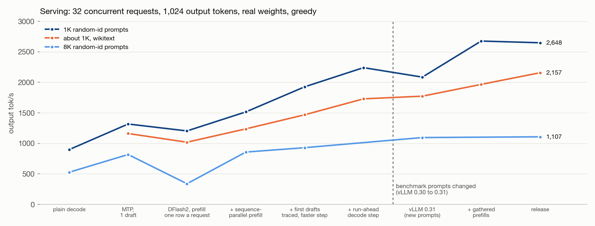

*Served output tok/s at 32 concurrent requests, 1,024 output tokens, real weights, greedy. DFlash2 first lost to MTP
because its prefill used one row a request; it won once its prefill was split over the rows. The benchmark's random
prompts changed with the vLLM upgrade (dashed line).*

**Where served throughput goes.** Splitting the serving run's wall clock factor by factor showed why it was about half
of the decode-only number, and which factor to attack next:

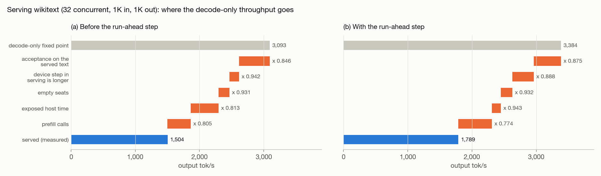

*From the decode-only fixed point (random tokens) to the measured served throughput, one factor at a time (the product
is within 0.1 % of the measurement). Before the run-ahead step, exposed host time cost 19 %; with it, 6 %. Prefill
calls (decode stops while a prefill runs) cost 20-23 % in both.*

The serving features, in order of their gain:

- **Sequence-parallel prefill with DFlash2**: DFlash2 serving first prefilled one request a row; with the prefill split
  over the rows, each row also writes its segment's drafter context and the request's row gathers it. DFlash2's prefill
  time per run fell from 113 to 69 s; +21-26 % served at 1K inputs, 2.5x at 8K.
- **The run-ahead decode step**: the next step is launched on the inputs the device made while vLLM does its host work,
  including steps where requests end and right after prefills. When a prefill or a changed request makes it wrong, a
  second set of KDA verify states (ping-pong, +459 MiB a chip at 32 seats) lets it be thrown away. +13-19 %.
- **Gathered prefills**: new requests wait up to 1.5 s so that up to 4 are prefilled in one call (each prefill call
  stops every decoding user for its duration). +8-10 %, measured on top of running ahead at request ends and after
  prefills. A first version that waited 200 ms gave only +2 %: requests rarely arrived within the window. Waiting has a
  cost: at 32 concurrent requests the median time to first token went from 0.23 to 0.94 s (1K random ids; 1.07 s on
  wikitext), and at 4 concurrent requests most new requests waited the full 1.5 s, because 4 could never
  gather (and an 8K prompt fills a prefill step alone). An adaptive stop fixed that: stop waiting once the waiting
  requests fill one prefill step, or once their summed wait reaches what one more prefill call would cost the
  decoding requests (a rent-or-buy rule).
- **Chunked prefill**: a long prompt goes in 8,192-token steps between decode steps. On the release, the longest
  stall of 24 decoding requests while 30K-token prompts arrived fell from 1.52 to 0.46 s, for about 1 % less
  throughput of those requests ([README.md](../README.md#vllm-serving)).
- **The prefix store**: after a prefill that ends on a multiple of 8,192 tokens, the request's whole state (KDA's wave
  state and convolution history, DSA's latents and keys, the drafter's K / V) is copied into a DRAM entry (0.12 GiB a
  chip at a 36,864-token context); a later request with the same start is restored bit for bit and prefilled from
  there. On 8 conversations of 4 turns of about 30K tokens, later turns' median time to first token fell from 4.2-5.7 s
  to 0.55-0.98 s and throughput rose from 62.9 to 132.8 tok/s.

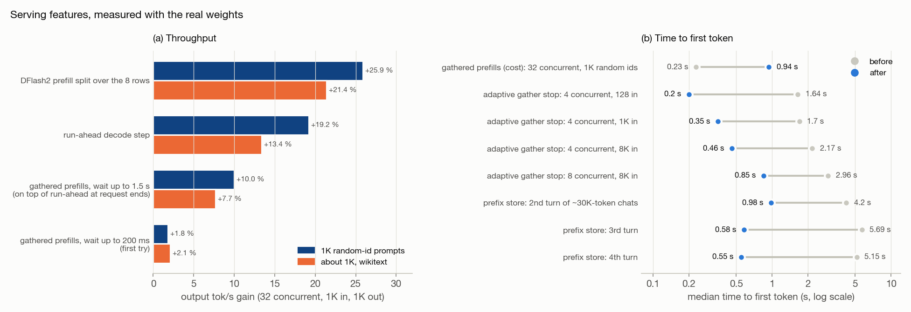

*(a) Served throughput gain of each feature (32 concurrent, 1K in / 1K out; the prefill split compared across code
versions, the others A/B on one tree). (b) Median time to first
token before and after: gathering prefills costs latency at high concurrency; the adaptive stop removes the cost at
low concurrency; the prefix store makes later turns of long conversations fast.*

Serving brought its own bugs, none of which a decode-only test can show. They were found by replaying the plugin's
call order without vLLM, in a serving run's log, or by model-checking the adapter's host-side protocol: a warm-up order
that left reused seats' prefill broken (MTP's acceptance fell to 1 % on 8K prompts), a chunked prompt's later chunks
arriving on a different seat than its first, and idle seats left at stale positions before steps no request could
follow (a speed loss only: every step run ahead was thrown away).

## 8. Start-up and the fast presets

**Start-up.** Loading the real weights is host-bound (reading, transposing and slicing the experts, packing BFP8 tiles),
not disk- or PCIe-bound. Each change below kept the device bytes identical:

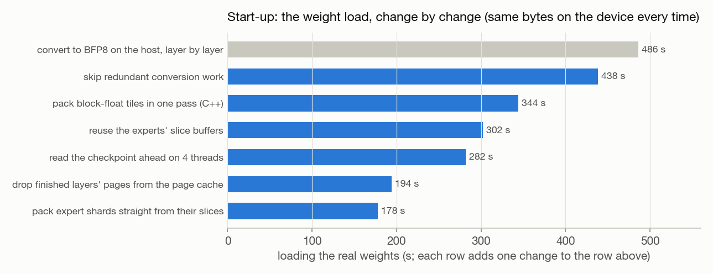

*Loading the real weights, each row adding one change to the row above: 486 to 178 s. Dropping each finished layer's
checkpoint pages from the page cache (on its own thread) was worth 87 s: the 642 GB checkpoint is read once, and
without it every page read ahead had to be reclaimed from the cache first.*

The warm-up (one eager run of each prefill form, then the trace captures) is host-bound too: about 5 s per captured
prefill form, 40 forms at a 33,792-token context. Skipping the eager pre-run of the forms the warm-up had already
compiled took that warm-up from 347 to 282 s, and lighter host-side trace population took a 4K warm-up from 113 to 88
s. With the load changes up to the read-ahead and the warm-up changes, the server at a 33,792-token context became
ready in 557 s instead of 979 s (the last two load changes came after that measurement).

**Fast presets.** A decode step spends most of its time reading the experts' weights, so the presets read fewer bytes
where it matters least: each expert as a BFP4 base plus a BFP4 correction, the correction read only for the experts
with the largest routing-weight sums in the step, up to a budget F times the busiest column's BFP8 bytes in every
column ([how it works](../README.md#fast-presets-the-progressive-form-and-f),
[the exact rule](DESIGN.md#91-the-fast-presets-progressive-form), [measurements](../PERF.md#fast-presets)).

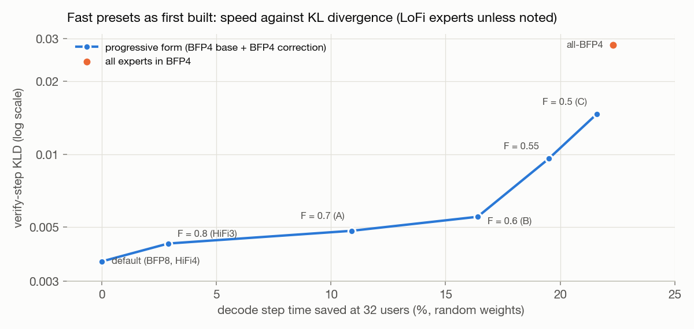

*Step time saved at 32 users (random weights) against the verify step's KLD (real weights), measured when the
progressive form was first built; the release's presets were tuned further (A / B / C −9.2 / −14.2 / −22.8 %, all-BFP4
−19.6 % at 32 users, [PERF.md](../PERF.md#fast-presets)). At F = 0.7 and 0.6 the progressive form costs about 1/10 of
all-BFP4's KLD per percent of speed (1/5 at F = 0.8, measured with HiFi3); below F = 0.6 the efficiency drops (1/3.6
at 0.55, 1/2.2 at 0.5).*

- All experts in BFP4 shortens the release's step by 17-20 % (random weights) but multiplies the verify step's KLD by
  8 and loses AIME problems. Every static way of choosing which weights stay in BFP8 (per layer, per matrix, per tile
  row, per expert by measured damage or by popularity) degraded nearly in proportion to the bytes rounded to BFP4 (the
  best, by measured damage, saved only 20-30 % of that); choosing per step from the routing weights
  is what broke that proportion.
- Concatenating BFP-tiled tensors along the width with `ttnn.concat` re-rounded about 7 % of BFP8 values (10 % of
  BFP4); the experts' gate | up weights were built that way at first, which made the presets' error floor look like a
  property of the format.
- Only the experts op gets faster: everything else in the step is unchanged, so preset C's step is 16-18 % shorter with
  the real weights (19-23 % more tok/s) while its weight-read bound nearly halves.

## 9. What did not work

Each was tried on the device unless marked as a CPU estimate; "random weights" marks the measurements that used them.
The numbers say why it was dropped.

| Idea | Result | Why |
|---|---|---|
| Sparse MoE in model code for every batch and for prefill (`sparse_matmul`, or sorting and gathering tokens; BF16, random weights) | With `sparse_matmul`: decode 8 / 64 users −20 / −11 %, but 512 users +5 % and prefill 2.2x slower (8 x 512 tokens: 1.33 to 2.92 s) | Fixed shapes need N rows of capacity per expert; packing, zero-filled outputs and unpacking cost what the skipped compute saved. Kept only for decode up to 128 users once BFP8 left room for a second weight layout (−6.5 to −14 %), then replaced by the experts op |
| Prefill MoE sized from the routing counts (read back each layer) | MoE layer at 512 tokens 21.3 to 9.5-13.4 ms, whole prefill slower (1.18 to 1.49 s) | Each read-back synchronizes the host and stops it from dispatching ahead |
| DRAM-sharded decode matmuls | −0.7 ms a step | Needs a second copy of the weights (more than 1 GB a chip) for the prefill |
| KDA prepare and recurrence fused in one op | 159.7 to 177.1 µs at 16 users | The gap between two ops was about 1 µs; the all-core handshake inside one op cost more |
| mHC write and next read fused (first form) | 48-65 to 76-84 µs | The read's 8 slice cores then computed 16 tiles each serially. Measure what a fusion saves (DRAM round trips, handshakes) before building it |
| Experts op reading weights on both NoCs from the start | −1.0 / −2.9 ms at 8 / 32 users (random weights), then hung after about 6,000 steps | A NoC multicast and DRAM reads on the same NoC in one op jam it every few thousand steps |
| Deeper read pipelines, smaller read requests | Experts op 75 to 81 to 87 µs an expert (4, 8, 12 blocks in flight); smaller requests made the decode step slower | Deeper: more reads in flight at one bank, likely more contention (not isolated). Smaller: a core can issue a read request only about every 70 ns |
| Experts sliced over all 32 chips | Against whole experts: 8 / 32 users −5.6 / −7.2 ms, 128 users +17.8 ms (real weights); 139 s more load time | Past one tile row of tokens the op slowed with the hand-off of h between core groups and ran out of L1, so 128 users fell back to the dense path. The column split gains at every point |
| Splitting a column's last partial expert group over more cores | 120 to 131 µs (9 experts) | The op's time follows the number of experts in the column, not the number of groups |
| Router matmul with K split over cores | 47 / 130 µs at 32 / 128 tokens; ttnn's default config 54 / 95 µs, a tuned single config 19 / 21 µs | Two transposes and the sum of the parts; one well-chosen config is faster |
| Expert weights copied into L1 during the attention part (first design) | 44.1 against 44.0 ms (32 users, verify step, random weights) | Ops that read DRAM take about 70 % of the step, and copies beside them slowed them; limited to the quieter ops, the copies still gained nothing (the cause was not isolated). Copying at the end of the experts op (4.3) worked |
| MTP with two drafts | 2.56 tokens a step, but +5 % over one draft at 8 / 32 users; −25 % at 128 (random weights) | The third token a user added 7.1 ms to the 8-user step; at 128 users, 48 tokens a row took a slow path |
| DFlash2 K = 4-6; K = 7 at 128 users | Never best; 128 users at K = 7 100.2 ms, 93.6 ms with every change tried for that shape (random weights), against the 76-82 ms needed | Row token counts off multiples of 32 take slow forms; at 128 tokens a row the MoE, matmuls and collectives leave the decode ops' shapes |
| More drafting tricks (drafter run twice, 15 drafts in one block, copying n-grams from the context, shortening K by confidence) | CPU estimates: a loss, or at most +1.5 % at 1-8 users (15 drafts: +3 % at 16 users only, within the estimate's error) | Checking more tokens a step lengthens it more than the extra drafts gain; where a copy from the context would hit, the drafter already hits |
| A second draft on idle seats | +2.9 % tokens a step on the device (GSM8K, 3 of 4 seats busy), but the host-side seat assignment added 1.4-3.7 ms a step | The serving plugin compares against one draft only, so it was not taken further |
| Dropping low-weight experts beyond a column cap (changes values) | CPU estimate −4.9 % at 32 users; measured −1.0 % on real text | The estimate assumed 7.3 µs an expert where the op adds 3.3-4.6 µs, and its reference texts loaded the busiest column more than GSM8K does |
| Top-7 or top-6 experts instead of 8 | DFlash2 0-5 % faster (one-draft MTP at 8 users 3-7 %) | With many tokens a step nearly every expert is still read; KLD 0.0106 / 0.0285 against 0.0024 (top-6 as high as all-BFP4) |
| Rotations (Hadamard) or channel reordering before BFP4; a shared low-rank basis for the experts (CPU) | Rotations did not lower the KLD (+3 to +26 %, mostly within noise); reordering cut the error by 0.1-1.4 %; a rank-512 residual kept only 52-60 % of the energy | The experts' weights have no outliers to spread and little shared structure |
| The prefill experts op's partial outputs (written between down and combine) in fp8 (CPU) | Squared rounding error 12-14x that of BFP8; KLD +0.0010 against BFP8's +0.0004 | fp8 keeps 3 mantissa bits to BFP8's 7; a BFP8 form is kept as a switch (off by default) |
| DSA top 2,048 tokens cut to 1,024 / 512 on long contexts | Prefill −1.6 / −3.0 % | KLD 0.0175 to 0.0263 / 0.0418 |
| Drafter in BFP4 with LoFi matmuls | Drafter −0.4 ms; +0.7-1.3 % tok/s | The drafter is about a tenth of the step, and its largest matmuls wait for the multicast of x, not for the weights |
| Each mesh row reading the DRAM banks with ports on its row | Read benchmark −4.8 %; in the experts op +10-13 %, and still +3-10 % with the partial sums exchanged over the columns instead | In the op, the reads competed with the row's partial-sum exchange and its other traffic; the benchmark's gain did not carry over |
| A row all-reduce op of our own for prefill (1,024 tokens a row) | 202.5 against 192 µs for ttnn's | ttnn's ring is already at 72 % of the two links' limit; faster only at 128-512 tokens |

## 10. Practices and pitfalls

### 10.1 Hangs and how they were triaged

- **Get call stacks at the hang.** Set `TT_METAL_OPERATION_TIMEOUT_SECONDS` and make
  `TT_METAL_DISPATCH_TIMEOUT_COMMAND_TO_EXECUTE` run tt-metal's `tools/tt-triage.py` (call stacks, semaphores, circular
  buffers, running operations). Most hangs were then read off the dump: cores waiting in a semaphore, a writer stuck in
  a NoC barrier, a circular buffer placed over another one.
- **A tt-metal circular-buffer placement trap**: a circular buffer added for all cores after the per-group buffers of
  merged core ranges was placed over one of them; add the all-core buffers first.
- **Make fabric waits bounded** so a logic error ends the op with wrong values and the sender still closes its fabric
  connection; an unbounded wait left an Ethernet core wedged for the next process.
- **Count hangs before blaming a change.** One hang is not an A/B; run the old form as a control and attribute only
  after several hangs.
- **Close what you open.** A trace capture left open by an exception, or a vLLM engine not shut down, leaves the
  boards' Ethernet cores busy for the next process. `tests/_trace.py` (`traced`) ends a capture on any exception.
- **Kernel profiler zones**: keep them to a few dozen per RISC per program run; overflowing the buffer made the
  post-processing fail at mesh close.

### 10.2 NoC rules on Blackhole

- **Within one op, do not put NoC multicasts and DRAM reads on the same NoC.** Both-NoC weight reads in the experts op
  and in `decode_matmul` passed op tests, model tests and KLD, and then hung, each time in a multicast: the experts op's
  packed form within a minute of a stress run, its one-tile-row form and `decode_matmul` after about 6,000 steps (both
  had passed a 2,000-step stress). Reads on NoC 0 with multicasts on NoC 1 never hung; `decode_matmul` reads on both
  NoCs only after its multicast has finished.
- **Small transfers need matching offsets.** A DRAM read under 64 bytes whose source and L1 destination differ in their
  offset modulo 64 returns wrong data with no error (it showed only at 1 user a row, not 4 / 8 / 16 / 32); a NoC write
  under 16 bytes needs the same offset modulo 16 (a 4-byte semaphore value at the wrong offset hung a fabric op). Put
  each small value at the start of its own 16-byte slot, and test with offsets of both parities.
- **Name the NoC of every kernel and give multicast rectangles in that NoC's corner order.** A reader config defaults
  to NoC 0 on Blackhole; a rectangle given in NoC 1 order never acknowledged.
- **An old kernel in a new NoC configuration is a new kernel**: run it with the watcher first (`TT_METAL_WATCHER=1`;
  with the fabric open also `TT_METAL_WATCHER_DISABLE_ETH=1`, or the device does not open).
- **Wait for atomic acknowledgements at the end of a kernel.** A kernel waiting on an atomic barrier hung every time
  in the model (never in its op test), because an earlier program's kernel on the same core had ended with atomic
  increments still in flight and shifted the barrier's count. A scan of every custom kernel's end then found six
  decode kernels that end without waiting for their acknowledgements (and later a seventh); all now wait.

### 10.3 Trace rules

- **Run every form eagerly once before capturing anything.** Constants and buffers created on first use must exist
  before the first capture: a constant created after a capture was overwritten by the trace's replay. Inside a capture,
  no new allocations, no host writes, no new programs (not even a new zeros tensor).
- **Watch allocations after a capture**: an eager prefill path that built a separate program for each mesh row
  allocated buffers after traces had been captured, which corrupted generation; a check that fails on any allocation
  after the first capture found it.
- **Warm-up order matters in serving**: the server warms up in two passes and reuses seats; replaying exactly the
  plugin's calls (without vLLM) is how its order bugs were found.
- A replay that very rarely differed by up to 5e-4 was a tt-metal all-gather bug (the completion semaphore went only
  along the main route of an even ring); suspect the collectives before the model when replays are not bit-identical.

### 10.4 Long traced stress runs before a default

Every change to NoC traffic, collectives or synchronization ran 2,000 traced steps or more, several times and at several
user counts, before becoming the default (`tests/test_model_device_trace.py` with `GLM53_TRACE_SPEED_STEPS`). Even
that is not proof: a relay race in the fused reduce-scatter never appeared in 2,000-step stresses of 5 forms and showed
only when one core was artificially delayed; model-checking the same protocol found it, and found that the default form
could hit it too, in seconds.

### 10.5 `generic_op` and other ttnn traps

- **`ttnn.generic_op`'s program cache key** covers the kernels, core ranges, compile-time arguments and the
  circular-buffer and semaphore descriptors, and only the number of runtime arguments, not their values or per-core list
  lengths. A second call with a different amount of work per core reused the first call's argument buffers and hung
  every core of all 32 chips. Keep per-core list lengths fixed for a given compile-time configuration, or put what
  changes them into the compile-time arguments.
- **The destination registers keep their contents between programs**: clear before accumulating. And a kernel that
  leaves hardware state behind (a transpose that left the destination's zero flags ignored) made the next program's
  first matmul add to stale values.
- **Circular buffers and formats**: a compute kernel mixing bf16 and fp32 circular buffers produced wrong values (the
  packer's format switch); widen to fp32 in the reader and round in the destination registers instead.
- **`ttnn.pad` and `ttnn.slice` can return the input buffer itself** when the change stays inside a tile; freeing the
  input then frees the result.
- **`ttnn.concat` along the width of BFP tiles re-rounds values** (section [8](#8-start-up-and-the-fast-presets)).

### 10.6 Run-to-run variance in serving

- A request's output depends on its seat (rounding differs between mesh rows' batches), and vLLM's seat assignment
  shifts with prefill timing, so the same run varies by a few percent.
- A closed benchmark's last seconds (1-2 slow requests left) weigh heavily on its total tok/s.
- Compare steady-state, token-weighted numbers from the server's timeline (`GLM53_VLLM_TIMELINE` in the adapter),
  report the benchmark total beside them, and treat differences of a few percent between single runs as noise until
  repeated. In cells with few prompts, throughput moved by −12 to +47 % between two runs of the same code, with the
  drafts' acceptance; compare time to first token there instead.

## 11. Checklist for the next model

**Bring-up**
- [ ] A CPU reference that matches Hugging Face bit for bit, per module; reference generations and teacher-forced
      logits made from it with the LM head in fp32.
- [ ] Device modules one at a time against the reference, then the whole model by teacher-forced KLD and greedy
      agreement; know the reference's own floor (its prefill and decode paths disagree too).
- [ ] Trace the decode step and choose the token on the device before measuring anything.
- [ ] An end-to-end version (prefill, traced decode, a server) early, measured at fixed points, as the baseline.

**Before optimizing**
- [ ] Fixed measurement points for decode (users) and prefill (prompt sets), used for every comparison.
- [ ] Random weights for speed, with uniform routing and one seed per tensor; real weights and real text for quality
      and for MoE-sensitive speed claims.
- [ ] A bit-for-bit output check for value-preserving changes; KLD with intervals for the others.
- [ ] A bound per module (layout bound and ideal), recomputed when the placement changes.

**Optimizing**
- [ ] Decide the placement early (here, experts split by mesh column); op work cannot make up for it.
- [ ] Rework the model code with stock ops until it saturates, then write custom ops for the chains of small ops and for
      the weight-streaming ops; replace collectives whose fixed cost dominates small messages.
- [ ] Measure what a fusion would save before building it; check imbalance per chip, not summed op maxima.
- [ ] Speculative decoding on the device once the step's fixed time is known; choose K so a row's tokens stay on
      multiples of 32, and revisit K as the step gets faster.
- [ ] Prefill: waves over the mesh rows, traces for every chunk form, the MoE reading weights once a chunk, sequence
      parallel for long prompts.
- [ ] Serving: decompose a serving run's wall clock (acceptance, device step, empty seats, host, prefill) before
      choosing what to build.

**Safety**
- [ ] Kernel-only changes first; compile every variant offline; never edit the tree a device job reads.
- [ ] Watcher run for any new NoC pattern; NoC multicasts and DRAM reads on different NoCs in one op; matching offsets
      for small transfers.
- [ ] Every form run eagerly before any capture; nothing allocated after a capture; captures closed on errors.
- [ ] Thousands of traced steps, several times, before a synchronization change becomes the default; model-check the
      protocol where possible.
- [ ] Resident L1 allocations made at load, checked against every program's circular buffers, the prefill's included.
