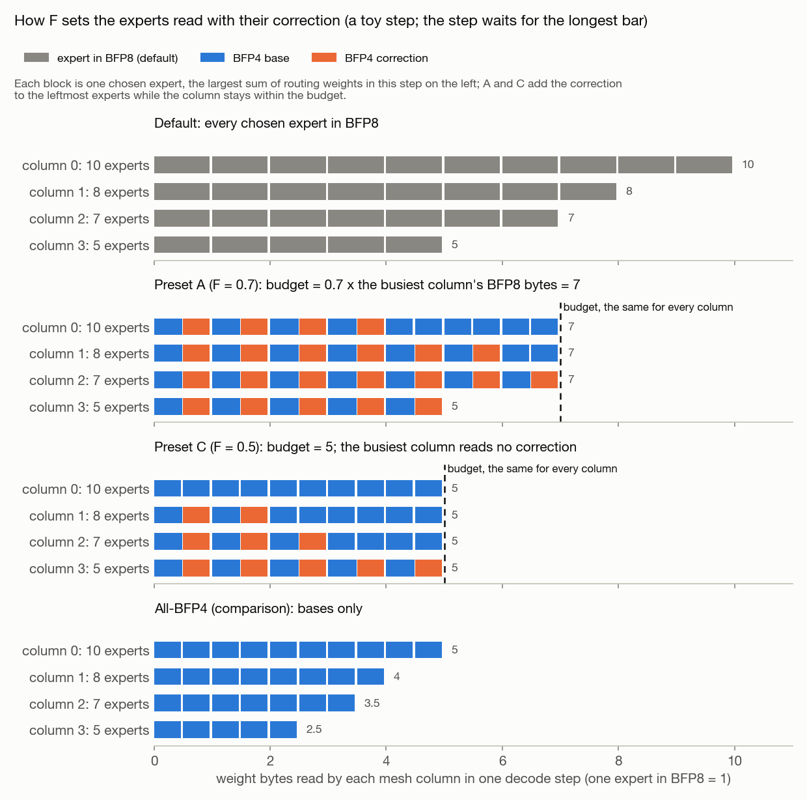

# GLM-5.3-Flash on Blackhole Galaxy: design

How the model is laid out on the 32 chips, how a decode step and a prefill run, and the techniques that make them
fast. Setup and usage are in [README.md](../README.md), measurements in [PERF.md](../PERF.md).

## 1. The model

GLM-5.3-Flash (`Glm5NextForConditionalGeneration`) is a text and vision model; this port runs the text model.

| Part | Shape |
|---|---|
| Layers | 45: KDA in 34 of them, DSA in layers 3, 7, .., 43 (every fourth). Dense MLP in layers 0-2, MoE in 3-44 |
| Hidden size, vocabulary | 4,096; 154,880 |
| Residual | mHC: 4 streams a token. Before each block the streams are mixed into its input ("read"); after it the output is spread back into the streams and the old streams are mixed ("write"). The mixing coefficients come from the streams themselves, the stream mixing matrix made doubly stochastic by 20 Sinkhorn iterations |
| KDA (Kimi delta attention) | Linear attention: 64 heads of 128, a causal convolution of width 4 on q / k / v, a per-channel forget gate (floor -5), a delta-rule state of 128 x 128 a head, a gated RMS norm on the output. Its state does not grow with the context |
| DSA (DeepSeek sparse attention) | MLA without RoPE: 64 heads, q rank 1,536, a 512-wide latent a token, qk and v heads of 256. An indexer (32 heads of 128) scores pools of 4 past tokens and keeps the top 512 pools (2,048 tokens) plus the tail for each query |
| MoE | 288 routed experts (SwiGLU, intermediate 2,048), 8 a token, plus one shared expert. Sigmoid router with a selection bias, weights normalized and scaled by 2.5. SwiGLU values clipped at 10 |
| MTP layer | Layer 45 predicts one token further: it can serve as a drafter (one draft a step) |
| Context | Up to 1,048,576 tokens |

About 97 % of the backbone's parameters (304B of 313B) are the routed experts; a token uses 8 of the 288 in each MoE
layer.

Per user, the KDA state is a fixed size (34 layers x 64 heads x 128 x 128), and the DSA cache grows with the context
(the latent and the indexer's pooled keys of every past token).

## 2. Code layout

| Path | Contents |
|---|---|
| `tt/` | CPU reference in torch, module by module. It follows Hugging Face Transformers' `glm5_next` operation by operation and matches it bit for bit (per layer and the full model). Also the DFlash2 drafter's reference |
| `ttnn/` | The device model, split as `tt/`: `model.py` (the text model, its traces), `layer.py`, `kda.py`, `dsa.py` (+ `dsa_indexer.py`, `dsa_latent.py`), `mhc.py`, `moe.py` (+ `moe_route.py`, `moe_prefill.py`, `router_mm.py`), `mlp.py`, `head.py` (+ `head_pick.py`, `head_argmax.py`, `head_relax.py`, `sampling.py`), `mtp.py`, `dflash2.py` (+ `dflash2_ops.py`, `dflash2_step.py`, `verify_accept.py`), `generator.py` (request seats, prefill scheduling, the decode loop's step) |
| `ttnn/` collectives | `row_all_reduce.py`, `row_ar2.py`, `col_collectives.py`, `col_row_rs.py`, `x2d_gather.py`, `kda_maps_x.py`: collectives over the fabric for the model's shapes |
| `ttnn/` other ops | `dsa_absorb.py` (DSA's per-head absorb matmuls), `kda_d2.py` (KDA's verify-step prepare with the recurrence's state read ahead), `fc_ksplit.py` (a decode matmul with its K split over 3 cores a column), `w1_landing.py` (+ `w1_popular.json`: the L1 landing of the next MoE layer's expert weights), `prefix_store.py` (+ `prefix_keys.py`: the serving's prefix store) |
| `ttnn/kernels/` | Kernels of the small device steps run through `ttnn.generic_op` |
| `checkpoint.py`, `config.py`, `paths.py` | The pinned checkpoint revision and memory-mapped tensor access; the model's shape, checked against what the port implements; where files live |
| `tools/` | Checkpoint download, CPU reference runs, task sets, the vLLM adapter (`glm53_vllm.py`, `glm53_vllm_scheduler.py`, `vllm_bundle/`) and checks |
| `tests/`, `demo/` | Tests (CPU and device) and the demo |

The C++ ops the model uses are under `ttnn/cpp/ttnn/operations/experimental/`: `kda/` (the KDA decode and chunked
prefill ops), `deepseek_prefill/` (the mHC ops `mhc_stream_read`, `mhc_stream_write`, `mhc_stream_mix`,
`mhc_stream_project`, `mhc_split_sinkhorn`; the MoE's `moe_decode_route` and `moe_decode_experts`; `decode_matmul`)
and `ccl/` (`col_row_reduce_scatter`, `all_reduce_async`). The paged MLA decode
(`ttnn/cpp/ttnn/operations/transformer/sdpa_decode`) takes the heads before the users (`heads_first`), and tt-metal's
`glm_drisc` loads the copy kernel that the DRAM cores' RISCs run for the L1 landing.

## 3. Placement on the 8x4 mesh

The mesh's 8 rows hold different users (data parallel); the 4 chips of a row split the work of their users (tensor
parallel), except the routed experts, which are split by mesh column.

| Part | Placement | Communication |
|---|---|---|
| Users | Mesh row r holds U users (seats r U .. r U + U - 1): 8 U users in all | - |
| Embedding | Hidden split over the row's 4 chips | Row all-gather |
| mHC, norms | Replicated on the row's 4 chips | - |
| KDA, DSA | Heads split over the row's 4 chips (16 a chip). DSA's q_a / kv_a projections and the indexer replicated | Row all-reduce after o_proj |
| Dense MLP | Intermediate split over the row's 4 chips | Row all-reduce |
| Routed experts | Mesh column c holds experts 72 c .. 72 c + 71; chip (r, c) holds columns 256 r .. 256 r + 255 of their intermediate (gate, up and down), so the 8 chips of a column share every expert's work evenly | The column's tokens gathered, the partial sums reduce-scattered over the column, then all-reduced over the row |
| Shared expert | In decode, inside the experts op: up to 64 tokens a column as a 73rd expert of one column, from 128 spread over the 4 columns (a quarter of the tokens each). In prefill, intermediate split over the row's 4 chips | With the routed experts |
| LM head | Vocabulary split over all 32 chips (4,840 tokens a chip) | Each chip's best candidates gathered over the mesh |
| DFlash2 drafter | Users by mesh row as the model; within a row, heads, MLP and projections split over the 4 chips | Row all-reduce |

Weights: the large matrices (expert, attention and MLP projections, LM head) in BFP8, converted from the BF16
checkpoint as they load; the router, norms, mHC weights, KDA's gate vectors and the embedding in bf16. The routed
experts take about 9.4 GiB a chip.

States a user, per chip: the KDA delta-rule states in bf16 (34 layers x 16 heads x 128 x 128: 17 MiB) and the
convolution history in fp32; the DSA cache in bf16, the same on the row's 4 chips (over the 11 layers, the latents
11 KiB a token and, for caches past 2,048 tokens, the indexer's pooled keys 0.7 KiB a token); the drafter's K / V of
its last 4,096 positions in BFP8 (17 MiB).

## 4. A decode step

A seat with a request decodes at its own position; a seat without one runs a dummy token that selects no expert and
writes only its own state. Every step runs every seat (the trace has a fixed shape); idle seats read no expert
weights.

### 4.1 Traces and inputs
- The whole step is captured once as a trace and replayed. The host writes the step's inputs (tokens, positions, which
  seats are live, the drafts accepted last step) into fixed device buffers in one packed write, and reads back one
  small result (the ids, or DFlash2's accepted counts, bonus tokens and next drafts) from one chip.
- Everything the step allocates for good (constants, landing buffers of the collectives, persistent semaphores) is
  made before any capture: the warm-up runs the prefill and the decode once eagerly first. A buffer allocated after a
  capture could overlap the trace's scratch space.

### 4.2 Per layer
`mHC read` -> `KDA or DSA` -> `row all-reduce` -> `mHC write + next read` -> `dense MLP or MoE` -> `mHC write + next read`.

- **mHC**: `mhc_stream_read` does the read in one op: the projection of the 4 streams to the 24 mixing coefficients
  and their RMS scaling, the Sinkhorn iterations on the SFPU (all 20 in one pass), the block input (the streams
  weighted by the read coefficients) and its RMS norm. `mhc_stream_write_read` writes the block's output into the
  streams and starts the next block's read in the same program; the write's new coefficients are made on one
  finisher core a group. The streams are packed 4 rows a token so the mixing stays in whole tiles.
- **KDA**: after one matmul for x's projections (q / k / v, beta, the low-rank gate inputs), three ops:
  `decode_prepare` (convolution, SiLU, L2 norms, the decay and beta), `recurrent_decode_step` (the delta rule: the
  state read and written once, updated in fp32 in the destination registers, stored in bf16), `decode_finish` (the
  gated RMS norm), then o_proj. Their outputs are handed over in L1. The forget gate's and output gate's small
  projections (f | gate) are computed inside x's projection, on the cores its weight blocks leave free. At 128 users
  (K = 3) `decode_prepare`'s reader also reads the recurrence's state into L1 under the prepare's own work, and the
  recurrence starts on it without reading DRAM (`kda_d2.py`).
- **DSA**: for a cache of up to 2,048 tokens the indexer keeps every token, so the layer is dense MLA: the absorbed
  form (the query multiplied by each head's key projection attends over the 512-wide latents directly; the model has
  no RoPE), with the latent written into a paged cache and one paged flash MLA decode call that takes the queries
  and gives the output with the heads first (no transposes around it). The two per-head absorb matmuls (q by each
  head's key projection, the output by its value projection) run as one op over more cores (`dsa_absorb.py`), the
  latent's write beside the first. For longer caches the indexer runs: the latents in a row-major cache, the pooled
  keys updated in place (`index_update`), the pool scores of the step's queries (`pool_scores`, four queries of a user
  at a time), the top 512 pools (the chunks of a long row sorted on helper cores and merged), their tokens and the
  tail (`select_tokens`), and the sparse attention with each query's tokens split over several cores and combined
  (`sparse_split`, `sparse_combine`).
- **MoE**: from 8 tokens a row, the router and the routing op (`moe_route.route_only`) run on each row's own tokens
  and the experts op (`moe_decode_experts`) gathers the column's routing and activations over the fabric itself
  (with fewer, a one-shot fabric gather brings the column's tokens first). The op streams the chip's slice of each
  chosen expert from DRAM (an expert's weights read once a step, whatever its token count), and at 32 or 64 tokens a
  row it runs the column's reduce-scatter itself. Up to 8 tokens a row the way back is one op (the column scatter and
  the row all-reduce as one-shot fabric writes). At 64 tokens a row half of each token's activations reach the
  column's chips through the next mesh row (a relay on the row's link), so both link directions carry the gather.
- **Expert weights in L1 ahead** (`w1_landing.py`, `GLM53_W1`): at the end of each MoE layer's experts op, when DRAM
  is otherwise idle, the DRAM cores' RISCs copy the gate | up blocks of experts the next MoE layer is likely to read
  (a per-layer table of each column's most chosen experts, measured on real text, then experts spread over the op's
  items) into an L1 landing area on the compute cores; the next experts op reads those blocks from L1 and every other
  block from DRAM. Each block is framed by seals naming its layer and expert, so a stale or half-written block is
  simply read from DRAM again: the values never change. The landing's size follows the DFlash2 step the model is
  built for (12 experts a column at 8 or 32 users with K = 7, 5 at 128 users with K = 3, by default), and the prefill's
  programs are laid out to fit beside it.
- **Router**: at 128 users (two tile rows of tokens) each pair of router cores that compute the same output columns
  reads each weight block from DRAM once between them and passes it on to the other, halving the router's reads.
- **Weight matmuls** for one or two tile rows of tokens use a tuned 1D configuration per shape, and the largest ones
  `decode_matmul` (each core reads its weight columns as one DRAM bank's run, the activations multicast to it).
- **Row all-reduce**: one-shot fabric writes for up to 4 tokens a row (`row_all_reduce.py`); `all_reduce_async` with
  its input and output in L1 at 8 and 16 tokens a row, sending only the token rows (narrow landing areas up to 32
  tokens a row) with its fabric routes made on the host; two stages from 17 to 64 tokens a row (`row_ar2.py`: a
  one-shot reduce-scatter, then a multicast all-gather of the sums, 0.44 of a chip's share on each link instead of
  0.75). The output stays in L1 for the mHC write that reads it.
- **Trace placement**: the kernel binaries' places in the kernel config ring are planned over the whole trace
  (`TT_METAL_TRACE_ALLOC_BEAM`, set by the model), so fewer programs wait for the ring before they start.

### 4.3 LM head and acceptance
- The final norm and the LM head with the vocabulary split over all 32 chips; the greedy choice on the device (each
  chip's best, then the best over the mesh), so only ids leave the device.
- Sampling (temperature, top-k up to 32, top-p, a seed per request): each chip takes its top 32 candidates, the 1,024
  candidates of a token are gathered and `ttnn.sampling` draws one. The distribution is the model's cut to its top 32.

### 4.4 DFlash2 speculative decoding
- The drafter (DFlash2, 8 layers) is a block drafter: from the last accepted token and K mask slots it predicts K
  tokens in one forward pass. It conditions on the model's hidden states: the mean of the mHC streams after 9 of the
  model's layers ("taps"), projected and written into the drafter's own K / V cache as the model verifies tokens. A
  selector walks the drafter's top-16 candidates per slot to pick the drafts. It shares the model's LM head and
  embedding.
- One step, one trace (`dflash2_step.DFlash2Step`): the model verifies each user's token and its K drafts (K + 1
  tokens a user: `TtGlm53Model.forward_verify`), the drafts are accepted on the device (the leading drafts each equal
  to the model's greedy token one position before), the step's taps go into the drafter's context, and the drafter
  makes the next block from each user's bonus token. In serving, the next step's inputs are made on the device too
  (the host's write is skipped when they are the same).
- The drafter's step is fused where the values allow: its convolution is made inside the kernel projection's matmul,
  its RoPE writes the block's K / V into the BFP8 caches in the same op, its context projection (36,864 wide) splits
  K over 3 cores a column for the larger batches (`fc_ksplit.py`), its residual stays in the norms' width-sharded
  layout, and the acceptance with the drafter's inputs, and the step's results row, are two single-core ops a chip.
- KDA under verification: the state keeps the start of the last step and the rows of its K + 1 tokens; the next step
  first redoes the accepted tokens, so a rejected draft never enters the state and one state is written a step. DSA's
  rejected positions are written over by later tokens before anything reads them.
- With sampling, every position draws a token from the model's distribution and a draft is accepted while it equals
  the draw one position before. The drafts are the drafter's top picks (deterministic), so this is speculative
  sampling's acceptance: the output has the model's own sampling distribution.
- K is chosen by the user count: K = 7 (a block of 8) up to 64 users, K = 3 (a block of 4) at 128 users (16 users a
  row x 4 tokens = 64 tokens a row; K = 7 would take 128). K = 4 .. 6 leave a row's tokens off the multiples of 32 and
  are slower everywhere.
- The drafter attends to its last 4,096 positions only (a ring of K / V slots): its memory does not grow with the
  context.
- The relaxed acceptance (`GLM53_ACCEPT_RELAX`, greedy only, off by default) also accepts a draft whose logit is within
  a given gap of the top, inside the LM head's pick.

## 5. Prefill

- **Waves and chunks**: each mesh row computes one request at a time, so requests go in waves of up to 8 (one a row),
  each prompt into its own seat. A prompt goes in chunks (in serving 128, 512 or 1,024 tokens: the longest that the
  remaining length fills more than halfway). KDA carries a per-row wave state in fp32 from chunk to chunk and writes
  it into the user's state at the end; DSA writes each chunk's latents and pooled keys into the user's cache.
- **Sequence parallel**: a long prompt (or a few, when that takes fewer waves) is split into segments of up to 512
  tokens over the 8 rows. KDA turns each segment into an affine map of the incoming state and chains the maps over the
  rows (`chain_affine_transforms`), so each segment starts from the right state; DSA gathers the segments' latents and
  pooled keys over the rows and each row writes them where the request's row (or a working seat) expects them; every
  row attends with its own queries. Two consecutive waves run as one wave of 1,024 tokens a row. This needs one
  working seat a row for the full cache length.
- **Traces**: in serving, every chunk form (length; first or later chunk; a long cache's pool bucket;
  sequence-parallel waves and wave pairs) is captured once at warm-up and replayed, with the start position as an
  input.
- **MoE**: the column's tokens are gathered by a two-dimensional all-gather (half of each token down the column, relay
  cores passing it on along the row) whose program also builds the expert plan; `moe_prefill` then computes each
  chosen expert once a chunk on its tokens (gate | up, down, and a combine of each token's pairs), reading each
  expert's weights once a chunk; for chunks of 128 to 1,024 tokens a row the way back is one op
  (`col_row_reduce_scatter`): the column's reduce-scatter batch by batch, the shared expert's add and the row's
  reduce-scatter and all-gather behind it, with the combine carried in the same program so that each batch's
  reduce-scatter starts once the combine has written it.
- **DSA**: a first chunk attends within itself; later chunks attend over the user's cache: chunked MLA for caches up
  to 2,048 tokens, else the indexer as in decode, each chip scoring a quarter of the chunk's queries.
- **mHC**: the same read and write ops in a grouped form (32 tokens a group), so the cost grows with the chunk length,
  not its square. From 512 tokens a row each of a row's 4 chips keeps the streams of a quarter of the row's tokens
  only: a block's output is reduce-scattered over the row and exchanged all-to-all, not all-reduced.
- **Sequence-parallel details**: each row sends its KDA maps only to the rows of its own request that read them, the
  wave state's bookkeeping is folded into the chain's op, and the convolution history moves by copies; the DSA
  attention's query chunks and work split are chosen so each core gets one chunk (the same values).
- **Output**: only each request's last position goes through the LM head; its greedy first token is chosen on the
  device.

## 6. Long contexts

- A cache of up to 2,051 positions uses the dense attention form (bf16 latents on each of a row's 4 chips).
- A longer cache stores the latents in FP8 (e4m3) and the pooled indexer keys in BFP4. From 8,192 positions it also
  splits the latents by position over the row's 4 chips (token t on chip t mod 4): about 1.6 KiB a token a user a
  chip, against about 11.7 KiB for a bf16 cache on every chip. Each chip attends over its share of a query's selected
  tokens with all 64 heads, and the partial results (outputs, sums and maxima) are exchanged and combined for each
  chip's heads. The indexer's scoring is split over the 4 chips the same way. In prefill, chunks that end within the
  first 131,072 tokens gather the request's earlier latents and attend as an unsplit cache does; later chunks exchange
  queries and partials.
- Four switches ([README.md](../README.md#long-contexts)) set this back to a bf16 cache on every chip.

## 7. Serving

- `tools/glm53_vllm.py` adapts the generator to the vLLM TT plugin: vLLM's seats map to the generator's seats
  interleaved over the mesh rows, so a batch of new requests lands on different rows and prefills in one wave. vLLM's
  paged KV cache is accepted and ignored: the generator keeps every seat's KDA state and DSA cache.
- Speculative decoding through the plugin's model-owned drafter interface: the adapter returns the device's accepted
  ids and hands over the next drafts.
- DFlash2 serving runs ahead: the next step is launched on the inputs the device made while vLLM does its host work,
  also at the steps where requests end and right after prefills; when a prefill or a changed request makes it wrong,
  a second set of KDA verify states (ping-pong) lets it be thrown away. Idle seats are set to position 0 before a
  step no request can follow. `tools/glm53_vllm_scheduler.Glm53Scheduler` tells the adapter when no new request can
  be admitted.
- New requests are gathered into one prefill call (up to 4, waiting up to 1.5 s), and a call of 3-4 requests on
  neighbouring rows is prefilled as one sequence-parallel wave. The wait ends early where it cannot pay off
  (`glm53_vllm_rows.GatherClock`): once the waiting requests fill one prefill step's token budget, and once their
  summed wait reaches the decoding requests' cost of one more prefill call (a rent-or-buy rule: at most twice the
  better choice made knowing the arrivals); a request left behind by a call keeps its clock. With chunked prefill a prompt's later chunks stay on
  its first chunk's seat.
- The prefix store (`prefix_store.py`): after a prefill that ends on a multiple of 8,192 tokens the request's state
  (each row's KDA wave state and convolution history, the DSA latents and pooled keys, the drafter's K / V) is copied
  into an entry in DRAM, by a few copy ops; a later request with the same first tokens is restored from the longest
  stored prefix into a free seat of the same row and prefilled from there, bit for bit as a whole prefill would leave
  it. The store's size is set at start-up from the free DRAM.
- Sampled requests: the device draws for requests it can sample (top-k up to 32); requests with controls it does not
  draw (penalties, logprobs, ...) are refused with a reason by default, or, when allowed, the step returns the model's
  logits for the plugin's exact acceptance on the host.

## 8. Start-up

- The weight load reads the checkpoint ahead on threads and drops each finished layer's pages behind it, converts on
  16 threads, packs block-float tiles in one pass over each tensor, and packs the experts' shards straight from their
  slices; the warm-up's host side (trace population, runtime arguments) is lighter, and a capture skips the eager run
  of the forms the warm-up already ran.

## 9. Numerics

- Large matrices in BFP8; matmuls at HiFi4 with fp32 accumulation; activations bf16, with fp32 where the reference
  computes in fp32: the router logits and weight normalization, the mHC coefficients and Sinkhorn, KDA's convolution,
  gates, norms and state update, and the LM head's logits.
- Rounding points follow the Hugging Face model where the device form allows. The device output is compared with the
  CPU reference (BF16 weights, LM head in fp32) by teacher-forced KL divergence: about 0.004 for the verify step on the
  reference records, 0.013 on wikitext-2 (the second half of 1,024-token chunks).
- Sensitive spots: near-ties between the 8th and 9th expert (the order of sums decides), the first positions of a
  sequence (the mHC coefficients there amplify rounding), and near-ties of the greedy token. The batched verify step
  rounds differently from one-token decoding, so greedy outputs can differ at near-ties.
- The long-context cache (FP8 latents, BFP4 indexer keys) changes the values of caches over 2,051 positions; its
  effect on quality is in [PERF.md](../PERF.md#quality).
- The fast presets lower the experts' precision (a BFP4 base with partial BFP4 corrections, LoFi matmuls); their
  effect on quality is in [PERF.md](../PERF.md#fast-presets).

### 9.1 The fast presets' progressive form

With `GLM53_MOE_PROG_F=F` (the fast presets A / B / C: F = 0.7 / 0.6 / 0.5, with LoFi expert matmuls) each routed
expert, and the decode step's in-op shared expert, is stored in the experts op's layout with twice the slots: a BFP4
**base**, BFP4(W), and after the bases a BFP4 **correction**, BFP4(W - base), both packed on the device from the bf16
upload. Base plus correction is about as precise as BFP8; the pair takes about 0.56 GiB a chip more than BFP8.

In a decode step the experts op's routing builder (the core that turns the routing into the op's work list) decides,
for every mesh column, which of the column's chosen experts also read their correction:

- **The budget.** Let B be the number of distinct experts chosen in the busiest mesh column (the routing's picks of
  all the step's tokens, OR'ed together) and D the number chosen in this column. With a BFP8 tile of 1,088 bytes and a
  BFP4 tile of 576, the column reads all D bases and m = floor((F x 1,088 x B - 576 x D) / 576) corrections, clipped
  to 0 .. D. Every column gets the same number of bytes, F times the busiest column's BFP8 bytes: the step waits for
  the busiest column, so the others spend that time on corrections. From F = 1.06 every chosen expert reads its
  correction (F = 2: always).
- **The order.** The m corrections go to the column's experts with the largest sums of routing weights in this step
  (over all the tokens that chose each), in fixed-point integers so that the order of the sums does not matter; equal
  sums: the lower expert first.
- **The arithmetic.** The correction's product is accumulated into the same accumulator as the base's, so a corrected
  expert computes with base + correction; the others with the base alone.
- **Prefill** (moe_prefill) reads every expert's base and correction.

At F = 0.5 (preset C), m = 0 in the busiest column (a base is 576 / 1,088 = 0.53 of the BFP8 bytes): it computes with
the bases alone, as the all-BFP4 comparison form does, while the other columns read the corrections that fit in the
same time. With many users nearly every expert is chosen in every column (128 users: close to all 72), B and D are
close, and few corrections fit beyond the busiest column's.

A toy step (sizes rounded: a base and a correction 0.5 of the BFP8 bytes each): four mesh columns choose 10 / 8 / 7 / 5
experts; each block is one chosen expert, the largest routing-weight sum on the left.

## 10. Testing approach

- Every device module is compared with its `tt/` counterpart (PCC thresholds in `tests/pcc_thresholds.json`), and the
  whole model with the CPU reference: teacher-forced KL divergence, greedy runs against 11 recorded reference
  generations (`tools/acceptance/greedy-v1`), long-context passkey retrieval and task accuracy.
- Changes meant to keep the values are checked bit for bit against a saved run on random weights (seeded per tensor).
- Changes to collectives and synchronization get long traced stress runs (thousands of steps), since rare races show
  only there.
