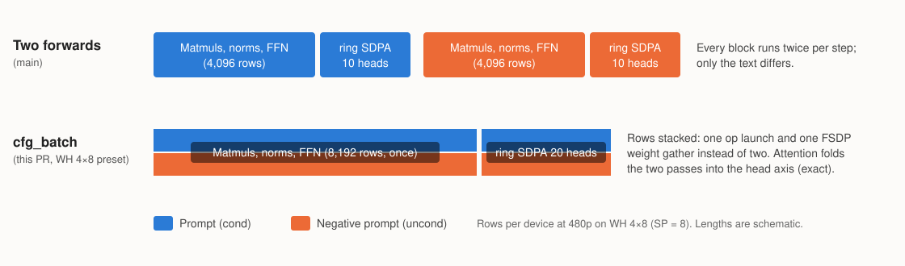

# Wan 2.2 on a WH Galaxy 4×8: the tt-dit changes, commit by commit

> This folder lives only on the branch `hkato/wan22-wh-galaxy-perf-bf8-lofi-docs`. That branch is the 7 commits of the PR branch `hkato/wan22-wh-galaxy-perf-bf8-lofi`, rebased onto main `3d5782d0f4c`, plus this file. It walks through the diff of the two PR branches commit by commit. The full write-up of the earlier optimization branch, including the ttnn, LLK and runtime changes that are not part of these PRs, is on `hkato/wan-wh-opt-docs`.

<!-- toc -->
## Contents

- [0. Summary](#0-summary)
- [1. The commits at a glance](#1-the-commits-at-a-glance)
- [2. Wan defaults (commits 1–3)](#2-wan-defaults-commits-13)
  - [2.1 Ring SDPA chunks (256, 512)](#21-ring-sdpa-chunks-256-512)
  - [2.2 FFN2 unfused when no fused MM+RS config resolves](#22-ffn2-unfused-when-no-fused-mmrs-config-resolves)
  - [2.3 CFG cond and uncond passes as one forward](#23-cfg-cond-and-uncond-passes-as-one-forward)
- [3. WH 4×8 preset settings (commits 4–6)](#3-wh-48-preset-settings-commits-46)
  - [3.1 Cache the cross-attention K/V](#31-cache-the-cross-attention-kv)
  - [3.2 Resident FFN weights and the text encoder placement](#32-resident-ffn-weights-and-the-text-encoder-placement)
  - [3.3 VAE decode in 5-frame chunks](#33-vae-decode-in-5-frame-chunks)
- [4. Opt-in bf8 / LoFi preset (commit 7)](#4-opt-in-bf8--lofi-preset-commit-7)
- [5. Output and quality](#5-output-and-quality)
- [6. Left out, and why](#6-left-out-and-why)
- [7. Where the settings live](#7-where-the-settings-live)
<!-- /toc -->

## 0. Summary

- **Scope.** Python under `models/tt_dit` only: the Wan model, pipeline and tests, plus additive changes to shared tt-dit files (table entries, arguments that default to the current behaviour). No ttnn op, LLK or runtime change.
- **Two branches, stacked.**

  | Branch | Commits | Files | Lines | What |
  |---|---|---|---|---|
  | `hkato/wan22-wh-galaxy-perf` | 6 | 10 | +414 / −61 | Wan defaults (3 commits) and WH 4×8 preset settings (3 commits). The output keeps the same scenes; details differ slightly (other accumulation order) |
  | `hkato/wan22-wh-galaxy-perf-bf8-lofi` | +1 | 14 in total | +657 / −95 in total | An opt-in `QuantConfig` preset, `wh_galaxy_bf8_lofi`. Off by default |

- **Speed.** `test_performance_wan.py`, WH Galaxy 4×8, T2V-A14B, 81 frames, 40 steps, with CFG, on main `3d5782d0f4c`. main: 3 runs at 480p (ratios from the mean); the branches: one run each:

  | Configuration | Perf test id | 480p | vs main | 720p | vs main |
  |---|---|---|---|---|---|
  | main | `wh_4x8_sp1tp0` | 110.05–110.41 s | — | 347.16 s | — |
  | `hkato/wan22-wh-galaxy-perf` | `wh_4x8_sp1tp0` | 83.18 s | −24.5 % | 316.54 s | −8.8 % |
  | + `wh_galaxy_bf8_lofi` | `wh_4x8_sp1tp0_bf8_lofi` | 64.85 s | −41.1 % | 276.69 s | −20.3 % |

  With the cross-attention fused add that was dropped from the series (section 6), the two branches took 82.97–83.29 s and 64.78–64.88 s at 480p (4 runs each). Before the rebase (main `e7c94bbed8b`, with that add): 110.8 / 83.0 / 64.0–64.2 s at 480p and 347.0 / 316.3 / 273.5 s at 720p; on the new main the preset is about 0.7 s slower at 480p and 3.4 s at 720p, the other rows are unchanged.
- **Other meshes are unchanged by default.** Every new setting is a `WanPipelineConfig` field that only the WH 4×8 preset turns on, a table row that only matches WH 4×8 shapes, or the opt-in preset. The one rule that applies everywhere (2.2) keeps the fused FFN2 path wherever a fused config resolves, which includes the Blackhole Galaxy grid.
- **Quality.** With the prompt and settings of the CI quality test (`test_pipeline_wan.py`) over seeds 42–46, the perf branch matches main, and seed 42 (what CI runs) passes the floors for all configurations. The bf8 preset lowers VBench `imaging_quality` by 2.7 % (720p) and 5.2 % (480p) on that prompt, and by about 2 % over the 6 perf-test prompts × 7 seeds; CLIP, consistency and motion change little (section 5).

## 1. The commits at a glance

The time column is the 480p total of `test_performance_wan.py` after each commit, stacked, measured before the rebase (main `e7c94bbed8b`).

| # | Commit | Files | 480p total |
|---|---|---|---|
| — | main | — | 110.68 / 110.96 s |
| 1 | Use (256, 512) ring SDPA chunks on WH Galaxy 4×8 | `attention_wan.py` | 105.23 s (−5.0 %) |
| 2 | Run FFN2 unfused when no fused MM+RS config resolves | `transformer_wan.py` | 99.71 s (−5.2 %) |
| 3 | Run the CFG cond and uncond passes as one forward (with the blockings for its 8192-row matmuls) | `attention_wan.py`, `transformer_wan.py`, `pipeline_wan.py`, `test_transformer_wan.py` | 87.80 / 87.99 s (−11.9 %; 88.39 s without the blockings) |
| 4 | Cache the cross-attention K/V across denoising steps | `attention_wan.py`, `transformer_wan.py`, `pipeline_wan.py` | 85.08 s (−3.1 %) |
| 5 | Keep the FFN weights resident instead of FSDP-gathered on WH Galaxy 4×8 | `model_t5.py`, `transformer_wan.py`, `pipeline_wan.py`, `text_encoder.py`, 3 pipeline tests | 83.65 / 84.08 s (−1.7 % denoise) |
| 6 | Decode the VAE in 5-frame chunks on WH Galaxy 4×8 | `pipeline_wan.py`, `utils/conv3d.py` | 83.09 s (VAE 1.15 → 0.76 s) |
| 7 | bf8 / LoFi quant config tuned for WH Galaxy 4×8 | `feedforward.py`, `linear.py`, `attention_wan.py`, `transformer_wan.py`, `quant_config.py`, `test_performance_wan.py`, `utils/matmul.py` | 64.85 s with the preset id, after the rebase (−22.0 % vs commit 6 on the same main) |

Commits 1–6 are `hkato/wan22-wh-galaxy-perf`; commit 7 is the extra commit of `hkato/wan22-wh-galaxy-perf-bf8-lofi`.

## 2. Wan defaults (commits 1–3)

### 2.1 Ring SDPA chunks (256, 512)

- **What.** The WH 4×8 entry `(False, 8, 4)` of `WanAttention.sdpa_chunk_size_map` goes from `(q_chunk, k_chunk) = (256, 256)` to `(256, 512)`. One line.
- **Why.** Ring SDPA runs an online softmax per K chunk (row max, rescale, correction). A larger K chunk halves these fixed costs per chunk. The candidates that fit L1, swept with the 480p block test (ring SDPA per block):

  | (q, k) | ms | (q, k) | ms |
  |---|---|---|---|
  | **(256, 512)** | **13.06** | (352, 256) | 14.12 |
  | (352, 320) | 13.16 | (384, 256) | 14.55 |
  | (256, 384) | 13.64 | (256, 256), old | 14.69 |
  | (192, 640) | 14.03 | (352, 352) | 17.02 |

- **Who is affected.** WH 4×8 only; the other mesh entries keep their chunks.

### 2.2 FFN2 unfused when no fused MM+RS config resolves

- **What.** The FFN's second matmul (ff2) takes the fused matmul + reduce-scatter path only when `resolves_fused_mmrs_config()` finds a config for the shape (a swept table entry or a rule-engine config for this device grid). Otherwise it runs ff1 (AGMM) → ff2 (matmul + reduce-scatter) → addcmul. MiniMax-H3 uses the same check.
- **Why.** On WH 4×8 no fused config is registered for the Wan ff2 shapes, so the fused path silently ran `default_fused_mmrs_config`, which is slower than not fusing (480p ff2: 5.18 ms fused vs 3.19 ms unfused).
- **Who is affected.** Wherever no fused config resolves. On the Blackhole Galaxy grid (12×10) the rule engine resolves the Wan ff2 shapes, so Blackhole keeps the fused path.

### 2.3 CFG cond and uncond passes as one forward

- **What.** With classifier-free guidance, every step runs the transformer twice on the same latent and timestep; only the text differs. With `cfg_batch`, `inner_step_cfg` stacks the per-device rows of both passes (`[1, 1, 2n, D]`, 8192 rows per device at 480p), so every row-wise op (norms, projections, FFN) runs once on twice the rows, with one FSDP weight gather and one op launch instead of two.
  - **Self-attention** folds the two passes into the head axis (`[1, 2H, n, E]`). Attention is per head, so this is exact, and it keeps one B = 1 ring SDPA call. A batch-2 ring SDPA takes about 4× a batch-1 call (51.90 vs 13.06 ms), because its K/V store-and-forward chains are only built for B = 1. The folded call runs on the full grid width with the CCL on the last row: the 2 × 10 heads × 16 Q chunks split evenly over 8×8 workers (22.39 vs 24.08 ms per block on 7×9).
  - **Cross-attention** folds the passes the same way. It takes the prompts as a (cond, uncond) pair, computes K/V per prompt and joins them per head, so folded head 2h + b attends to the K/V of prompt b. The query layout change stays a free reshape.
- **Blockings for the 8192 rows.** The attention projections then see 8192 rows per device, shapes without a table entry on the 8×8 AGMM worker grid. The blockings swept with `sweep_mm_block_sizes.py` are registered from the Wan attention module with `register_matmul_configs`, the way MiniMax-H3 registers its own. The shared table in `utils/matmul.py` does not change.

  | Matmul | (M, K, N) | Blocking | Time |
  |---|---|---|---|
  | to_qkv | (8192, 5120, 3840) | (8, 10, 10, (2, 2)) | 4398.0 µs |
  | to_out + addcmul / cross to_q, to_out | (8192, 5120, 1280) | (12, 8, 5, (4, 1)) | 2305.0 / 1873.7 µs |

- **Who is affected.** `WanPipelineConfig.cfg_batch` is on in the WH 4×8 preset only; other meshes keep two forwards.
- **Output.** Not bit-identical to two forwards (other matmul shapes, so another accumulation order).
- **Test.** The block test gets a `14b-480p-b2` case that checks this path against a torch reference whose two batches share RoPE and timestep embedding: PCC 99.9968 % (99.9942 % for the usual `14b-480p`). It is skipped on Blackhole, where no preset enables CFG batching. With the preset forced off, the 480p video is bit-identical to the parent commit.

## 3. WH 4×8 preset settings (commits 4–6)

All three are `WanPipelineConfig` fields, set in the WH 4×8 preset (`_PRESETS_WH[(4, 8)]`) only. The VAE time varies by 0.76–1.17 s from run to run, so the denoise time is the better measure for the small ones.

### 3.1 Cache the cross-attention K/V

- **What.** The cross-attention K/V depend only on the text embedding, which is the same in all denoising steps, yet every step and block redid the to_kv matmul (with its FSDP weight gather) and the K norm. With `cross_kv_cache`, `WanAttention` keeps the post-norm K and head-split V per prompt tensor (or per (cond, uncond) pair with CFG batching). About 0.2 GiB per device per transformer at 480p.
- **Safety.** `WanTransformer3DModel.prepare_text_conditioning()` drops the cache, so a new prompt never reuses stale K/V, and a cache entry holds its prompt tensors, so their ids cannot be reused. The pipeline turns the cache off when tracing: a trace captured on a cache hit has no K/V ops and would keep replaying the K/V of its capture prompt.
- **Effect.** Denoise 86.50 → 83.82 s at 480p.

### 3.2 Resident FFN weights and the text encoder placement

- **What.** Under FSDP every block all-gathers its ff1 / ff2 weights before use. With `ffn_resident` they stay resident (TP-sharded only) while the attention weights stay FSDP, at about 2.3 GiB of DRAM per device per 14B transformer.
  - `WanTransformerBlock` / `WanTransformer3DModel` get `ffn_fsdp` (default True = unchanged). The resident weights use another sharding, so they get their own cache entry (`<transformer>_resident_ffn`).
  - At 720p the resident weights run out of DRAM in the first step, so the preset value is `{(480, 832): True}`. A preset value can now be such a `{(height, width): value}` table.
- **Freeing the DRAM.** This only fits for both transformers once the text encoder frees DRAM. The UMT5-XXL encoder ran tensor-parallel over the 4 devices of the TP axis with its 256k × 4096 token embedding table (2 GiB in bf16) replicated.
  - `WanPipelineConfig.default()` places the encoder on the DiT's SP axis (8 devices) where the preset says `encoder_on_sp_axis`, and on the TP axis otherwise. The default now follows the axes of the given `dit_parallel_config`, so the pipeline tests no longer pass their own encoder config.
  - `T5Encoder` gets `shard_token_embeddings` (default False): the table is sharded over the encoder's TP axis and the looked-up rows are all-gathered (`shard_text_embeddings` in the preset).
  - On its own the encoder placement changes no time; without the sharded embeddings the resident FFN weights run out of DRAM.
- **Effect.** Denoise 83.82 → 82.40 / 82.43 s at 480p.

### 3.3 VAE decode in 5-frame chunks

- **What.** The WH 4×8 preset had no `vae_t_chunk_size`, so the cached VAE decoder ran one latent frame per chunk (21 chunks at 480p). It is now 5 (5 chunks), with conv3d blockings for the 480p `t_chunk = 5` shapes on the 4×8 mesh, swept with `bruteforce_conv3d_sweep.py`, in `utils/conv3d.py`. For two shapes the fallback table won, so they get no entry. The rows only match WH 4×8 shapes; the Blackhole 4×8 preset decodes the full T at once.
- **Effect.** VAE decode 1.15 → 0.76 s at 480p.

## 4. Opt-in bf8 / LoFi preset (commit 7)

`QuantConfig.wh_galaxy_bf8_lofi()` goes in the direction of the existing `all_bf8_lofi`, tuned and measured on WH 4×8 with CFG batching. It is applied with `set_quant_config` like the other presets, and is off unless selected. The perf test selects it with the id `wh_4x8_sp1tp0_bf8_lofi`.

The three ways it trades precision for time:

| | |
|---|---|
|  | **bf8 (BFP8):** 16 values share one exponent, so a tile takes about half the bytes to read, gather and store |
|  | **LoFi:** one multiplication pass instead of two (HiFi2) |
|  | **bf16 DEST:** the accumulator holds 8 tiles instead of 4, so larger subblocks read fewer input tiles per output tile |

What the preset sets:

| Part | Setting |
|---|---|
| Weights | `bfloat8_b`, except the two attention output projections: the fused addcmul of the self-attention one needs bf16 weights, and the cross-attention one stays bf16 as tuned |
| Projections | LoFi, accumulating in bf16 DEST (`fp32_dest_acc=False`), with blockings swept for bf16 DEST: to_qkv (16, 10, 10, (4, 2)), ff1 (16, 8, 14, (4, 2)), to_out / cross to_q, to_out (16, 8, 5, (8, 1)), and a fused MM+RS config for ff2, so ff2 takes the fused path at 8192 rows |
| Projection inputs | The norms write the inputs of to_qkv, cross to_q and ff1 in bf8 (`projection_input_dtype`); the attention outputs are cast to bf8 before `concat_heads`. These projections pin their outputs to bf16 (`ColParallelLinear.pin_output_bf16`) |
| FFN intermediate | ff1 writes it in bf8 (`ParallelFeedForward.intermediate_dtype`, default None = unchanged); ff2's output stays bf16 |
| Ring SDPA | bf8 Q / K / V, LoFi QKᵀ and PV matmuls (`SDPAProgramConfig.matmul_math_fidelity`; the softmax stays HiFi2), (128, 1024) chunks, which fit L1 with bf8 K / V |
| Cross-attention SDPA | bf8 Q / K / V; K / V are cast once, when computed |

- **New `QuantConfig` fields.** `SDPAQuantConfig.matmul_math_fidelity` / `chunk_size`, `cross_sdpa_input_dtype`, `projection_input_dtype`, `ffn_intermediate_dtype`, `bf16_dest_matmul_configs` / `bf16_dest_fused_mmrs_configs`. All default to no change, so the existing presets behave as before. `WanAttention.set_ring_sdpa_config` rebuilds the ring SDPA program configs.
- **Blockings for bf16 DEST (`utils/matmul.py`).** The best bf16-DEST blockings often use 8-tile subblocks, which an fp32-DEST matmul of the same shape cannot run, and the shared tables are keyed by shape only. So `register_matmul_configs` and `register_fused_mmrs_configs` take `fp32_dest_acc` (default True = unchanged). Entries registered with `fp32_dest_acc=False` go to separate tables, which `get_matmul_config`, `get_agmm_config`, `get_fused_mmrs_config` and `resolves_fused_mmrs_config` consult first when given `fp32_dest_acc=False`, falling back to the shared tables on a miss. `ColParallelLinear` (all-gather-matmul path) and `RowParallelLinear.forward_fused_addcmul` pass the `fp32_dest_acc_en` of their compute config. Only this preset registers such entries, so other lookups do not change.
- **Warmup in the perf test.** The pipeline's allocation run compiles the programs of the model as built, before `set_quant_config` changes them, so the timed run paid for compiling the new ones (+6.0 s with a cold kernel cache, +1.6 s with a warm one). A quant config now gets the warmup run too; this also applies to the existing `2x4_sp0tp1_bf8_lofi` id.
- **CI.** The WH Galaxy perf job selects ids by substring, so the new id runs at 480p and 720p there (about 2 + 6 min more). Its timing limits are the same table as the default id.
- **Combinations.** The parts depend on each other: dropping one of the bf8 settings can push the bf16-DEST blockings past L1. The preset is shipped as one tested combination rather than as separate switches.

## 5. Output and quality

Section 5.2 was measured on the final branches. Sections 5.1, 5.3 and 5.4 were measured before the cross-attention fused add was dropped from the series (section 6); without it the add is rounded once more, so the videos differ slightly from the ones measured there.

### 5.1 Run-to-run

- **480p on main `e7c94bbed8b` (before the rebase).** Repeated runs of the same configuration gave bit-identical videos: main 2 of 2, both branches as well (3 of 3 with the preset; 8 of 8 in an earlier version of it).
- **480p on main `3d5782d0f4c` (after the rebase).** This no longer holds, for main itself too:

  | Configuration | Runs | Pairwise | Bit-identical to the pre-rebase video |
  |---|---|---|---|
  | main | 3 | all different (mean absolute difference 3.7–4.6 on 0–255) | 1 of 3 |
  | `wh_4x8_sp1tp0` | 4 | all different (3.2–7.7) | 0 of 4 |
  | `wh_4x8_sp1tp0_bf8_lofi` | 4 | all different (3.6–4.1) | 1 of 4 |

  Since some runs still reproduce the pre-rebase videos bit for bit, the results are not computed differently; they are no longer repeatable. The scenes stay the same. One more main run hung (1 of 4 main runs at 480p); none of the 10 runs of the PR branches on this main did.
- **720p.** Already on main `e7c94bbed8b`, repeated runs differed slightly (3 of 3 differ, mean absolute difference 2.4–3.0). The branches behaved the same way. Compare 720p against a spread of repeats, not one run.

### 5.2 CI quality test, seed 42 and five seeds

The prompt and settings of `test_pipeline_wan.py` with the WH Galaxy CI selection (`4x8sp1tp0nl4_ring_is_fsdp1`; boxing cats, 81 frames, 40 steps), scored with its CLIP (8 frames) and VBench code, on main `3d5782d0f4c`. Seed 42 is what CI runs; the means are over seeds 42–46. The floors are the current ones (after #60488).

| 720p | Floor | main, seed 42 | perf, seed 42 | + preset, seed 42 | main, mean of 5 | perf, mean of 5 | + preset, mean of 5 |
|---|---|---|---|---|---|---|---|
| CLIP | 36.0 | 37.82 | 38.54 | 36.68 | 37.78 | 38.29 | 36.79 |
| subject_consistency | 0.8 | 0.9262 | 0.9280 | 0.9120 | 0.9308 | 0.9390 | 0.9257 |
| background_consistency | 0.8 | 0.9275 | 0.9275 | 0.9354 | 0.9519 | 0.9503 | 0.9510 |
| motion_smoothness | 0.9 | 0.9722 | 0.9676 | 0.9734 | 0.9726 | 0.9726 | 0.9755 |
| dynamic_degree | 1.0 | 1.0 | 1.0 | 1.0 | 1.0 | 1.0 | 1.0 |
| imaging_quality | 0.5 | 0.6577 | 0.6495 | 0.5970 | 0.6416 | 0.6371 | 0.6198 |

| 480p | Floor | main, seed 42 | perf, seed 42 | + preset, seed 42 | main, mean of 5 | perf, mean of 5 | + preset, mean of 5 |
|---|---|---|---|---|---|---|---|
| CLIP | 36.0 | 36.71 | 36.80 | 36.67 | 37.30 | 37.05 | 37.76 |
| subject_consistency | 0.8 | 0.9523 | 0.9531 | 0.9433 | 0.9475 | 0.9497 | 0.9398 |
| background_consistency | 0.8 | 0.9749 | 0.9748 | 0.9723 | 0.9575 | 0.9629 | 0.9519 |
| motion_smoothness | 0.9 | 0.9793 | 0.9789 | 0.9809 | 0.9722 | 0.9728 | 0.9788 |
| dynamic_degree | 1.0 | 1.0 | 1.0 | 1.0 | 1.0 | 1.0 | 1.0 |
| imaging_quality | 0.45 | 0.5650 | 0.5634 | 0.5273 | 0.6462 | 0.6487 | 0.6147 |

- **perf vs main:** no difference beyond the seed-to-seed spread (imaging_quality −0.7 % at 720p, +0.4 % at 480p; it varies by about 0.04–0.05 across seeds).
- **preset vs perf (paired by seed):** imaging_quality −0.017 (−2.7 %, 3 of 5 seeds lower) at 720p and −0.034 (−5.2 %, 3 of 5) at 480p, where one seed (45) accounts for most of it (−0.136). subject_consistency −0.013 / −0.010. CLIP −1.50 at 720p, +0.71 at 480p.
- **Floors:** seed 42 passes for all three configurations at both resolutions. Of the 30 videos, one fails a floor: the preset at 720p, seed 44, CLIP 34.31 < 36.0.
- The test has no quant option; for the preset the preset was applied to the pipeline with `set_quant_config` before generating, outside the test.

### 5.3 Six prompts × seven seeds

To see whether the preset changes quality beyond one video's noise, both configurations generated the 6 prompts of `test_performance_wan.py` with seeds 42–48 (42 videos each per resolution), scored with the same CLIP and VBench code as the CI test. Differences are paired (same prompt and seed), preset minus no preset.

| Metric | 480p no preset | 480p preset | 480p diff | 720p no preset | 720p preset | 720p diff |
|---|---|---|---|---|---|---|
| CLIP | 32.28 | 32.40 | +0.12 | 32.56 | 32.48 | −0.08 |
| subject_consistency | 0.9716 | 0.9709 | −0.0007 | 0.9662 | 0.9671 | +0.0009 |
| background_consistency | 0.9736 | 0.9711 | −0.0024 | 0.9735 | 0.9713 | −0.0022 |
| motion_smoothness | 0.9888 | 0.9899 | +0.0010 | 0.9884 | 0.9889 | +0.0006 |
| imaging_quality | 0.6763 | 0.6613 | **−0.0150 (−2.2 %)** | 0.6798 | 0.6641 | **−0.0157 (−2.3 %)** |
| pairs with lower imaging_quality | | | 24 / 42 | | | 29 / 42 |

- **imaging_quality** (per-frame technical quality) drops by about 2 % at both resolutions; paired t = −2.12 at 480p and −2.36 at 720p. The other metrics stay within the spread.
- **Scene dependent.** Per-prompt imaging_quality difference (mean over 7 seeds):

  | | cats | butterfly | alley | whale | Roman general | snowy cabin |
  |---|---|---|---|---|---|---|
  | 480p | −0.017 | +0.008 | −0.035 | +0.010 | −0.045 | −0.011 |
  | 720p | +0.003 | −0.037 | −0.003 | −0.021 | −0.021 | −0.015 |

- **dynamic_degree** is 0 for most of these videos in both configurations (mean 0.31–0.38), so the CI floor of 1.0 only holds for some prompts, independent of precision.

### 5.4 Where the drop comes from

Leave-one-out against the preset (cats prompt, 3 seeds, 480p):
- Projections back to HiFi2 with fp32 DEST: imaging_quality +0.024 to +0.032 on 3 of 3 seeds. This part is also the largest single speed-up: reverting it costs about 7 s of denoise at 480p (61 → 68 s; no preset 80 s).
- Ring SDPA back to its defaults: subject_consistency +0.002 to +0.021 on 3 of 3 seeds.
- Cross-attention SDPA, weights and FFN intermediate back to bf16: no clear effect.

## 6. Left out, and why

| Item | Reason |
|---|---|
| Fusing the cross-attention residual add into its output projection | 0.3 s (0.3 %) for 61 changed lines in 3 files, a new pipeline setting and a slightly different output; it was commit 8 of the earlier 9-commit series |
| K / V ping-pong buffers per tag | Adds a gather buffer pair (80–160 MB × 2 on WH 4×8) for a race that showed no divergence on main's C++ |
| proj_out split over TP | 0.16 s of denoise for 88 changed lines in `transformer_wan.py` |
| 12 small items (VAE / latent handling, timestep embedding precompute, small chunks) | 0.33 s together, not worth the review |
| Faster device-to-host read | Its gain comes from reusing output buffers, which would overwrite videos already returned to the caller |
| Fully resident high-noise transformer (bf8) | About 1.0 s; touches model construction and the weight cache |
| 4096-row matmul and MM+RS tables | Unused once CFG batching is on |
| Changes that need ttnn op, LLK or runtime changes | Out of scope; see `hkato/wan-wh-opt-docs` |

## 7. Where the settings live

| Kind | Upstream mechanism | Used for |
|---|---|---|
| Per-mesh pipeline defaults | `_PRESETS_WH` / `_PRESETS_BH` in `pipelines/wan/pipeline_wan.py`, read by `WanPipelineConfig.default()`; explicit arguments win | `cfg_batch`, `cross_kv_cache`, `ffn_resident`, `encoder_on_sp_axis`, `shard_text_embeddings`, `vae_t_chunk_size` |
| Precision | `QuantConfig` in `pipelines/wan/quant_config.py`, applied with `set_quant_config` | `wh_galaxy_bf8_lofi` |
| Ring SDPA chunks | `WanAttention.sdpa_chunk_size_map` | The `(False, 8, 4)` entry |
| Matmul blockings | `register_matmul_configs` / `register_fused_mmrs_configs` from the model | The 8192-row blockings; the bf16-DEST tables |
| conv3d blockings | `_BLOCKINGS` in `utils/conv3d.py` | The WH 4×8 480p `t_chunk = 5` rows |

None of the changes reads an environment variable.
