# Speeding up Wan 2.2 on a Wormhole Galaxy: the main optimizations

> This folder lives only on the branch `hkato/wan-wh-opt-docs`, which is `hkato/wan-wh-opt` (the Wan 2.2 changes, rebased onto main `e7c94bbed8b`) plus this documentation. The detailed record is in [NOTES.md](NOTES.md); `#123` numbers refer to the experiment ids used there.

This document explains, theme by theme in order of impact, the optimizations that brought Wan 2.2 T2V-A14B (480p, 81 frames, 40 steps) on a WH Galaxy 4×8 from 110.4 s down to about 40.7 s (39.9 s with the optional fast exp). Section 10 of the detailed notes ([NOTES.md](NOTES.md)) has a detailed record of each item. Here, "#number" is the serial number of that experiment.

## 0. How to read this document

### 0.1 Themes and contributions

The −69.7 s from 110.39 s to 40.7 s is split across themes by stacking the adopted items in order and taking the difference at each item.

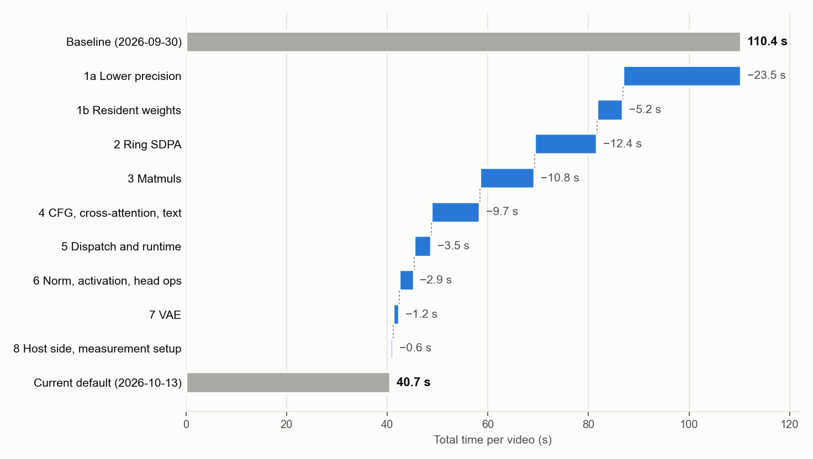

| Ch. | Theme | Contribution | Share | Does the output change? |
|---|---|---|---|---|
| 1a | Lower precision (BFP8, LoFi, dropping fp32 DEST) | −23.5 s | 34% | Yes (the composition changes; picture quality is kept) |
| 1b | Resident weights (no more FSDP weight re-gathering) | −5.2 s | 7% | No (only #50 changes the composition, because it moved where rounding happens) |
| 2 | ring SDPA (chunks, Q assignment, multicast, pack-thread rework) | −12.4 s | 18% | Slightly (same composition; the LoFi of #21 counts toward 1a) |
| 3 | Matmuls (FFN2 path, AGMM, ring MM+RS) | −10.8 s | 16% | Slightly in some items (same composition) |
| 4 | CFG, cross-attention, text | −9.7 s | 14% | Slightly in some items (same composition) |
| 5 | Dispatch and runtime (8×10 grid, 3 SP links, kernel config region) | −3.5 s | 5% | Slightly (same composition) |
| 6 | Fewer ops for normalization, activation and heads | −2.9 s | 4% | The composition changes in some items (picture quality is equivalent) |
| 7 | VAE | −1.2 s | 2% | Almost no change (VAE rounding only) |
| 8 | Outside the blocks, host side, measurement conditions | −0.6 s | 1% | Slightly in some items (same composition) |
| Separate | Fast exp (optional, #138) | −0.8 s | — | Yes |

- **How contributions are counted:** The difference when the adopted items are stacked in the order they were adopted. A different order gives different values, and each run varies by ±0.05-0.1 s. Read them as rough guides.
- **Synchronization:** Up to #167, timing synced with the host at every step. At the end, the numbers are connected to the default value measured without that sync (40.7 s).
- **How 1a and 1b are split:** #49-#66 were measured together as one combined range, but #50 and #51 (resident weights) in it were also measured alone, so they count toward 1b and the rest toward 1a.
- **Chapters 9 and 10:** These are not individual optimizations. They summarize how the experiments were run (chapter 9) and how hangs were handled (chapter 10).

### 0.2 Background: what happens in one step

- **Steps and forwards:** A video is made by starting from noise and removing the noise a little at a time. One round of that is one step, and it is repeated 40 times. Each step runs the DiT (the main network that makes the video) twice (for CFG: once with the prompt and once without). The DiT has 40 blocks. The first 26 steps use a DiT for high noise, and the last 14 steps use a separate DiT for low noise.
- **Parallelism:** The 32 chips are arranged as 4×8. The 4 chips on axis 0 do TP (they split the weights and the computation), and the 8 chips on axis 1 do SP (they split the video token sequence into 8 parts).
- **Inside one block:** self-attention (attention among the video tokens, computed with ring SDPA), cross-attention (attention to the text), and the FFN. Matmuls are computed with AGMM (an op that multiplies while gathering data across chips) and MM+RS (an op that multiplies, then adds up the partial sums and distributes them).
- **Where the switches live:** Most optimizations are experiment switches enabled by environment variables. The current best configuration runs the performance test with the following two in place. Every environment variable listed under "How to enable" in each chapter is included in them.
  - Source the repo's `models/tt_dit/tests/models/wan2_2/eth_dispatch/env.sh` (Ethernet dispatch, chapter 5).
  - Set the environment variables in the appendix.
- **Bottleneck breakdown (#20, 2026-10-05):** Of 26.6 ms per block, ring SDPA took 13.0 ms and most of the rest was matmuls. The matmuls were bound by data supply (DRAM reads and the inter-chip all-gather), not by compute (#47, #53).

### 0.3 Glossary

| Term | Meaning |
|---|---|
| **Chip, core, Tensix** | One WH chip has 8×10 = 80 compute cores (Tensix cores). The standard configuration uses one row for dispatch (sending out commands), so 8×9 = 72 cores are left for compute. A Galaxy is a box of 32 chips |
| **DRAM, L1** | DRAM is the chip's main memory (12 GB, slow but large). L1 is a small SRAM in each core (about 1.4 MB, fast but small). Data is moved from DRAM to L1 to be computed on |
| **Tile** | A 32×32 block of numbers. Matrix operations work tile by tile |
| **op, program, kernel** | An op is one computation (a matmul, attention, ...). On the device it runs as a program, and the program's contents are the kernels that run on the cores |
| **CB (circular buffer)** | A hand-off buffer in a core's L1. The reader, compute and writer threads pass tiles to each other through it |
| **DEST** | A register next to the matrix engine. It holds the running sums of a multiplication |
| **all-gather, reduce scatter** | Inter-chip communication. In all-gather, everyone's pieces are collected so that everyone holds the whole. In reduce scatter, everyone's partial sums are added up and the result is split and distributed |
| **AGMM, MM+RS** | AGMM is one op that combines all-gather and matmul. MM+RS is one op that combines matmul and reduce scatter |
| **SDPA, ring SDPA** | SDPA is the core of attention (QKᵀ, softmax, P·V). ring SDPA is a version that computes while passing the K and V pieces, which are split across chips, around a ring of chips |
| **CFG** | A method that mixes two results, with and without the prompt, to make a video that follows the prompt. It doubles the DiT computation |
| **FSDP** | A scheme that splits the weights across chips and gathers them with all-gather right before use. It saves memory but adds communication every time |
| **PCC** | The correlation coefficient between a torch reference computation and the device result. 1.0 is a perfect match. Around 99.9% means the error is small |
| **The composition changes** | Small numeric differences accumulate over 40 steps, and the same seed gives a different picture (the kind or position of the butterfly, etc.). This is a separate matter from picture quality degradation |
| **Changes slightly** | Something like the order of additions changes, and details (such as the angle of the wings) shift slightly. The composition is the same |
| **Output unchanged (bit-identical)** | The output values do not change by a single bit after the speedup. The video is exactly the same as before the change |

## 1a. Lower precision (BFP8, LoFi, dropping fp32 DEST)

**Contribution:** −23.5 s (34% of the total). The theme with the biggest effect.
**Output:** Changes. The composition of the video (the butterfly's kind, color and size, the kind of flowers, etc.) changes. Picture quality is kept (checked by eye; CLIP and VBench were not measured).

### What was the bottleneck

- The matmuls (AGMM, MM+RS) were bound by data supply rather than compute. Timing with compute turned off barely reduced the time (#47), and the time was roughly proportional to N (the output width).
- In ring SDPA, the heavy parts were the transfer that passes K and V around the ring of chips and the QKᵀ and P·V matmuls.
- In both, the "bytes moved" and the "number of multiplications" both mattered.

### What was done

Numeric precision was lowered in three ways.

#### (1) Data format from BF16 to BFP8 (about half the bytes moved)

BF16 is a 16-bit format in which each value has its own sign, exponent and mantissa. In BFP8 (`bfloat8_b`), 16 values share one exponent (8 bits), and each value has only a sign and a mantissa (8 bits). Nearby values often have similar magnitudes (exponents), so sharing the exponent gives only a small error.

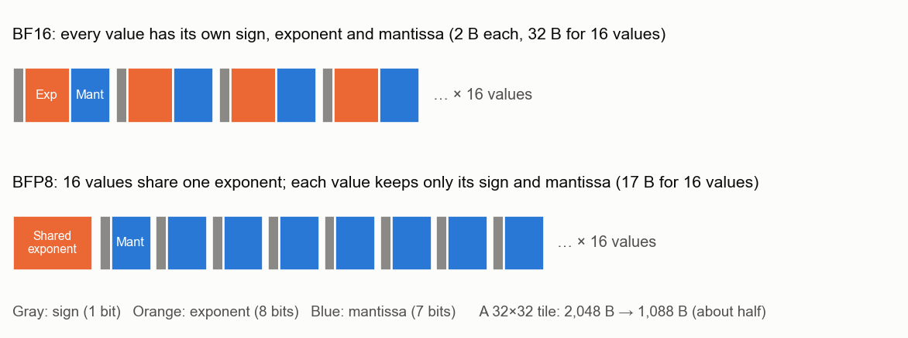

| Target | Items | What is reduced |
|---|---|---|
| Weights (qkv, xq, xkv, ff1, ff2, and later the output projection) | #48, #67 | Weight reads from DRAM. #67 relaxed the format constraint of the AGMM with the fused residual so that the output projection could also be BFP8 |
| ring SDPA inputs (Q, K, V) | #49, #52, #61 | The volume of K and V passed around the ring, and the SDPA reads |
| AGMM inputs (activations, the intermediate values of each layer) | #59 | The all-gather volume inside the AGMM. The LayerNorm output is written directly as BFP8 |
| FFN1 output (FFN2 input) | #60 | MM+RS reads |
| QKV AGMM output | #73 | Reads by the next distributed RMSNorm and SDPA. The input type constraint of RMSNorm was removed |
| cross-attention SDPA | #70 | The text K and V are converted only once, when they are cached |
| MM+RS partial sums | #76 | The partial sums sent in the reduce scatter. Only the final add is written in the residual format (BF16) |

#### (2) Multiplication fidelity to LoFi (fewer multiplication passes)

The WH matrix engine performs a mantissa multiplication in several passes. HiFi4 uses 4 passes, HiFi2 uses 2, and LoFi uses 1 with only the upper bits. Where compute is the bottleneck, LoFi is up to 2x faster than HiFi2.

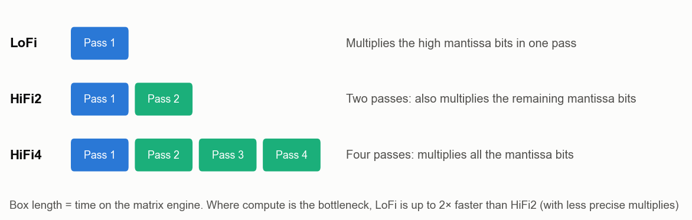

| Target | Item | Effect |
|---|---|---|
| QKᵀ and P·V in ring SDPA | #21 | ring SDPA 13.00 → 12.04 ms/block, e2e −4.1 s |
| Projection matmuls (attention and FFN) | #56 | Small on its own (once compute gets lighter, data supply becomes the bottleneck again). Effective combined with BFP8 |

#### (3) Accumulation from fp32 to BF16 (twice as many tiles in DEST)

A matmul's running sums are held in DEST. When they accumulate in fp32, DEST holds half as many tiles as with BF16 (4 tiles). The subblock (the block of output computed at once) gets smaller, and more input is read per output tile.

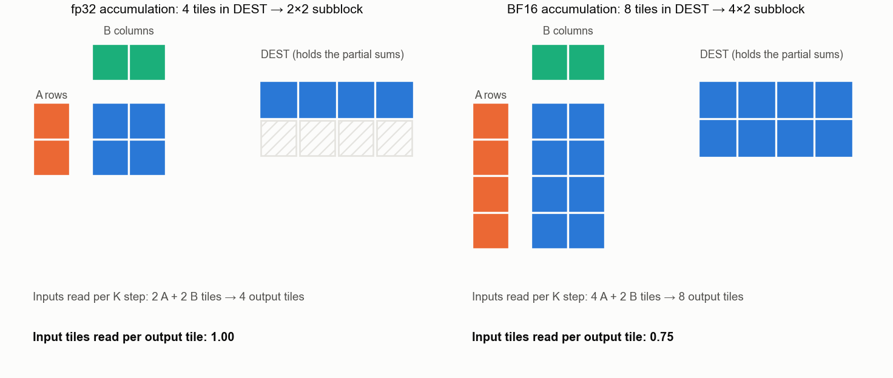

| Target | Item | Effect |
|---|---|---|
| FFN matmuls | #6 | Made the subblock 4×2 and searched the blocking (how the matmul is split) again. e2e −2.9 s |
| attention projections | #6b, #57 | The same rework for the attention projections. QKV subblock 2×2 → 4×2 |

### Effect

- **From 95.24 s after #5b to 53.73 s after #76:** The items in this range that belong to 1a account for −23.5 s. Of the −14.5 s in the #49-#66 range (73.86 → 59.33 s), the −2.5 s of #50 and #51 is 1b and the remaining −12.0 s is 1a.
- **The big ones:** #21 (LoFi for SDPA, −4.1 s), #6 (dropping fp32 DEST in the FFN, −2.9 s), #61 (BFP8, LoFi and BF16 DEST combined, −4.6 s), #66 (the fix described below, −3.0 s).
- **Block PCC:** 99.95-99.99%. The output changes, but the per-block error is small.

### Did picture quality drop?

Lowering the precision barely reduced picture quality. What changes is the composition (what is drawn where); the fine detail is kept.


Why the composition changes: a diffusion model removes noise little by little over 40 steps. A small numeric difference in the first step becomes the input of the next step and accumulates. So the final picture is different. Still, both pictures are drawn by the same model from the same prompt, at about the same quality.

### Costs and pitfalls

- **The composition changes:** With the same prompt and seed, the kind and position of the butterfly, the kind of flowers and so on change. This was not checked with quality metrics (CLIP, VBench), so picture quality was judged by eye.
- **Experiment switches did not apply to the measurement (#66):** LoFi and the SDPA BFP8 were applied after the pipeline's warm-up run. Programs were rebuilt in the first measured step, and LoFi applied to only some of the matmuls. Fixing this so they apply when the model is built gave −3.0 s (and changed the composition again).
- **LoFi combined with fp32 DEST hung (note on #66):** Combine LoFi only with BF16 DEST.
- **Keep the residual in BF16 (#61):** If the residual (the stream in which each block's output is added to its input) is BFP8, error accumulates layer by layer. When the SDPA inputs were made BFP8, the outputs of the output projection and the residual add had also become BFP8, so the residual stream was put back to BF16.
- **Where the weights are rounded also changes the composition (#50):** Moving the BFP8 conversion of the weights from the device side to the host side at load time changes how rounding happens, and the composition changes.

### How to enable

Only #21 (LoFi for the ring SDPA matmuls) is enabled by default in the code. The rest are off by default and are enabled with environment variables (see section 0.2 for where they go).

| Environment variable | Items |
|---|---|
| `WAN_WEIGHTS_BF8=qkv,out,xq,xkv,xout,ff1,ff2`, `WAN_WEIGHTS_BF8_LOAD=1`, `TT_AGMM_TERNARY_ANY_DF=1` | #48, #50, #67 |
| `WAN_SDPA_BF8=1` | #49, #52, #61 |
| `WAN_AGMM_IN_BF8=1`, `WAN_FFN2_IN_BF8=1` | #59, #60 |
| `WAN_QKV_OUT_BF8=1`, `TT_DIT_RMSNORM_ALLOW_BF8=1` | #73 |
| `WAN_XATTN_BF8=1` | #70 |
| `WAN_FFN2_RS_BF8=1`, `TT_MMRS_SPLIT_FINAL_DF=1` | #76 |
| `WAN_SDPA_MATMUL_FIDELITY` (LoFi by default; `none` disables it) | #21 |
| `WAN_PROJ_LOFI=attn,ffn` | #56 |
| `WAN_MM_FP32_DEST=all` (despite the name, it makes the matmuls of the given parts [`attn`, `ffn`, `all`] use BF16 DEST) | #6, #6b, #57 |

### What did not work

- All matmuls in LoFi (with BF16 weights, #23): the matmuls were not compute-bound, so this only skewed the error.
- BFP8 CBs for the SDPA intermediates (QKᵀ / P) (#29, #153): no effect, or the output broke.
- All SDPA inputs in BFP4 (a 4-bit format, half again) (#116): ring SDPA −2%, but the block PCC dropped to 99.51%.
- Skipping the type conversion before the output projection and feeding BF16 to the AGMM (#88): the all-gather volume doubled, and it got slower.


## 1b. Resident weights (no more FSDP weight re-gathering)

**Contribution:** −5.2 s (7% of the total).
**Output:** Residency itself does not change it. The same weights are simply kept in place from the start instead of being gathered every time (#72 has a mean pixel difference of 0.0 from before). But #50 also moved where the BFP8 conversion happens, so the composition changed (comparison below).

> **What "resident" means:** Keeping the weights in each chip's DRAM for the whole generation. It is the opposite of FSDP (section 0.3): no communication is needed, but much more memory is used the whole time.

### What was the bottleneck

- **The weights do not fit in DRAM:** There are two DiTs (one for high noise and one for low noise, about 14 billion parameters each). In BF16 (2 bytes per parameter), each is 28 GB. Even split over the 4 TP chips, that is 7.0 GB per chip, or 14 GB for both, which does not fit in one chip's DRAM (12 GB).
- **Hence FSDP:** The original configuration also split the weights over the 8 SP chips (about 0.9 GB per chip per DiT) and gathered them with all-gather right before each layer's computation.
- **The gather time was not hidden:** In the measurement before optimization ([NOTES.md](NOTES.md) §9.2), gathering weights took 2.9 ms (8.6%) of the 33.7 ms per block.
  - Each block gathered 154 MB, running at the limit of the inter-chip bandwidth (about 50 GB/s).
  - The matmul that uses the gathered weights waits until they have all arrived. So the gather was not hidden behind compute.
- This was repeated for every block at every step (twice per step, before the two CFG passes were merged into one).

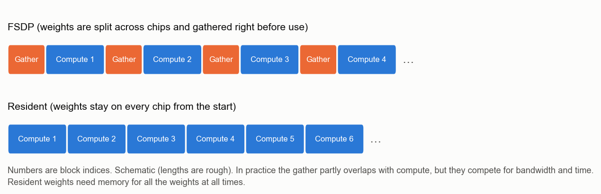

### What was done

There is not enough memory to make everything resident. So the resident range was widened in 5 stages, freeing memory at each stage.

| Stage | Item | What was done | Memory (per chip) | e2e |
|---|---|---|---|---|
| 1 | #5b | Made the FFN weights of the high-noise DiT (about 40% of the weights) resident | About 2.3 GiB more; 1.93 GiB free | −2.1 s |
| — | #24 | Also made the low-noise FFN resident | Only 0.75 GiB was free after initialization, and allocating the first buffer of the generation (20 MB) failed. **Rejected** | — |
| 2 | #50 | Converted the weights to BFP8 (#48 in 1a) on the host at load time, and made the whole high-noise DiT resident | High-noise weights 7.0 → 4.2 GB. 0.79 GiB free during steps | −2.3 s |
| 3 | #51 | Split the text encoder over 8 chips instead of 4, and used the freed memory to make the low-noise FFN resident too | The encoder frees about 1.3 GiB | −0.3 s |
| 4 | #71 | Split the text encoder's word embedding table over 8 chips | Free during steps 1.76 → 3.47 GiB | ±0 |
| 5 | #72 | Used the freed memory to make the whole low-noise DiT resident too (needs about 2.4 GB) | — | −0.5 s |

Key points of each stage:

- **#50 (BFP8 conversion at load time):** Trying to make everything resident in BF16 ran out of DRAM during loading. Until then, the weights were first placed on the device in BF16 and then converted to BFP8, so the BF16 copy from before the conversion took up space. If the conversion to BFP8 happens on the host, when the torch weights are turned into the device format, the BF16 copy never lands on the device.
- **#51 (text encoder split 8 ways):** The text encoder (UMT5) is used only once, at the start, yet it was split over the same 4 TP chips as the DiT and used a lot of each chip's DRAM. Splitting it along the 8-chip SP axis frees about 1.3 GiB. The text encoding time stays at 0.08 s.
- **#71 (embedding table split):** The word embedding table (256K words × 4,096 dims) was fully replicated on every chip and used 2.1 GB per chip. Now the 4,096 dims are split over 8 chips, and after the lookup an all-gather restores the full 4,096 dims. The computation is the same.

> **Terms:**
> - **GiB:** 2³⁰ bytes (about 1.07 GB). Memory amounts are given in GiB and weight sizes in GB.
> - **Embedding table:** A table that turns a word (token) id into a vector of 4,096 numbers. Used at the entrance of the text encoder.
> - **Steady-state step:** The time of a normal step, excluding the first few steps (which include setup work).

### Effect

- Total −5.2 s (#5b −2.1, #50 −2.3, #51 −0.3, #72 −0.5).
- Steady-state step: high noise 1,769 → 1,732 ms (#50), low noise 1,797 → 1,769 ms (#51), 1,391 → 1,360 ms (#72; now the same as the high-noise side).
- The weight gather time per block per step (both CFG passes), which was 5.78 ms, went to 0 ([NOTES.md](NOTES.md) §9.7).

### Did the output change?

Residency itself does not change the output (#5b is almost the same as #3; #71 and #72 have a mean pixel difference of 0.0).

Only #50 changed the composition. Below are #48, which converted to BFP8 on the device, and #50, which moved that conversion to the host.

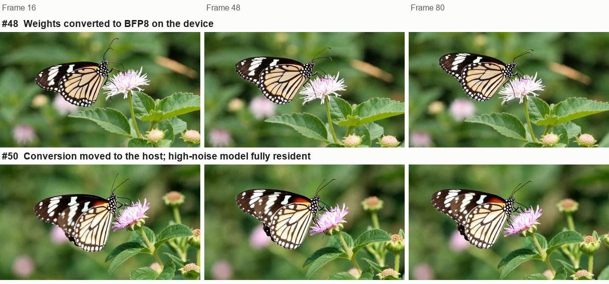

- The only difference is the source value that is rounded to BFP8. The device side rounds from the BF16 value; the host side rounds directly from the FP32 value. The host side is actually closer to the original weights.
- For only some of the weights, the rounded result is one step off, but over 40 steps the difference grows and the composition changes (same as "Why the composition changes" in 1a).
- It is not a difference in picture quality.

### Costs and pitfalls

- **Little memory headroom:** With little free memory, a large buffer added later may not fit. For example, in the VAE, decoding 6 or more latent frames at once ran out of DRAM (#75; freeing the DiT's communication buffers was not enough).
- **BFP8 is required:** With BF16 weights, both DiTs cannot be resident. This goes together with the BFP8 work in 1a.
- **After changing a parallel axis, check the video (#51):** After the text encoder was split over 8 chips, the first video had nothing to do with the prompt (a hand gripping a red ball).
  - The encoder splits the prompt batch (several prompts processed together) along the axis it does not use for TP. The cause was that this axis was derived from the DiT's TP axis.
  - It was fixed to derive the axis from the encoder's own TP axis. No error was raised; the bug was found only by watching the video.

### How to enable

Off by default in the code; enabled with environment variables (see section 0.2 for where they go).

| Environment variable | Items |
|---|---|
| `WAN_FFN_RESIDENT=transformer,transformer_2` | #5b, #51 |
| `WAN_FULL_RESIDENT=transformer,transformer_2` | #50, #72 |
| `WAN_WEIGHTS_BF8_LOAD=1` (converts the layers in `WAN_WEIGHTS_BF8` to BFP8 on the host at load time) | #50 |
| `WAN_ENC_ON_SP_AXIS=1` | #51 |
| `WAN_ENC_EMB_SHARD=1` | #71 |

`transformer` is the high-noise DiT and `transformer_2` is the low-noise DiT. A DiT listed in `WAN_FULL_RESIDENT` is fully resident, so in the current configuration, which lists both, `WAN_FFN_RESIDENT` has no real effect.

### What did not work

- **Weight prefetch (#5a):** The idea was to start gathering the output projection weights before ring SDPA and hide the gather behind SDPA. SDPA then had to wait for the same communication resources, so there was no gain (+0.3%).
- **Making the low-noise FFN resident first (#24):** As shown in the table above, there was not enough memory. It fit only after the text encoder was split (#51).

## 2. ring SDPA (faster attention)

**Contribution:** −12.4 s (18% of the total). The second-largest theme after 1a.
**Output:** Changes slightly. In items that change the chunk boundaries or the order of additions (#3, #45, #69, #117, #128, #167), details and positions shift slightly. The composition is the same. Only for #3 is the shift easy to see.
LoFi for the ring SDPA matmuls (#21) and BFP8 inputs (#49 and others) are counted in 1a.

### How ring SDPA works

- **attention:** Each video token looks at all the other tokens, decides how much to draw from each one, and mixes their information in that proportion. As a formula, softmax(QKᵀ)·V.
  - A 480p video has about 33K tokens. Every pair of tokens is computed, so this is the heaviest part of the DiT.
  - Wan has 40 attention heads, and with TP each chip handles 10 heads.
- **Splitting with SP:** When the tokens are split over 8 chips, Q (the side that looks) needs only the local 1/8. But K and V (the side being looked at) are needed from all chips.
- **ring:** So the K and V chunks are passed to the neighboring chip in turn. After 7 passes around the ring of 8 chips, every chip has seen every chunk. Chunks are computed as soon as they arrive, so the communication is hidden behind compute.
- **Inside one core:** Q is split into chunks that are distributed to the cores, and the K and V chunks stream through in order. One step is "Q chunk × K chunk".
  - There are two matmuls (QKᵀ and P·V). Between them come the softmax steps (row max, subtract and exp, row sum, correction of the earlier result).

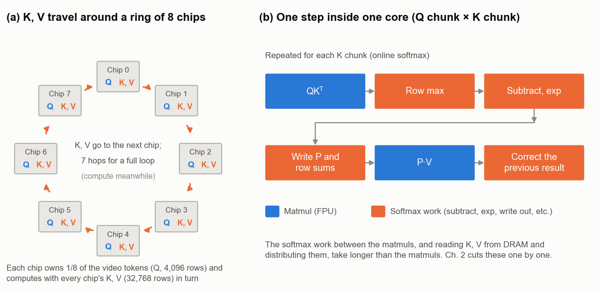

> **Terms:**
> - **Chunk:** A unit of several rows of Q or K. (256, 512) means that one step computes the pair "256 rows of Q × 512 rows of K".
> - **online softmax:** A way to compute softmax while looking at K one chunk at a time. If a new chunk raises the row max, the result so far is corrected. It avoids keeping a table of all token pairs in memory, at the cost of a correction for every chunk.
> - **Threads:** A Tensix core has 5 small CPUs inside: reader and writer (read and write data from DRAM or other cores), unpack (loads tiles from L1 into the engines), math (tells the engines to do matmuls and so on), and pack (writes results to L1).
> - **FPU, SFPU:** The FPU is the matmul engine. The SFPU is the engine for element-wise math such as exp. In this ring SDPA, the pack thread computes exp on the SFPU.
> - **NoC:** The on-chip network that connects the cores and DRAM. There are two: NoC0 moves right and down, NoC1 moves left and up.
> - **chain, multicast:** Ways for one core to share data it read from DRAM with other cores. chain relays it to the neighboring core, one core at a time. multicast delivers it to everyone with one write.
> - **M cycle:** One million clocks. At a 1 GHz clock, 1 ms.

### What was the bottleneck

The bottleneck changed three times. Fixing one exposed the next.

1. **First, efficiency inside a step (analysis in #33):** ring SDPA ran at only 19% of the theoretical speed.
   - Breakdown: 63 usable cores out of 72 (0.875) × per-core work imbalance (0.85) × efficiency inside one step (0.27).
   - Inside one step, QKᵀ → row max → subtract and exp are lined up in sequence by data dependencies. The threads wait on each other, and the matmul engine is busy for only about 27% of the step.
   - With small K chunks, the per-chunk correction cost is paid many times.
2. **Once compute was faster, the K and V supply (#37-#44):** The first core of each head read K and V from DRAM and distributed them via chain. This read could not keep up, and the compute cores waited for K and V to arrive.
3. **Once the supply was fixed, the pack thread (#115):** All three compute threads were 80-90% busy. The busiest was pack, and its largest part was the softmax "subtract + exp" (including writing out P and the row sum).

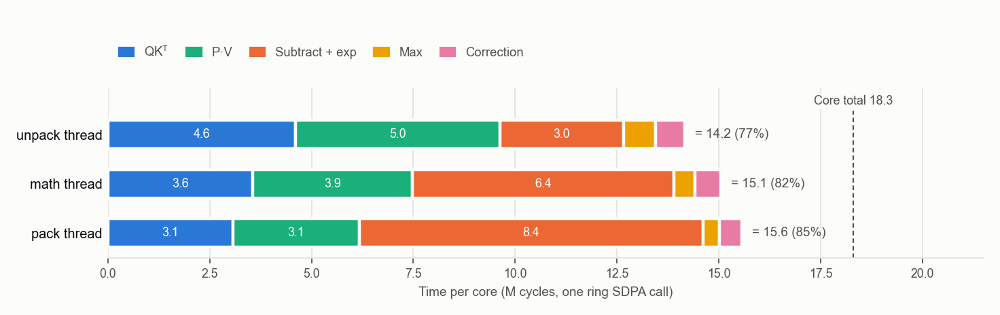

### What was done

#### (1) Compute bigger chunks at a time (#3, #69)

- The fixed per-chunk overhead (updating the max, the correction) is repeated once per K chunk. Bigger K chunks mean fewer repetitions.
- **#3:** (256, 256) → (256, 512). ring SDPA 14.69 → 13.06 ms per call. e2e −5.4 s, the largest single item in chapter 2.
  - The limit is whether it fits in L1 (about 1.4 MiB per core).
  - Sizes where the number of K tiles is prime (11, 17) were slower even though they are bigger. The guess is that only small matmul subblocks can be used for them.
- **#69:** BFP8 inputs (1a) freed L1, so the chunk became (128, 1024). With 128-row Q chunks, the number of rows to correct is also halved. e2e −1.1 s.

#### (2) Read K and V from DRAM fewer times (#45, #78)

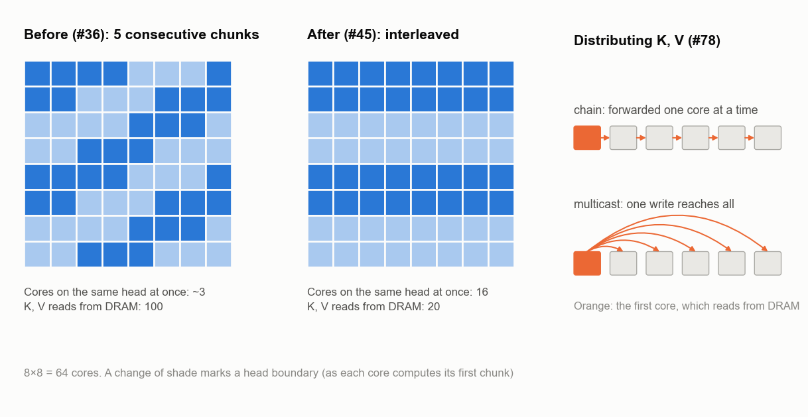

- **#45 Q interleave:** One chip has 320 work items (20 heads × 16 Q chunks), and the 64 cores take 5 each.
  - Before: each core took 5 consecutive items (almost all from the same head). Only about 3 cores computed the same head at the same time, and the first core of the chain re-read K and V once for every chunk handled. That was 100 reads per ring step.
  - After: in 5 rounds, 16 cores each compute one of the 16 chunks of the same head. The first core of the chain needs to read only once per round, so the reads dropped to 20.
- **Aligning the NoC direction:** Q interleave alone made half of the chips in the mesh slower (#44).
  - The inter-chip all-gather traffic and the DRAM reads of the chain's first core were competing on the same NoC route.
  - The reader was moved to NoC1, and the chain was reordered to follow NoC1's direction (leftward). Relaying in the opposite direction makes all chips about 2x slower (40.6 ms).
  - ring SDPA evened out at about 20.7 ms on all chips (max 22.76 → 20.84 ms). e2e −2.5 s.
- **#78 multicast:** K and V, which had been relayed one core at a time via chain, are delivered to a group of 32 cores with one write. ring SDPA 18.03 → 17.70 ms. e2e −0.5 s.

#### (3) Less work for the pack thread (#118, #119, #120, #167)

All of these keep the computation the same and change how the pack thread issues its instructions. #118-#120 also give bit-identical videos.

| Item | What was done | ring SDPA | e2e |
|---|---|---|---|
| #118 | Lowered the threshold for "blocked" (batched) writes from 8 or more tiles to 4 or more. Wan's shape writes 4 tiles at a time, so until then the tiles were written one by one | 17.73 → 17.19 ms | −0.8 s |
| #119 | The row sum was accumulated with one write per P tile. Setting the destination stride of the blocked write to 0 lets one write accumulate 4 tiles into the same tile | 17.19 → 16.84 ms | −0.6 s |
| #120 | exp called the SFPU and waited for it to finish once per tile. Now one call computes 8 tiles in a row (one setup and one completion wait) | 16.84 → 16.36 ms | −0.8 s |
| #167 | Get the row sum from the P·V matmul at the same time (figure below). 128 fewer pack writes per pair | 15.5 → 15.2 ms | −0.4 s |

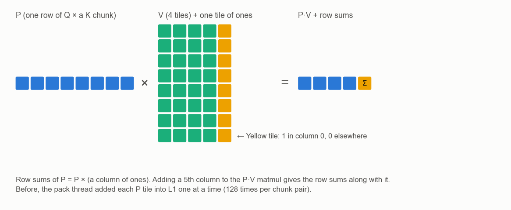

#### (4) Others (#128, #117)

- **#128 Fewer unpack reads:** The QKᵀ matmul subblock went from 2×4 to 1×8. The tiles loaded into the engine per K step go from 10 to 9. unpack was bound by the number of tiles (#116). e2e −0.3 s.
- **#117 Skip a type conversion:** The final ring SDPA output is written directly in BFP8, the format the next matmul uses. The type conversion op in between (0.14 ms per block) goes away. e2e −0.2 s.

### Effect


- ring SDPA halved, from 29.4 to about 14.7 ms. Chapter 2 items (blue) account for 8.3 ms of that, and other chapters (lower precision, merging the CFG passes, 8×10 cores) for 6.4 ms.
- In e2e, the total is −12.4 s (#3 −5.4, #45 −2.5, #118-#120 −2.2, #69 −1.1, #78 −0.5, #167 −0.4, #128 −0.3, #117 −0.2).
- Even so, ring SDPA is still the longest op in a block (59% of the block as of #107).

### Did the output change?

Items that change the chunk boundaries or the order of additions change the video slightly. Items that do not (#78, #118-#120) are bit-identical.


- In #3, the boundaries of the softmax accumulation changed, and that difference grew over 40 steps. Both are clean videos of the same prompt.
- #45 (a change of core assignment) gave an almost identical video (mean pixel difference 4.15).


### Costs and pitfalls

- **NoC direction:** If the chain's relay direction does not match the NoC's direction, it gets much slower (1.5-2x in #44 and #45).
- **Hangs (#78, #167):** Changes to kernel synchronization easily cause hangs.
  - In #78, the multicast destination range was given in NoC0's direction, so the data reached only one core at the end of each row and everything stopped. It was fixed to use NoC1's direction.
  - In #167, the math and pack threads each waited for the SFPU to be free and stopped (3 out of 9 runs). It was fixed by changing the pack-side wait from a hardware wait to a wait on a dedicated signal (a semaphore) that the TRISC reads (`TT_RING_SDPA_SFPU_GO`).
  - Rare hangs still remain in ring SDPA and the matmuls. They concentrated on a few specific chips, so a hardware-specific cause is possible, and the investigation was stopped (chapter 10).
- **L1 limit:** The chunk size tops out at L1. (256, 1024) does not fit in L1 (1.68 MB).

### How to enable

The (256, 512) of #3 is the code default. The rest are enabled with environment variables (see section 0.2 for where they go).

| Environment variable | Items |
|---|---|
| `WAN_SDPA_CHUNK=128,1024` | #69 |
| `TT_RING_SDPA_Q_INTERLEAVE=1`, `TT_RING_SDPA_READER_NOC1=1`, `TT_RING_SDPA_Q_INTERLEAVE_ORDER=rev` | #45 |
| `TT_RING_SDPA_Q_INTERLEAVE_MCAST=1` | #78 |
| `TT_RING_SDPA_FINAL_BF8=1` | #117 |
| `TT_SDPA_BLOCKED_PACK_MIN=4` | #118 |
| `TT_RING_SDPA_SUM_STRIDE0=1` | #119 |
| `TT_RING_SDPA_EXP_BATCH=1` | #120 |
| `TT_RING_SDPA_QK_SB=1,8` | #128 |
| `TT_RING_SDPA_PV_SUM=1`, `TT_RING_SDPA_SFPU_GO=1` | #167 |

> **Separate item: fast exp (#138, off by default):** Replaces the softmax exp with a fast approximation that skips the input range check (`TT_RING_SDPA_EXP_OVF=1`). −0.8 s in the current configuration. It changes the output and may affect picture quality, so it is off by default and counted separately.

### What did not work

- **Rewriting softmax (#32-#34, #115):** A prototype that removes the max and the correction and does even exp inside the engines. As of #34 it promised −28% per step, but after the original kernel had improved, it was slower on one chip (11.6 → 11.9 ms). The unpack reads for the matmuls remained, so the rewrite was stopped.
- **Subtracting an upper bound instead of the max (#46):** Compute exp after subtracting a guaranteed upper bound for each row. ring SDPA got slower (20.8 → 21.4 ms), and the block PCC dropped to 95.8%.
- **Keeping the max from the first stage (#139):** ring SDPA was faster (15.40 → 14.49 ms), but the video broke.
- **Every core reads K or V from DRAM (#40):** Without the chain, it tops out at the DRAM read bandwidth (about 100 GB/s with this access pattern) and was 54% slower.
- **A separate ring SDPA op meant for BH (#41):** It did not fit in L1 on WH 4×8 and did not run.
- **Reordering the processing (#168, #171):** Grouping the work to reduce engine configuration switches cut the time during which the three threads can run at once, and it got slower.

## 3. Matmuls (FFN2 path, AGMM data flow, ring MM+RS)

**Contribution:** −10.8 s (16% of the total).
**Output:** Changes slightly in some items. Items that change the order of additions (#1, #68, #142, #143) shift details slightly, but the composition is the same. #80, #132 and #133 are bit-identical.
Matmul speedups from BFP8 weights and inputs, LoFi and BF16 DEST are counted in 1a.

### How matmuls work

- **7 matmuls per block:** QKV, the self-attention output projection, the cross-attention Q, K/V and output projections, FFN1 and FFN2. The per-chip size for QKV, for example, is 8,192 rows (both CFG passes × 4,096 tokens) × 5,120 × 3,840.
- **Weights split over the 4 TP chips:** Depending on how they are split, a matmul takes one of two forms.
  - AGMM: gather the input, which is split over the 4 chips, with all-gather, then multiply by your own columns of the weight.
  - MM+RS: multiply by your own rows of the weight to make partial sums, then add up the partial sums of the 4 chips and distribute them (reduce-scatter). FFN2 has this form.
  - Both combine the communication and the matmul into one op (a fused op) that computes on data as it arrives, hiding the communication behind compute.

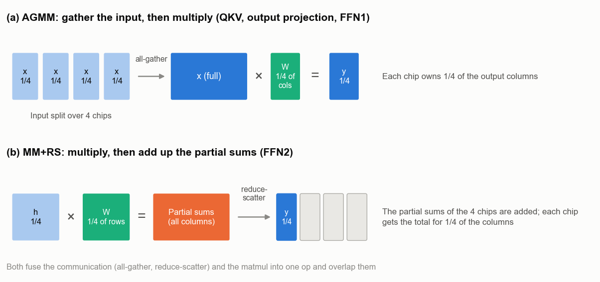

- **Inside a chip:** The output is split over, for example, 8×8 cores, and each core computes its own block of the output.
  - The input (in0, the activations) is read from DRAM by the first core of each row and distributed to the cores in the same row.
  - The weight (in1) is read from DRAM by the first core of each column and distributed to the cores in the same column.

> **Terms:**
> - **Blocking:** The setting for how a matmul is split into blocks along M (rows), N (columns) and K (the direction summed over). Written like (8, 8, 10). The subblock is the shape of the output tiles held in the engine (DEST) at once (2×2, 4×2, etc.).
> - **in0, in1:** The two inputs of a matmul. In Wan, in0 is the activations and in1 the weights.
> - **injector:** The first core, which reads from DRAM and distributes the data to the other cores.
> - **Fabric:** The mechanism that carries data over the Ethernet links between chips.
> - **Grid:** The arrangement of cores that an op uses. A WH Galaxy chip has 8×10 cores, and one row is used for dispatch, so ops usually get up to 8×9 = 72 cores (8×10 in chapter 5).

### What was the bottleneck

The bottleneck moved from "no config" → "data supply" → "serial work of the first core".

1. **No config (at first, [NOTES.md](NOTES.md) §9.3):**
   - The fused MM+RS for FFN2 had no config for WH's 8×9 grid and ran with default values. Engine utilization was 19%. The log printed a warning about using defaults 3,360 times per run.
   - So FFN2 took about twice as long as FFN1, which has the same amount of compute (first values in the figure below: 10.36 ms vs 5.42 ms).
   - The other main matmuls also ran with the generic blocking (8, 8, 8).
2. **Data supply (#47, #53):**
   - Even skipping the matmul compute itself shrank the AGMM by only about 6%. The bottleneck was the data flow: the input all-gather, the weight reads, the output writes and so on.
   - Making the weights BFP8 (1a) lightened the data and made it compute-bound. Lightening the compute with LoFi then brought data supply (especially in0 of the output projection) back as the bottleneck (#56).
3. **Serial work of the first core (#132):** In the AGMM of the output projection shape, the first core of in0 did, alone and in sequence, the DRAM read, the wait for free space at the receivers, the distribution, and the write-out of its own output. The sum was almost the whole op time. Waiting for data from other chips took about 2 µs, so inter-chip communication was not the bottleneck.

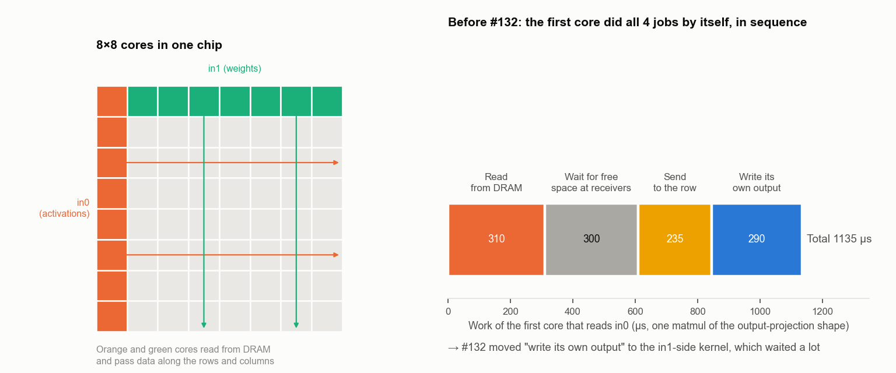

### What was done

#### (1) Leave the slow FFN2 path (#1, #2b, #4)

- **#1 Unfuse:** FFN2 was split into 3 ops: "matmul → reduce-scatter → residual add". This is the same path that MiniMax-H3 uses when there is no fused config.
  - Per call 5.18 ms → 3.19 ms (matmul 2.19, reduce-scatter 0.81, add 0.20).
  - e2e −6.0 s. The largest item in chapter 3, and one of the largest of all items.
- **#2b Search for WH configs:** The WH blocking for Wan's 7 matmul shapes was searched exhaustively (2,080 combinations, about 50 minutes). FFN2 went back to a fused MM+RS tuned for WH (8×7 grid). e2e −1.7 s.
  - Blocking alone gives a few % for each matmul (the top configs differ little). The big win was fixing FFN2, which had been taking the slow path because it had no config.
- **#4 Automatic choice:** Choose fused or unfused automatically, depending on whether a fused config is found. No change at 480p, −3.8% at 720p.

#### (2) Search the AGMM blocking again (#68)

- BFP8 inputs (1a) freed L1, so configs with the M block widened to 16 were searched (#62).
- In the block test, QKV 2.72 → 2.52 ms and FFN1 2.74 → 2.38 ms. At #62 the e2e time did not change, but measured again after fixing how experiment switches were applied (#66), e2e −0.7 s.

#### (3) Fix the AGMM data flow (#80, #132, #133)

- **#80 Multicast in0:** Instead of relaying it one core at a time from the first core (chain), one write delivers it to the whole row (the same idea as #78 in chapter 2). Output projection 1.33 → 1.22 ms, and so on. e2e −0.5 s.
- **#132 Move the output write to the other kernel:** Of the four jobs in the figure above, "write out its own output" was moved to the in1-side data movement kernel, which spends much of its time waiting for free space and has slack. e2e −0.8 s.
- **#133 Signal readiness first:** The core that sends in0 to the other chips did "receive → send to the fabric → signal ready for the next block", in that order, so the send time turned into a wait for the first core. Now it signals readiness first and sends the previous block afterwards. e2e −0.2 s.

#### (4) A new program for FFN2 (#142, #143)

- **Before:** The fused FFN2 op computed the matmul on 8×7 = 56 cores and gave the top 2 rows the reduce-scatter work.
- **#142 Add and pass along while computing:** A new program was written in which all 72 cores compute the matmul and the matmul cores also do the reduce-scatter.
  - In 4 rounds, each round computes 1/4 of the output columns. A chip receives the partial sums that the neighboring chip computed for the same columns in the previous round, adds its own, and passes them to the next chip (figure below).
  - The core at the end of each column writes the partial sums, over its own fabric connection, directly into the L1 of the core at the same position on the neighboring chip.
  - In the last round, the sum for the chip's own columns is complete, and it is written out after the residual add (+ bias, gate).
  - FFN2 2.55 → 2.30 ms. e2e −0.5 s.
- **#143 Faster in0 reads:** The same amount of DRAM reading was about 3x slower on NoC1 than on NoC0. Now only the reads use NoC0 (dynamic NoC mode), and groups of 4 cores share the reading. FFN2 2.30 → 1.97 ms, almost the same as the matmul-only time (1.92 ms). e2e −0.4 s.

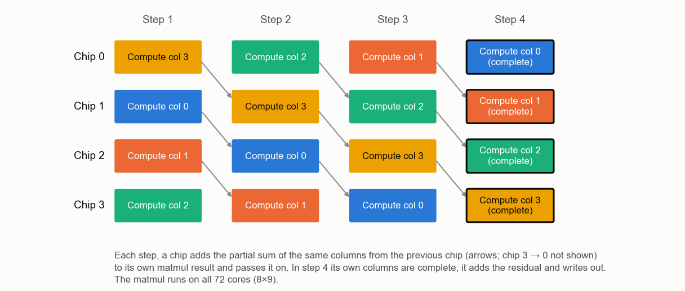

### Effect

- Total in e2e −10.8 s (#1 −6.0, #2b −1.7, #132 −0.8, #68 −0.7, #80 −0.5, #142 −0.5, #143 −0.4, #133 −0.2).
- The time of each matmul shrank as shown below. The differences in the figure also include the effects of 1a (BFP8, LoFi, BF16 DEST) and chapter 4 (the cross-attention K/V cache).
- FFN2 went from 10.36 to 2.62 ms (#77), and then to 1.97 ms with #142 and #143.

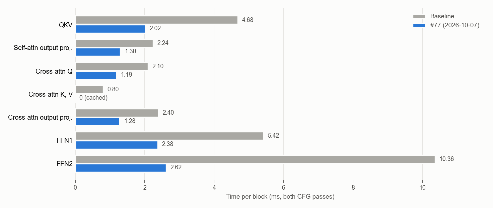

### Did the output change?

Most items either do not change the output or shift details slightly because of a different order of additions.


#142 had one precision pitfall (next section).

### Costs and pitfalls

- **The precision of a single multiplication can change the composition (#142):** The first version had an op test PCC of 99.9685% (the original op: 99.9790%), and the composition of the video changed (mean pixel difference 22.9).
  - The cause was that the gate multiplication applied to the residual was computed in LoFi, the same as the matmul. The original reduce-scatter computed it in HiFi4.
  - Making only this multiplication HiFi4 restored the precision of the original op (PCC 99.9792% with random inputs), and the composition matched the original.
  - LoFi for matmuls (1a) helps speed, but there is no need to lower the precision of small multiplications that do not affect the time.
- **Without a config, it silently takes the slow path:** Shapes missing from the config table run with default values and only print a warning in the log. Counting the log warnings makes them easy to find (#1, #2).
- **L1 headroom:** The #142 program uses 1.33 MB for CBs alone. With the enlarged kernel config region (#109 in chapter 5), only about 6 KB is left.
- **Read speed depends on the NoC:** The same read varied by 2-3x with the NoC and the position of the reading core. A version that applied the same trick (dynamic NoC) to the AGMM weight reads hung, so it was not adopted (#144).

### How to enable

#1, #2b and #4 are the code default (the config table and the automatic choice; `WAN_FFN2_UNFUSED=1` forces the unfused path). The rest are enabled with environment variables (see section 0.2 for where they go).

| Environment variable | Items |
|---|---|
| `WAN_AGMM_OVR=8192x5120x3840=16,10,10,4,2;8192x5120x3456=16,8,14,4,2;8192x5120x1280=16,8,5,8,1` | #68 |
| `TT_AGMM_IN0_MCAST=1` | #80 |
| `TT_AGMM_OUT_IN1=1` | #132 |
| `TT_AGMM_FAB_DEFER=1` | #133 |
| `TT_MMRS_RING=1` (the #143 part is on by default inside it; `TT_MMRS_RING_IN0_GATHER=0` and `TT_MMRS_RING_DYN=0` revert it) | #142, #143 |

### What did not work

- **Blocking with fewer DRAM re-reads (#54):** The K block got smaller and accumulation in L1 increased, so it got slower. The re-reads were not the bottleneck.
- **Triple-buffered CBs (#55):** FFN1 got faster but the output projection got slower, and the two canceled out.
- **Multicast in1 too (#89):** FFN1 is compute-bound, so nothing changed (kept as a switch).
- **Batching the GELU post-processing (#121):** The same trick as #120 in chapter 2, but in FFN1 that work was already hidden, so nothing changed.
- **Sharing the weight reads in the ring FFN2 (#145):** The synchronization overhead was heavy, and it got slower (1.97 → 2.84 ms).

## 4. CFG, cross-attention, text (batch the work and stop repeating it)

**Contribution:** −9.7 s (14% of the total).
**Output:** Changes slightly in some items. CFG batching (#15) changes the matrix sizes and thus the order of additions, so things like leaf positions shift slightly. The other items are almost the same or bit-identical.
BFP8 for the cross-attention SDPA (#70) is counted in 1a, and fusing the add after cross-attention (#77) in chapter 6.

### How it works

- **CFG:** Each step runs the DiT twice: once with the prompt and once with the negative prompt (a prompt that describes what to avoid). The two runs differ only in the text; the video latents and the timestep are the same.
- **cross-attention:** Attention in which the video tokens (Q) look at the text tokens (K and V, 512 of them). The text stays the same for all 40 steps.

### What was wasted

- **Recomputing the same thing every time:** The cross-attention K and V are made from the text alone, so they have the same values for all 40 steps. Yet every step and every block redid the K/V projection matmul (0.40 ms), the FSDP all-gather that collects its weights (0.40 ms), and the K normalization.
- **Running the blocks twice:** With the two CFG passes, the weight gather and the op launches each happened twice. The matrices were also small, which is inefficient.
- **Uneven work per core:** Distributing the ring SDPA work (160 Q chunks = 10 heads × 16) over 63 cores gives 34 cores 3 chunks and 29 cores 2 chunks. The whole op is not done until the 3-chunk cores finish. On top of that, some of the 2-chunk cores were held to the pace of the 3-chunk cores by the K/V chain and waited.
- **Most of the text is padding:** The text is padded to 512 tokens, and the K and V of all padding tokens have the same value. Attention was computed over them every time too.

### What was done

#### (1) Cache the cross-attention K and V (#10)

- The K and V made in the first step are kept per prompt and reused. The cache is cleared every time the prompts are prepared again, so the K and V of a different prompt are never used.
- Per block 27.59 → 26.71 ms. e2e −2.6 s.
- Memory grows by about 0.4 GiB.

#### (2) Merge the two CFG passes (#15, #36)

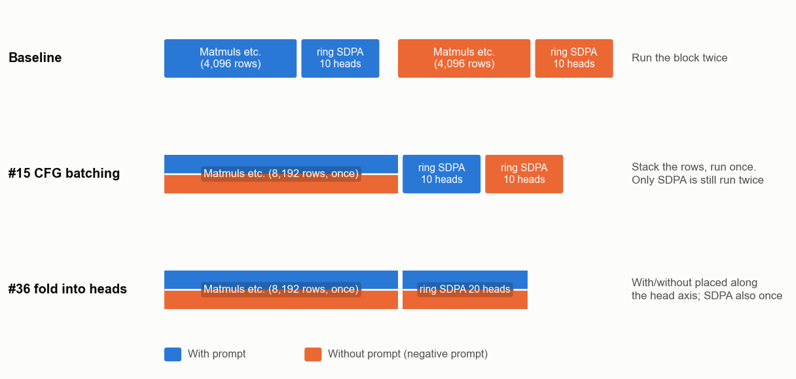

- **#15 CFG batching:** The rows of both passes are stacked vertically on each chip (4,096 rows → 8,192 rows), and the blocks run only once. The weight gather and the op launches happen only once, and the matrices get bigger.
  - But ring SDPA alone got 4x slower when merged (#15a). With batch 2, the K/V chain cannot be used, and every core reads K and V from DRAM on its own. So ring SDPA alone is still called twice (#15b).
  - Blocking for the 8,192-row matmul shapes was also registered (#15d). e2e −2.9 s.
- **#36 Fold into heads and spread evenly over 64 cores:** Attention is independent per head, so computing the two passes (with and without the prompt) as "one pass with 20 heads" gives the same result.
  - The work becomes 20 heads × 16 = 320 items, and going from 63 to 64 ring SDPA cores (8×8) gives exactly 5 items per core. The largest per-core work drops from 1,536 rows to 1,280 rows (figure below).
  - The row reordering ops (transpose, slice, concat) are also gone. Ops per block 54 → 46.
  - ring SDPA 24.08 → 22.39 ms. e2e −3.9 s, the largest single item in chapter 4.

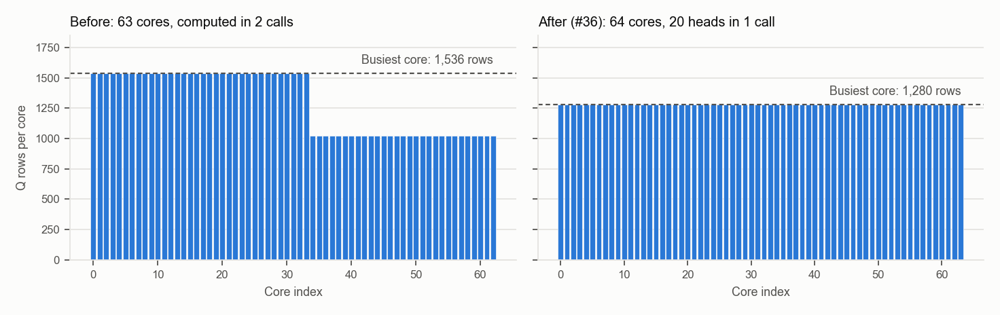

#### (3) Rework cross-attention (#101, #106, #164)

- **#101 Fold cross-attention into heads too:** In cross-attention, the text K and V differ between the two passes, so Q was reordered (transposed) and computed as two passes. As in #36, it is now folded into heads (a reshape without a copy), and K and V are laid out in head order when the cache is built. e2e −0.1 s.
- **#106 Chunk (256, 512) for the cross-attention SDPA:** The text K has 512 entries, so all of it can be seen in one go. The online softmax correction goes away. e2e −0.05 s.
- **#164 Compact the text padding:** See the figure below. Having n identical keys is the same as multiplying the softmax weight of one such key by n. K and V are compacted from 512 to 256 entries, and the padding columns get a weight of 3.
  - cross-attention SDPA 0.31 → 0.18 ms. e2e −0.2 s.
  - The result is mathematically the same as the original. The difference between the compacted and the original versions was the same size as the difference between other equivalent ways of writing the same computation (rounding noise).

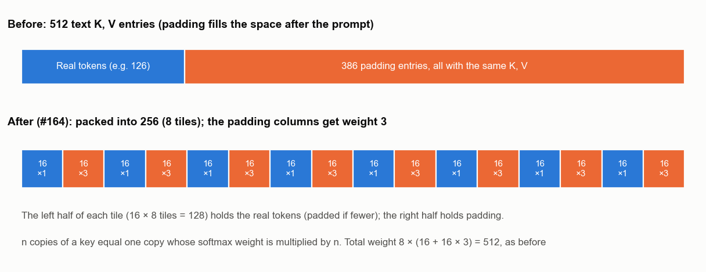

### Effect

- Total −9.7 s (#36 −3.9, #15 −2.9, #10 −2.6, #164 −0.2, #101 −0.1, #106 −0.05).
- Even the items that do not reduce the amount of compute (#15, #36) got faster by batching: fewer communications and launches, and no work imbalance.

### Did the output change?

- **#15:** The 8,192-row matmul uses a different blocking (order of additions), so it is not bit-identical to the two-pass computation. The composition shifts slightly (mean pixel difference 12.9). The quality is the same.
- **#36:** Almost identical (mean pixel difference 0.03).
- **#10, #101, #164:** Indistinguishable from run-to-run noise, or bit-identical.


When comparing with older videos or checking reproducibility, `WAN_CFG_BATCH=0` turns CFG batching off.

### Costs and pitfalls

- **Twice the activation memory:** CFG batching doubles the rows, so the memory for intermediate data also roughly doubles. This is also why the low-noise FFN could not be made resident (#24 in 1b).
- **ring SDPA with batch 2 is slow (#15a):** Some ops have tricks that work only at batch 1 (here, the K/V chain). Before batching, check the branches inside the op.
- **One half alone does not help (#36):** Going to 64 cores alone leaves the largest per-core work at 3 items. On top of that, ring SDPA got slower on the chips in the second half of the mesh (probably because the communication cores moved). Folding into heads alone gives 320 ÷ 63, which does not divide evenly, so some cores still get 6 items. Only the two together helped.
- **Use the same measurement conditions (#36):** At first, it was measured without sourcing the standard environment variables, and the wrong conclusion "#36 does not help" was nearly drawn. Since then, every run sources the standard environment variables, and the environment variables printed in the log are checked.
- **Where #164 applies:** Only when cross-attention has no mask. A weight of 3 works only up to 128 real tokens (beyond that, the weight changes to 5, ..., 33).

### How to enable

#15 and #36 are the code default (`WAN_CFG_BATCH=0` and `WAN_CFG_HEADFOLD=0` turn them off). The rest are enabled with environment variables (see section 0.2 for where they go).

| Environment variable | Items |
|---|---|
| `WAN_CROSS_KV_CACHE=1` | #10 |
| `WAN_XATTN_FOLD=1` | #101 |
| `WAN_XSDPA_CHUNK=256,512` | #106 |
| `WAN_XATTN_COMPACT=1` | #164 |

### What did not work

- **trace (#11):** A mechanism that records the op sequence once and replays it on the device. Op issue on the host was not the bottleneck (the device is slower), so nothing changed. It also does not work together with the K/V cache (#10).
- **Q chunk 128 to remove the imbalance (considered for #36):** The imbalance goes away, but chunk 128 itself was about 1.5x slower for the same number of rows.
- **A 1×8 subblock for the cross-attention SDPA matmul (#129):** The same trick as #128 in chapter 2, but nothing changed.
- **Less compute in the cross-attention SDPA (#131):** Measured with a timing-only variant, compute was only about 0.06 ms of the 0.37 ms op, so there was nothing to cut.

## 5. Dispatch and runtime (8×10 cores, 3 SP links, kernel config region)

**Contribution:** −3.5 s (5% of the total).
**Output:** Changes slightly. Extending the QKV and FFN1 matmuls to the 10th row changes the blocking and therefore the order of additions (same composition, mean pixel difference 12.2). Enlarging the config region (#109, #165) does not change it.
In this theme, fixing the races exposed by the speedups was a bigger job than the speedups themselves.

### How it works

- **Dispatch:** The mechanism that receives commands from the host, writes programs (kernel binaries and settings) to each core, and sends the start signal. In WH Galaxy's standard configuration, the 10th row of Tensix cores (8 cores) on each chip does this job. So an op can use at most 8×9 = 72 cores for compute.
- **Ethernet cores:** Each Ethernet port that connects the chips also has a small core. On a Galaxy, all 16 links per chip (4 directions × 4 links) are connected, and the fabric uses all of them.
- **Kernel config region:** The area in each core's L1 that holds the program of the op about to run. The WH default is 69 KB.

> **Terms:**
> - **prefetch, dispatch, dispatch_s:** The three roles that share the dispatch work: one prefetches commands from the host, one writes the programs, and one sends the start signals and checks for completion.
> - **Race:** When the order of two operations flips depending on timing. Usually the result changes slightly, or, rarely, everything stops (a hang). Making things faster changes the timing and can expose hidden races.
> - **Chained block test:** A test that feeds the output of one block in as the next input, runs 2,000 blocks in a row, and compares the hash of the final value across runs. It was built to find rare races.

### What was the bottleneck or waste

- **Only 72 cores were usable:** Both the matmuls and ring SDPA had been tuned to the point where the core count decided the time. There are 80 cores, but dispatch used the 8 cores of the 10th row.
- **Gaps between ops (#109):** There were 5-32 µs gaps between ops. A closer look showed that the 72 cores of the next op all started within 0.4 µs of each other, which means they had been waiting on dispatch.
  - The ring SDPA kernel binary is 60.5 KB, and it does not fit in the 69 KB config region together with the program of the previous op.
  - So the program of the next op could not be written until the previous op finished.

### What was done

#### (1) Enlarge the kernel config region (#109, #157, #165)

- The L1 for compute was reduced by 128 KB, and the config region was enlarged by that amount. The program of the next op can be written while the previous op is running.
- All the gaps (32, 22, 5-7 µs) became 0.6 µs. e2e −0.1 s.
- Later it turned out that, combined with one form of Ethernet dispatch (without dispatch_s), the e2e result diverged from step 32, so the enlargement was removed for a while (#157, +0.1 s).
- Comparing again in 6 alternating pairs showed that the divergence also happened without the enlargement: it was a pre-existing race. So the 64 KB enlargement was restored (#165, −0.15 s).

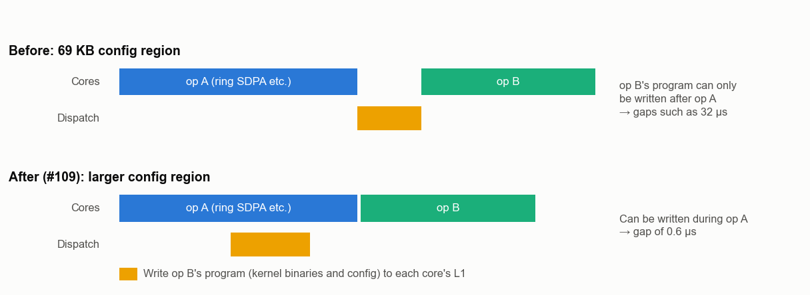

#### (2) Dispatch on Ethernet cores and compute on 80 cores (#154, #155)

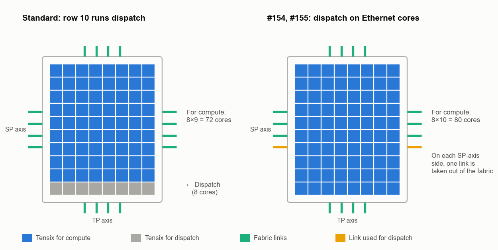

- **#154:** tt-metal has a Galaxy configuration that puts dispatch on Ethernet cores, but enabling it as is stops with "no free Ethernet cores".
  - On the SP axis (the ring of 8 chips used only by ring SDPA), 2 of the 4 links on each side were removed from the fabric at both ends (using the existing mechanism for removing unstable links). The Ethernet cores of the removed links become free, and dispatch runs on them.
  - All 8×10 = 80 Tensix cores can then be used for compute. ring SDPA computes on 72 cores and puts its all-gather workers in the 10th row; QKV and FFN1 split the output N over 9 rows.
  - Per block 26.47 → 25.19 ms (ring SDPA 15.74 → 15.01, QKV 1.97 → 1.78, FFN1 2.01 → 1.75 ms). e2e −2.0 s, the largest item in chapter 5.
  - Ethernet dispatch itself added no overhead (with compute restricted to 8×9, the op times and PCC are the same as in the standard configuration).
- **#155 Keep 3 SP-axis links:** Removing only 1 link per side leaves 3 links for ring SDPA communication. Only 2 Ethernet cores per chip become free, so it runs in the form without dispatch_s.
  - But with 3 links, the result of the chained block test changed from run to run (see the pitfalls below). After the fix, ring SDPA 15.01 → 14.13 ms, e2e −0.3 s.

#### (3) Fix the exposed races (#156, #162)

- **#156 Matmul output writes:** Using the 10th row for QKV and FFN1 made the chained block test diverge in 2 of 4 runs.
  - The function that writes the AGMM output row by row freed the output space (CB) without waiting for its writes to complete. The compute side writes the next block into the freed space, so rows not yet sent out could be overwritten.
  - It did not show on the 8×8 grid. It showed when the grid changed and the timing shifted. Fixing it to wait for completion per row before freeing gave 4/4 matches, with no change in speed.
  - This let QKV and FFN1 use the 10th row as well, e2e −0.8 s.
- **#162 A wrong switch check:** The send-mode switch added in #155 had never been enabled, because of a wrong environment variable check (it compared with the number `1` instead of the character `'1'`). The 6/6 matches in #155 were luck. After the fix, 5/5 matched, and e2e −0.2 s (bigger packets made it a bit faster).

### Effect

- Total −3.5 s (#154 −2.0, #156 −0.8, #155 −0.3, #162 −0.2, #165 −0.15, #109 −0.1, #157 +0.1).
- Per block 26.47 → about 23.2 ms (as of #162, block test without FSDP).

### Did the output change?

- Extending QKV and FFN1 to the 10th row (#154, #156) changes the blocking, so the output changes slightly (same composition, mean pixel difference 12.2). Running ring SDPA on 72 cores does not change the result by itself.
- Enlarging the config region (#109, #165) and fixing the races (#156, #162) do not change the result (it is the same as the result without the race).

### Costs and pitfalls

- **Removed links stay down until a reset:** The dispatch firmware replaces the base Ethernet firmware. Going back to the standard configuration, or changing the number of removed links, needs `tt-smi -glx_reset`. The first run right after a reset can fail because link training is not done in time (running it again works).
- **The list of removed links matches that machine's wiring:** The `HK_DISABLE_ETH_CHANS` list matches the wiring of the Galaxy used for testing. On another Galaxy, generate it again with `gen_disable_list.py`. If the machine will be used with the standard configuration afterwards, reset it at the end of the work.
- **Speeding up changes the timing and exposes hidden races:** Much of the work in this chapter was this.
  - #155: The WH send mode of the ring SDPA all-gather splits each head's pages into one contiguous range per link. With 3 links, the ranges are 171, 171 and 170 pages, so some ranges do not divide into the 2-page packets, and the result changed (where it breaks has not been identified). It was fixed by using the Blackhole send mode, which splits the work per DRAM bank, on WH as well (`TT_RING_AG_BANK_OWNED_WH=1`).
  - #156: As described above, how the matmul output CB is freed.
  - #165: The all-gather buffers for K and V in ring SDPA competed for the same set and did not alternate across calls. If a fast chip got one block ahead, it could write the next K and V into a buffer that a slow chip was still reading. Fixed by default (`WAN_AG_PP_FIX`).
- **How to check:** Use both the chained block test (2,000 blocks) and per-step latent hashes over a 40-step e2e run (`WAN_STEP_HASH=1`). Some divergences showed up only in e2e even though the chained test matched (#157).
- **Rare divergence and hangs remain:** Even as of #165, the baseline configuration had 1 divergent result and 1 hang in 6 runs. In the hang, only one chip was still in the ring SDPA of the previous block. The cause has not been identified (see also the pitfalls in chapter 2).

### How to enable

Ethernet dispatch is enabled by sourcing the repo's `models/tt_dit/tests/models/wan2_2/eth_dispatch/env.sh` before the run. It sets the list of removed links, the mesh descriptor, the number of SP-axis links, the form without dispatch_s, the bank-owned send mode, and the matmul settings that use the 10th row (`WAN_MM_GRID=8,9`, `WAN_AGMM_WIDE_N=3840,3456`, `WAN_AGMM_OVR_89`). With `HK_ETH_LINKS_TAKEN=2`, you get the #154 form (2 links removed per side, with dispatch_s).

| Environment variable | Items |
|---|---|
| Source `eth_dispatch/env.sh` | #154, #155, #162 |
| `WAN_KCFG_EXTRA_KB=128` (in the form without dispatch_s, capped at `WAN_KCFG_NODS_MAX_KB`, 64 KB by default) | #109, #157, #165 |
| `WAN_AG_PP_FIX` (on by default) | #165 |

The #156 fix is the code default and is always on.

### What did not work

- **Keeping 2 SP-axis links (the #154 form):** It works, but it is 0.3 s slower than keeping 3 (#155). Still available with `HK_ETH_LINKS_TAKEN=2`.
- **Relaying the ring SDPA K and V without all-gather workers (#150, parked):** The ring SDPA writer relays K and V one chip at a time. ring SDPA got faster (15.39 → 13.89 ms) and so did e2e (45.00 → 43.48 s), but in the chained block test about 30% of the runs gave a different result (cause not identified), so it is parked.
- **FFN2 on 8×10 too:** The ring FFN2 (#142 in chapter 3) did not get faster on 80 cores (1.95 → 1.98-2.02 ms).

## 6. Normalization, activation and head ops (speed up or remove small ops)

**Contribution:** −2.9 s (4% of the total).
**Output:** The composition changes in some items. Items that change the precision of intermediate data in normalization (#103, #125, #126) change the composition (picture quality is equivalent). Items that remove ops (#84, #102, #104, #105) are bit-identical.

### How it works

- Besides the matmuls and SDPA, a block has many small ops. Each takes about 0.1-0.3 ms, but they add up over 40 blocks × 40 steps.
  - **Normalization:** The adaLN LayerNorms (norm1, norm2, norm3) and the q/k RMSNorm (+ RoPE). Each row is split over the 4 TP chips, so the mean and variance are gathered across chips (distributed normalization).
  - **Activation:** The GELU after FFN1. It is computed at the end of the matmul op.
  - **Head reordering:** Ops that split a matrix per head or concatenate the heads, before and after attention.
  - **Type conversions and adds:** Conversion to BFP8 and adds into the residual.
- At first ([NOTES.md](NOTES.md) §9.7), per block (both CFG passes), normalization took 2.80 ms and glue such as head splits and concats took 1.80 ms.

> **Terms:**
> - **adaLN:** A mechanism that changes the scale and shift after normalization depending on the timestep (which step it is).
> - **RoPE:** A way to encode token positions by rotating the q and k vectors.
> - **Welford's method:** A way to compute the mean and variance by updating them as the values are added one at a time.

### What was the bottleneck or waste

- **The tanh in GELU was slow:** Wan was trained with a GELU that uses a tanh approximation. That tanh was computed with a higher-precision method even though DEST was BF16. The result is rounded to BF16 anyway, so that much precision is not needed.
- **Head reordering ops:** The ring SDPA output was written per head, concatenated by another op, and converted by yet another op. A block had several ops that only read and write data.
- **Many L1 round trips inside normalization:** The second half of LayerNorm (x − mean, × 1/σ, × weight, + bias) repeated "read from L1 → compute → write to L1" for each of its 4 stages. The first half (mean and variance) used Welford's method, transposing each tile and updating one value at a time on the SFPU, which took about 750 cycles per tile.

### What was done

#### (1) Faster GELU (#30, #84)

- **#30:** When DEST is BF16, the tanh inside GELU is computed with a polynomial that is accurate enough for BF16. The GELU formula itself (the tanh approximation) is unchanged. FFN1 4.62 → 4.12 ms. e2e −0.9 s, the largest item in chapter 6.
- **#84:** Two rows at a time go through the tanh polynomial, so the other row's math fills the wait for the engine's result. GELU is also computed on the pack thread, overlapping with the bias add on the math thread. FFN1 2.36 → 2.01 ms. e2e −0.6 s.
- Both require the BF16 DEST from 1a (`WAN_MM_FP32_DEST`).

#### (2) Remove head reordering ops (#102, #104, #105, #77)

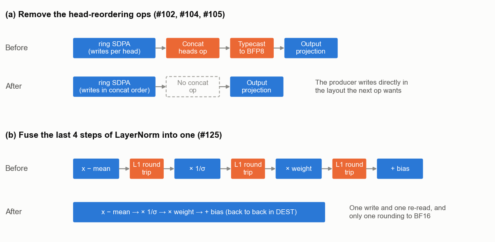

- **#102:** The order of the concat and the type conversion is swapped: convert to BFP8 first, then concat. The concat moves half as much data. A concat only moves values, so the result is bit-identical. e2e −0.2 s.
- **#104:** The ring SDPA writer writes the output directly in the "heads concatenated" layout (only the tile index computation is replaced). The same is done for the cross-attention SDPA. Two concat ops go away. e2e −0.3 s.
- **#105:** The QKV matmul op writes V directly in per-head layout. The op that splits it into heads goes away. e2e −0.2 s.
- **#77:** The residual add after cross-attention is moved into the post-processing of the output projection matmul op. The add op (0.27 ms) goes away. e2e −0.3 s.
  - When the weights were still BF16 (#65), the matmul side got slower and canceled out the gain. It paid off after the output projection weights also became BFP8 (#67 in 1a).

#### (3) Faster normalization (#103, #123, #125, #126)

- **#103:** The intermediate buffers between the stages of the second half of normalization were fp32, to match the fp32 DEST. Accumulation in DEST stays fp32, and only the intermediate buffers become BF16. e2e −0.1 s.
- **#123:** The first half of LayerNorm changed from Welford's method to "sum and sum of squares accumulated per row on the matrix engine (FPU)" (mean = sum ÷ 1280, variance = sum of squares ÷ 1280 − mean²). e2e −0.2 s.
- **#125, #126:** The 4 stages of the second half of LayerNorm are computed back to back within one DEST acquisition, with a single write-out ((b) in the figure above). In addition, only the two multiplications (× 1/σ, × weight) went from HiFi4 to HiFi2. The second half went from about 85K to about 55K cycles per call. e2e −0.1 s for the two together.

### Effect

- Total −2.9 s (#30 −0.9, #84 −0.6, #104 −0.3, #77 −0.3, #123 −0.2, #102 −0.2, #105 −0.2, #103 −0.1, #125 and #126 −0.1).
- Each one is small, but they are all ops that run every time inside a block, so each saving counts 40 blocks × 40 steps over.

### Did the output change?

- Items that remove ops (#84, #102, #104, #105) are bit-identical.
- Items that change the normalization precision (#103, #125, #126) change the composition. Below are #123 and #126 (the second half of LayerNorm merged into one pass, with two multiplications in HiFi2). The butterfly and the flowers are different, but picture quality is kept in both.

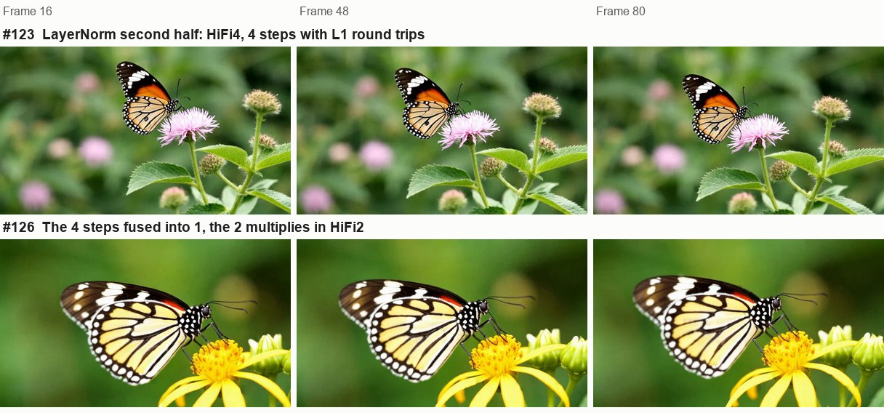

- Merging reduced the intermediate rounding to BF16, and the block PCC actually went up (99.9646 → 99.9660%). The difference in composition is not degradation; it is a rounding difference that grew over 40 steps.

### Costs and pitfalls

- **Cannot go down to LoFi (#126):** Making the two multiplications of the second half LoFi is a little faster again (about 53K cycles), but it failed the block PCC check. It stopped at HiFi2.
- **Changes prone to hangs:** In #125, which uses DEST reuse (feeding values in DEST back as engine inputs), a wrong signal on the unpack side caused hangs. A similar change, #127 (RMSNorm), also hung because of a missed condition (fixed, but rejected because it had no effect).

### How to enable

The GELU polynomials of #30 and #84 are the code default (they apply when DEST is BF16). The rest are enabled with environment variables (see section 0.2 for where they go).

| Environment variable | Items |
|---|---|
| `TT_AGMM_ACT_ON_PACK=1` | #84 |
| `WAN_SDPA_OUT_CAST_FIRST=1` | #102 |
| `TT_DRMS_INTER_BF16=1`, `TT_DLN_INTER_BF16=1` | #103 |
| `TT_RING_SDPA_OUT_CONCAT=2`, `TT_SDPA_OUT_PAIRFOLD=1` | #104 |
| `TT_AGMM_V_HEADS=4` | #105 |
| `WAN_XATTN_FUSED_ADD=1` | #77 |
| `TT_DLN_FPU_PRE=1` | #123 |
| `TT_DLN_POST_FUSE=1`, `TT_DLN_POST_FID=2` | #125, #126 |

### What did not work

- **Merging the q/k RMSNorm into one pass too (#127):** The same method as #125. RMSNorm spends a lot of time waiting for the all-gather of the statistics, so the time did not change.
- **A piecewise-linear GELU approximation (gelu_fast):** Not tried on Wan 2.2. When it was tried on Wan 2.1 (1.3B) on a P150, the PCC was almost the same, but the generated video collapsed into a flat, illustration-like texture. The image below is an example: real picture quality degradation, unlike "the composition changes". It also taught the lesson that you must check the video, not only the PCC.


## 7. VAE (decoding latents back into video)

**Contribution:** −1.2 s (2% of the total). The VAE time itself fell to a quarter (1.36 → 0.34 s), but it was only about 1% of the total to begin with, so its contribution is small.
**Output:** Almost no change. Changing the convolution settings changes only the VAE rounding (mean pixel difference about 2.5, same composition). Most changes from #174 on are bit-identical.

### How it works

- **VAE decoder:** The network that turns the latents made by the DiT (21 frames × 60 × 104, 16 channels) back into video (81 frames × 480 × 832, RGB). It is mostly 3D convolutions (conv3d) and normalization, and along the way it doubles the height/width and the time (upsample).
- **Time is split into chunks:** Decoding all frames at once does not fit in DRAM, so the latent frames are split into chunks of a few frames and decoded in order. The temporal convolution also uses earlier frames, so the last 2 frames of the previous chunk are handed to the next chunk (the causal conv cache).
- **Space is split over the 32 chips:** One frame is split 4 ways along H and 8 ways along W. A convolution also uses neighboring pixels, so before computing, each chip exchanges its edge rows and columns with its neighbors (neighbor pad).

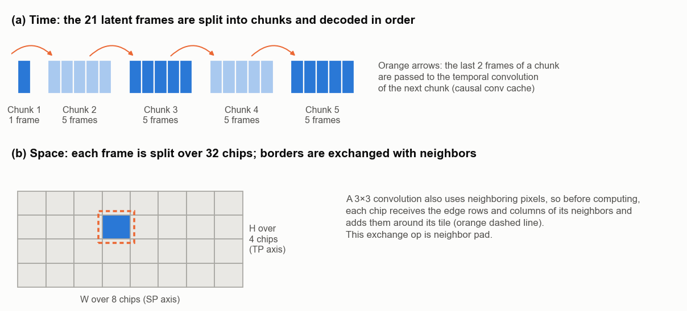

> **Terms:**
> - **neighbor pad:** An op that receives the edge rows and columns from neighboring chips and adds them around its own part.
> - **row-major:** A format that lays out a tensor row by row, as is. Converting to and from the tile format (32×32 each) used by the matrix engine (tilize, untilize) also takes time.
> - **Transfer to host:** Reading the decoded video from the device to the CPU side and assembling it into one video array.

### What was the bottleneck or waste

- **Decoding one frame at a time (#75):** The WH 4×8 config had no chunk size, so the default of 1 frame was used, and the fixed per-chunk overhead was paid 21 times.
- **No convolution configs (#92):** The 3D convolution blocking for the WH 4×8, 480p shapes was not in the config table, so it ran with fallback values. The two temporal layers were hardcoded to 1×1×1 and were 41x and 16x slower than with the best config.
- **A lot of pure data movement:** The halo exchange, the concat with the cache, and the conversions to and from the tile format took about as much time per decode as the convolutions (#93 measurement: convolutions 275 ms, versus halo exchange 237 ms, normalization 99 ms, concat 81 ms).
- **Host-side jitter (#100):** Assembling the video on the host varied widely (9-275 ms) and shook the total time by ±0.15 s.

### What was done

#### (1) Bigger chunks and a search for convolution configs (#75, #92, #94, #185)

- **#75:** 3 frames per chunk. VAE 1.41 → 0.95 s. e2e −0.5 s. 6 or more frames ran out of DRAM.
- **#92:** The convolution blocking was searched exhaustively on one chip, and 12 entries were added to the table. Decoder body 926 → 765 ms.
- **#94:** 5 frames per chunk, with a search for that shape too. The number of chunks drops from 8 to 5. 5 frames had been slow in #75 because the config was the fallback.
- **#185:** The Ethernet dispatch in chapter 5 gave an 8×10 grid, so the search was redone for that shape.

#### (2) Less data movement (#93, #95-#99, #174-#178, #189-#195)

- **Halo exchange (#93, #98, #178):** Instead of sending a packet and a signal per row and waiting for completion, the data is sent in batches.
- **Concat and format conversion (#95, #96):** Instead of reading and writing one page at a time and waiting each time, the work is batched in 16 pages or 32 rows (the ttnn ops themselves were fixed; the default behavior is unchanged).
- **Stay in row-major (#174, #195):** Normalization and the residual add can now read row-major directly, which removes the round trips to the tile format.
- **Write directly into the padded buffer (#175, #177):** The normalization output and the cache of the previous chunk are written directly into the buffer used for the halo exchange, which removes whole-tensor copies.
- **Fusion (#189-#192):** The residual add goes into the convolution. The convolution after an upsample reads the small tensor from before the upsample directly (the upsample op goes away).

#### (3) Less host-side jitter and waiting (#100, #180, #184)

- **#100:** The buffer for assembling the video was newly allocated every time (touching fresh pages for the first time is expensive). Reusing two buffers in turn took it from 9-275 ms to 17-18 ms.
- **#180, #184:** Host-side tweaks such as touching the buffer in advance and a faster latent hand-off.

### Effect

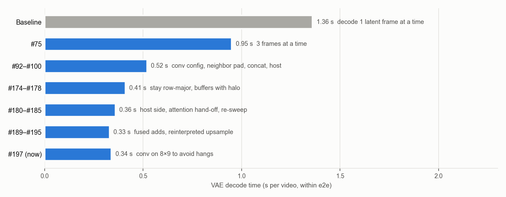

- VAE 1.36 → 0.34 s. In e2e, the total is −1.2 s (#75 −0.5, #92-#100 −0.6, #174-#197 −0.1).
- The current 5-frame chunk takes about 77 ms on the device, and 63% of that is convolution (as of #185). Skipping the convolution's input assembly shrank it by only 3-6% (#187), so the compute itself is close to the floor.

### Did the output change?

- Changing the convolution blocking changes only the VAE rounding (mean pixel difference 2.5, same composition; VAE-only PCC 99.966%).
- The data movement changes (most of #174-#195) are bit-identical.

### Costs and pitfalls

- **Free DRAM:** The chunk size tops out at DRAM. The DiT weights are resident (1b), so there is not much free memory.
- **Hangs (#197):** Running the convolutions on the 8×10 grid occasionally hung the VAE (8 times in 630 decodes). In every case, a core in the 10th row, the row made available for compute in chapter 5, had stopped in the middle of a convolution. On 8×9 it was 0 in 1,876, so on Galaxy the convolutions run on 9 rows (the VAE gets slightly slower, 0.33 → 0.34 s).
- **How to measure:** Timing that syncs at each VAE section exaggerates host-side savings. A host-side change (#188) looked faster in the section timing but did not help in e2e without sync. VAE comparisons switched to a test that alternates decodes within one process.
- **Rare mismatches:** When the VAE decodes dozens of times in a row, very rarely (a few %) a run does not match. This predates these changes, and the cause has not been identified.

### How to enable

The convolution config table from #92 on and the #174-#197 changes are the code default (`WAN_VAE_C3D_GRID_Y=0` goes back to 8×10 convolutions). The rest are enabled with environment variables (see section 0.2 for where they go).

| Environment variable | Items |
|---|---|
| `WAN_VAE_T_CHUNK=5` | #75, #94 |
| `WAN_VAE_SDPA_W_ONLY=1` (the attention in the middle block is shared only among the 8 chips of the W axis) | #92 |

### What did not work

- **Lower-precision normalization (#97):** HiFi2, LoFi, approximate math, and no fp32 accumulation: none of them had much effect.
- **Host-side I/O tweaks (#188):** The results were bit-identical, but e2e without sync did not get faster.
- **Skipping the convolution input assembly (#187):** Even skipping it entirely gave only 3-6%, so it was judged not worth a rewrite.
- **Receiving the halo inside the convolution (halo mode):** It hung in the launch synchronization on WH 4×8, so it is parked.

## 8. Outside the blocks, host side, measurement conditions

**Contribution:** −0.6 s (1% of the total).
**Output:** Changes slightly in some items. Items that change the order of fp32 additions (#107, #111, #114) differ slightly in things like the angle of the butterfly's wings (same composition). #112 and #166 are bit-identical.

### How it works

- Most of a step's time is spent in the 40 blocks. Before and after them, there is work outside the blocks.
  - **Before:** the timestep embedding (a small fp32 MLP), the patch embedding, and joining the two CFG passes.
  - **After:** the output normalization (norm_out), the output projection (proj_out, 5120 → 64), the inter-chip all-gather, and the denoising computation (the scheduler).
- The host (CPU) sends ops to the device one after another. As long as the host stays ahead of the device, host time does not show.

### What was wasted

- **Slicing the modulation in every block (#107, #114):** The adaLN modulation (6 coefficients) was computed in every block by adding "table + timestep embedding" and slicing the result into 6. Each slice ran tile format → row-major → slice → tile format.
- **A large all-gather before the output projection (#111):** After norm_out, a TP all-gather collected about 168 MB per chip, and only then did the small 5120 → 64 projection run.
- **Creating tensors every step (#112):** Every step, the timestep tensor and the CFG coefficient tensor were created and written to the device. At the write, the host waited for the previous step to complete, so the device sat idle until the first op of the next step was sent.
- **The timestep MLP every step (#166):** The timestep embedding MLP (mostly reading the 5120 × 30720 weights) was computed one row per step (about 3.1 ms per step).
- **Per-step sync in the measurement script:** The script synced the host and the device at every step for timing. The real pipeline does not need it.

### What was done

- **#107, #114 Pre-slice the modulation:** The timestep embedding is sliced into 6 only once, at the start of a step, and passed to all blocks; the table is sliced once per block, the first time, and kept. Only an fp32 add remains inside the block. e2e −0.1 s.
- **#111 Split the output projection over TP:** The proj_out weights are split over the 4 TP chips, each chip computes partial sums over its own 1280 columns, and only the small partial sums (about 2 MB) are added up. The large all-gather is gone. e2e −0.15 s.
- **#112 Create the tensors in advance:** The timestep tensors for all steps are created before the loop, and the coefficient tensors are reused. e2e −0.05 s.
- **#166 Batch the timestep MLP:** The timesteps are known in advance, so the 40 steps are computed at once as 40 rows, and each step slices out its row. Bit-identical. e2e −0.06 s.
- **Remove the measurement sync:** The e2e times up to #167 were measured with per-step sync. The real time without sync is 0.2 s shorter (41.00 → 40.81 s). This is a difference in measurement conditions, not an optimization, but the current default of 40.7 s uses this condition, so it is counted here.

### Effect

- Total −0.6 s (measurement sync −0.2, #111 −0.15, #107 −0.1, #166 −0.06, #112 −0.05, #114 −0.01).

### Costs and pitfalls

- **Sync hides host-side gains:** The same computation as #166 had been tried earlier as #159 and judged to have "no effect". The per-step sync in the measurement script made the start of each step host-bound, and that hid the gain. Comparing again alternately without sync showed the effect.
- **A shape that differs from the warm-up run triggers compilation in the real run (#159):** When the number of precomputed rows differed between the short warm-up run and the real run, program compilation ran at the start of the real run, and it got much slower (45.27 s). It was fixed by making the row counts match.
- **trace is not used:** trace, which records the op sequence and replays it on the device, does not help because the host is not the bottleneck (#11, #157), and it does not work together with the cross-attention K/V cache (chapter 4).

### How to enable

| Environment variable | Items |
|---|---|
| `WAN_TEMB_PRESLICE=1`, `WAN_TEMB_FOLD=1` | #107, #114 |
| `WAN_PROJ_OUT_TP=1` | #111 |
| `WAN_PREUPLOAD=1` | #112 |
| `WAN_TEMB_BATCH=1` | #166 |

The measurement sync is turned on with `WAN_STEP_TIMING=1`. The current default time (40.7 s) was measured with `WAN_STEP_TIMING=0` (no sync).

## 9. Running experiments efficiently

The next two chapters are not about individual optimizations but about how the experiments were run. Over more than 200 experiments, making each experiment fast and reliable mattered as much as the optimizations themselves.

### 9.1 Narrow down with cheap measurements, confirm with expensive ones

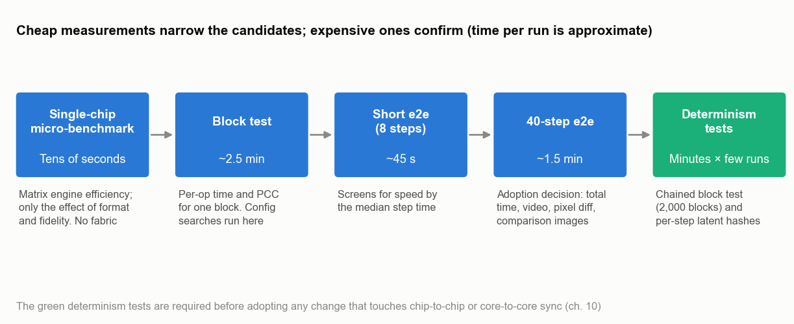

| Stage | Time per run | Use |
|---|---|---|
| Single-chip micro-benchmark | Tens of seconds | Isolates engine efficiency, or the effect of format, fidelity or subblock, by itself. It does not use the fabric, so it rarely hangs, and a hang does little harm |
| Block test (1 block run 3 times, Tracy) | About 2.5 min | Per-op time and PCC. Searches such as matmul blocking happen here |
| Short e2e (`WAN_PERF_STEPS=8`) | About 45 s | Speed screening by the median steady-state step time (noise about ±1 ms) |
| 40-step e2e | About 1.5 min (inference about 47 s + setup about 30 s) | Adoption decisions. One run gives the total time, the video, the mean pixel difference from the baseline, and comparison images |
| Determinism tests | A few min × several runs | The chained block test (2,000 blocks) and per-step latent hashes over 40 steps. Run before adopting changes that touch synchronization (chapter 10) |

- **Be careful with fewer steps:** With 6 or 8 steps, only the high-noise DiT runs (the low-noise DiT handles the last 14 steps). Changes that affect only one DiT (such as residency in 1b) and picture quality checks need 40 steps.
- **Do not lower the resolution:** Below 480p, SDPA (which grows with the square of the token count) shrinks a lot, the share of the weight gather and the fixed overhead grows, and the nature of the bottleneck changes.
- **Discrepancies are clues:** Sometimes an item helps in the block test but not in e2e (#62). Chasing that discrepancy uncovered the bug where experiment switches were applied after the warm-up (#66).

### 9.2 Faster experiment setup (weight cache)

Every time the weight format (which layers are BFP8) or the residency setup changes, the cache of converted weights (about 16 GB per DiT) must be rebuilt. This was the longest wait in the experiments.

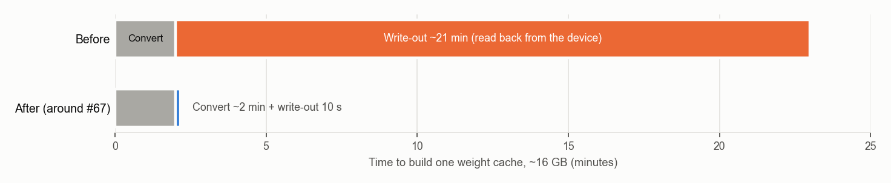

- **What was slow:** The weights are converted on the host (CPU) from torch tensors into the device format and sent to the device (about 2 min). Writing the cache then read them back from the device, one parameter at a time (about 12.6 MB/s, about 21 min).
- **What was done (`TT_DIT_FAST_CACHE_SAVE=1`):** The host tensors made during the conversion are kept and, at the same time as they are sent to the device, used directly to write the cache. Nothing is read back from the device.
- **Effect:** Writing went from 21 min to 10 s. A run that builds two caches went from about 45 min to 4 min 50 s.
- **How it was checked:** After confirming twice that a cache built the new way gives the same video as the old way (mean pixel difference 0.0), the read-back verification (about 7.5 min per cache) was turned off for experiment caches.
- This made it easy to try combinations of BFP8 layers and residency setups (#67 in 1a and #71-#72 in 1b came after this).

Other setup times:

- **C++ rebuild:** 30 s to 1.5 min for an incremental build. The kernel sources (`kernels/*.cpp`) are compiled at run time, so they need no rebuild.
- **Install after a rebuild:** Python loads the installed libraries. `cmake --build` alone does not apply C++ changes, and this nearly led to a wrong "no effect" conclusion (the re-test of #108). Run `cmake --install build_Release` as well, and check the timestamp of `ttnn/ttnn/_ttnn.so`.
- **Searches are bound by compilation:** In a matmul blocking search, almost all of the time is kernel compilation on the CPU (about 1.5 s per combination); the device is busy only about 0.1% of the time. Narrow down the candidates before running a search.

### 9.3 Deciding what to try

- **Biggest wins first:** First measure the per-op breakdown, then try things in order of "seconds likely saved ÷ effort". A big speedup also speeds up every later experiment. Small switches worth less than 1% are tried together, not measured one by one.
- **Check the ledger before trying:** With over 200 experiments, an idea was sometimes forgotten and tried again (#110 was the same idea as #81 from the day before, and #153 the same as #29; about an hour was lost). Before starting, search the experiment ledger ([NOTES.md](NOTES.md) §10) for the idea's name, its environment variables, and the names of the ops or CBs it touches.
- **On the other hand, rejected ideas can be worth retrying:** When the surrounding configuration changes, an idea that did not work before may work (#108 → #117, #28 → #118, #65 → #77).
- **Measure the upper bound first:** Use a timing-only variant that gives wrong results but measures the time, such as "skip the matmul" or "read K and V only once", to find out first whether the bottleneck is compute or supply, and the most that a rewrite could save (#37, #42, #47, #53). If the upper bound is small, do not rewrite.

### 9.4 Measuring correctly

- **Decide on the wall-clock time of the 40-step e2e:** Fewer engine cycles do not always mean a faster wall clock.
  - The chips are power-capped, and sometimes 1-2 of them lower their clock (to about 910 MHz). Because of inter-chip synchronization, the slowest chip sets the pace for all. #108 reduced the cycle count but made e2e slower.
  - Cutting normalization by 95 µs per block was absorbed by other inter-chip waits, and e2e did not change.
- **Compare alternately in the same time window:** Results vary with the state of the machine, so the baseline and the candidate are run alternately and compared (6 pairs for #165).
- **Experiment switches via environment variables, without changing the default behavior:** Combinations can then be compared without rebuilding.
- **Always source the standard settings:** A measurement without the standard environment variables nearly led to a wrong "no effect" conclusion (#36 in chapter 4). Every run sources the standard environment variables, and the environment variables printed in the log are checked.
- **Apply switches when the model is built:** The performance test's warm-up runs while the pipeline is being built. Changing settings after that rebuilds programs at the start of the measurement, and the settings apply to only some ops (#66).
- **Pitfalls of zone timing:** Per-thread zone times include time spent waiting on other threads. What looked like "the matmul is slow" was actually a wait on the pack thread (#35). Run control experiments before naming a hardware mechanism as the cause.
- **Add measurement tools:** Where the existing profiler cannot see, wait-time counters were added inside the kernels (the ring SDPA reader, the AGMM data movement). When Tracy post-processing fails, the op times are extracted from the device's raw logs.

### 9.5 Checking output changes

- **Rough guide for the mean pixel difference:** Repeats of the same setting differ by about 0.1; a changed composition gives about 20-50. Record changes that alter the output separately from those that do not.
- **Look at the video, not just the PCC:** Even when the PCC of one forward is almost the same, picture quality can collapse after 40 steps (the gelu_fast example in chapter 6). For a change that alters the output, always line up the frames and look at them.
- **Compare latents:** If the video differs, compare the final latent (saved with `WAN_DUMP_LATENTS=<file>`) with the baseline to tell whether the difference comes from denoising or from the VAE. Per-step hashes (`WAN_STEP_HASH=1`) show the step at which the runs diverged.
- **A matching e2e does not prove that there is no race:** e2e has regular timing, so rare races seldom show up. A change that touches inter-chip or inter-core synchronization is adopted only after the chained block test has run 6-10 times and the hashes have been compared (the #143 race was found by the chained test, although e2e had matched about 10 times).

## 10. Dealing with hangs

### 10.1 What a hang is

- A kernel on some core keeps waiting for data or a signal that never comes, and stops. The 32 chips are connected by communication, so when one chip stops, the others stop too, waiting on that communication.
- After a hang, the only way out is to kill the process and reset the device. Besides the lost time, some state can persist for a while after the reset (section 10.3).
- In this work, many changes touched the synchronization inside kernels (how signals are sent, how buffers are freed), so hangs were unavoidable.

### 10.2 Steps when a hang happens

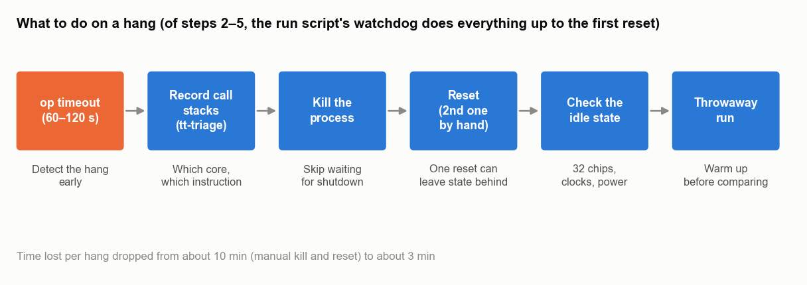

1. **Detect it early:** Shorten the op timeout (`TT_METAL_OPERATION_TIMEOUT_SECONDS=60` to `120`). With the default, it takes a long time to notice that things have stopped.
2. **Save the call stacks:** A watchdog was added to the run script. When a device timeout appears in the log, it records the call stacks of all cores with `tt-triage` (including a decode of the instruction where each one stopped). A reset erases them, so capture them first.
3. **Kill the processes:** Kill all the processes at once instead of waiting through the shutdown waits (120 s × 2).
4. **Reset:** `tt-smi -glx_reset`. The watchdog does this once. After a hang, one reset sometimes leaves state behind, so do one more.
5. **Check the idle state:** With `tt-smi -s`, check that all 32 chips are visible and that the clock and power are back at their idle values (about 500 MHz, about 17 W). After an abnormal exit, the clock can stay at 1,000 MHz. A gate before each run detects this and stops.
6. **Do a throwaway run:** Before the runs that will be compared, do one short run (section 10.3).

This cut the time lost per hang from about 10 minutes, back when processes were stopped and reset by hand, to about 3 minutes.

### 10.3 Things to watch after a reset

- **After one reset, results can change on every run:** After a hang and one reset by the watchdog, the latents started to differ from run to run with the same code and settings. One more reset brought back bit-identical results.
- **The first 1-2 runs after a rebuild or a single-chip test:** Only the first 1-2 multi-chip runs sometimes diverged. Do a throwaway run before comparing. For a quick check: "reset twice → baseline at 4 steps twice → candidate at 4 steps twice".
- **After a killed process:** If a run was killed right before a determinism test, the next few results tended to diverge (NoC hardware counters and the like persist across processes). Reset before a determinism test.
- **After Tracy crashes:** If it crashes with "End marker found without a corresponding start marker", the gate of the next run finds the clock stuck at 1,000 MHz. Reset twice.
- **The first run right after a reset fails:** The first run can fail because link training is not done in time, because a DRAM check fails on a specific chip, and so on. Running it again works.
- **After switching the dispatch mode:** Switching between the Ethernet dispatch of chapter 5 and the standard configuration, or changing the number of removed links, needs a reset.

### 10.4 Finding the cause

- **Read the call stacks:** The triage record shows, per core and per thread, in which function and where it stopped. Read the positions of the stopped cores together with what the other chips are waiting for.
- **Example 1 (#78 in chapter 2):** In the K/V multicast, the first core waited for an acceptance signal, and only the rightmost core of each row waited for the next V. The multicast destination range was given in the direction opposite to the reader's NoC, so the data reached only the one rightmost core.
- **Example 2 (#167 in chapter 2):** The math thread waited for the SFPU to be free, and the pack thread waited for math to be free; they waited on each other and stopped. Fixed by changing the pack-side wait from a hardware wait to a software signal.
- **Example 3 (#197 in chapter 7):** In every VAE hang, a core in the 10th row of one chip (the row made available for compute in chapter 5) had stopped in the middle of a convolution. Alternating 200 decodes each of "convolution on 8×10", "convolution on 8×9" and "standard dispatch" pinned it down: it happened only with convolutions on 8×10.
- **Do not judge by file name alone:** Kernels of different ops sometimes have the same file name. A hang in the text encoder's all-gather was at first nearly mistaken for a hang in the VAE halo exchange because the file names were the same. Check the kernel path too.

### 10.5 Counting hangs

With rare hangs, a small number of runs tells you nothing.

- **Count from the logs:** Recount all the logs instead of relying on memory. Counting from memory once gave too low a number.
- **To claim "it does not hang":** To rule out a hang rate p, you need about 3/p consecutive successes (95% confidence). For example, ruling out 1 hang in 50 runs takes about 150 runs.
- **For an A/B comparison:** Run the two conditions alternately, with the same script and the same settings, until one condition has 5 or more hangs.
- **Do not guess at causes:** Do not blame "time of day" or "machine state" based on a few runs. Keep the list of possible causes open (a race in the code, state accumulated by repeated resets, specific chips or temperature/power, differences in conditions between the compared runs) and decide by the numbers.
- **Before suspecting a change, run a control with committed code:** A divergence that seemed to be caused by one's own change sometimes turned out to happen with the committed code too.

### 10.6 Running experiments that hang less

- **Single chip first:** A single-chip micro-benchmark does not use the fabric, so it rarely hangs, and a hang does little harm. Kernel changes first run on one chip and are then extended to many chips.
- **One synchronization change at a time:** Changes to how signals are sent or how buffers are freed go in one at a time and are checked with the chained block test. If several are stacked, it becomes unclear which one is the cause.
- **Write the data, then signal:** When "data → signal" are sent over different paths, wait for the writes to complete before the signal (`noc_async_writes_flushed()`). Otherwise the signal can overtake the data.
- **Avoid settings known to hang:**
  - When searching matmul blocking on WH Galaxy, add `MM_SWEEP_PROFILER_DUMP_EVERY=100000` (without it, the search stops).
  - Run the VAE convolutions on 8×9 (#197).
  - The AGMM dynamic NoC (#144) and the convolution halo mode hung, so they are not adopted.
- **Do not adopt a change that raises hangs, even if it is faster:** A result configuration that hangs is useless. The idea of merging Phase 2 of ring SDPA (#172, −0.45 s) increased hangs and divergence, so it is parked; the K/V relay (#150, −1.4 s) is parked because its results are not deterministic.

### 10.7 Remaining hangs

- **Rare hangs in ring SDPA and matmuls:** During denoising, ring SDPA stops on one chip (in the 2026-10-13 tally, 1 in 5 runs for the default configuration at 40 steps, 3 in 10 with fast exp).
  - In these hangs, the hand-off of engine inputs (SrcA, SrcB) is out of step. `TT_RING_SDPA_SFPU_GO` from #167 fixed one pattern, but other patterns remain.
  - The hangs concentrated on a few specific chips out of the 32. A different kind of hang, in the matmul output writes, also appeared on the same chips. A hardware-specific cause is possible, so the investigation was stopped (2026-10-12). Running the same configuration on another Galaxy would tell the two apart.
- **VAE hangs:** The 10th-row convolution hangs no longer appear after #197 (convolutions on 8×9).

## Appendix. Environment variables of the best configuration

After sourcing the Ethernet dispatch settings (`models/tt_dit/tests/models/wan2_2/eth_dispatch/env.sh`), set the following environment variables and run the performance test `models/tt_dit/tests/models/wan2_2/test_performance_wan.py::test_pipeline_performance[wormhole_b0-t2v-resolution_480p-wh_4x8_sp1tp0]`. To add the fast exp (the separate item in chapter 2), add `TT_RING_SDPA_EXP_OVF=1`.

```
WAN_AGMM_IN_BF8=1
WAN_AGMM_OVR=8192x5120x3840=16,10,10,4,2;8192x5120x3456=16,8,14,4,2;8192x5120x1280=16,8,5,8,1
WAN_CROSS_KV_CACHE=1
WAN_D2H_FAST=1
WAN_ENC_EMB_SHARD=1
WAN_ENC_ON_SP_AXIS=1
WAN_FFN2_IN_BF8=1
WAN_FFN2_RS_BF8=1
WAN_FFN_RESIDENT=transformer,transformer_2
WAN_FULL_RESIDENT=transformer,transformer_2
WAN_KCFG_EXTRA_KB=128
WAN_MM_FP32_DEST=all
WAN_PREUPLOAD=1
WAN_PROJ_LOFI=attn,ffn
WAN_PROJ_OUT_TP=1
WAN_QKV_OUT_BF8=1
WAN_SDPA_BF8=1
WAN_SDPA_CHUNK=128,1024
WAN_SDPA_OUT_CAST_FIRST=1
WAN_TEMB_BATCH=1
WAN_TEMB_FOLD=1
WAN_TEMB_PRESLICE=1
WAN_VAE_SDPA_W_ONLY=1
WAN_VAE_T_CHUNK=5
WAN_WEIGHTS_BF8=qkv,out,xq,xkv,xout,ff1,ff2
WAN_WEIGHTS_BF8_LOAD=1
WAN_XATTN_BF8=1
WAN_XATTN_COMPACT=1
WAN_XATTN_FOLD=1
WAN_XATTN_FUSED_ADD=1
WAN_XSDPA_CHUNK=256,512
TT_AGMM_ACT_ON_PACK=1
TT_AGMM_FAB_DEFER=1
TT_AGMM_IN0_MCAST=1
TT_AGMM_OUT_IN1=1
TT_AGMM_TERNARY_ANY_DF=1
TT_AGMM_V_HEADS=4
TT_CONCAT_RM_BATCH=16
TT_DIT_RMSNORM_ALLOW_BF8=1
TT_DLN_FPU_PRE=1
TT_DLN_INTER_BF16=1
TT_DLN_POST_FID=2
TT_DLN_POST_FUSE=1
TT_DRMS_INTER_BF16=1
TT_MMRS_RING=1
TT_MMRS_SPLIT_FINAL_DF=1
TT_NP_LC_BATCH=16
TT_NP_W_FAST=1
TT_NP_W_ROW1=1
TT_RING_SDPA_EXP_BATCH=1
TT_RING_SDPA_FINAL_BF8=1
TT_RING_SDPA_OUT_CONCAT=2
TT_RING_SDPA_PV_SUM=1
TT_RING_SDPA_QK_SB=1,8
TT_RING_SDPA_Q_INTERLEAVE=1
TT_RING_SDPA_Q_INTERLEAVE_MCAST=1
TT_RING_SDPA_Q_INTERLEAVE_ORDER=rev
TT_RING_SDPA_READER_NOC1=1
TT_RING_SDPA_SFPU_GO=1
TT_RING_SDPA_SUM_STRIDE0=1
TT_SDPA_BLOCKED_PACK_MIN=4
TT_SDPA_OUT_PAIRFOLD=1
TT_SILU_FAST=2
TT_UNTILIZE_BATCH_BARRIER=1
```
